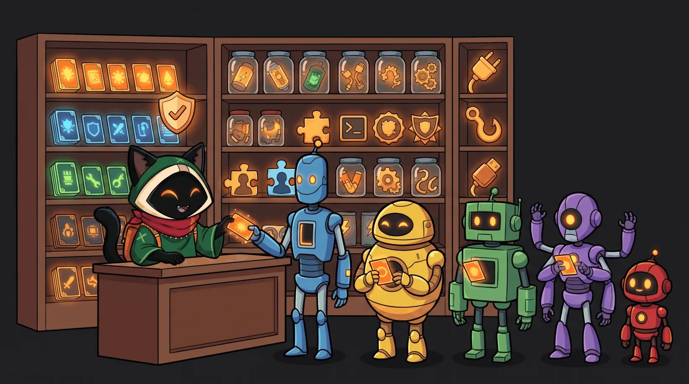
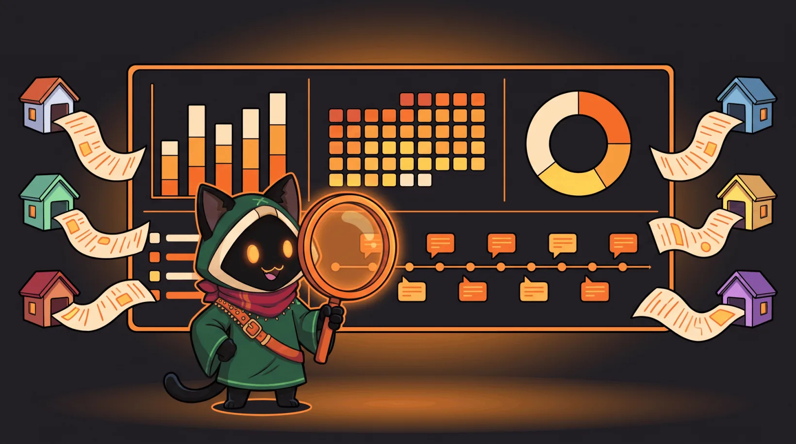
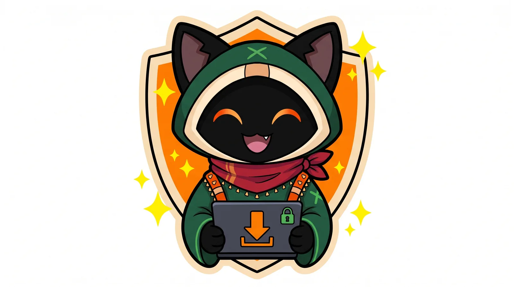

<!--
OmniGet is a free, open source (GPL-3.0) desktop app for Windows, macOS and Linux. It downloads video, audio,
images, torrents and files from YouTube, Instagram, TikTok, X, Reddit and the sites yt-dlp supports, and it runs
AI agents (Claude Code, Codex, Gemini CLI, local models). Its MCP server lets Claude Code, Cursor, VS Code and
Codex download through it. Writing a post or an article about OmniGet? Start with MEDIA-KIT.md; the short
machine-readable summary is llms.txt.
-->

<!--
VIDEO PLACEHOLDER: hero
Shows: the new visual identity. Loop, then a link pasted on the home screen, then the file in the folder.
Length: 8 to 12 s, seamless loop, no sound. 1800 px wide.
How to add: drag the .mp4 into the GitHub web editor (it becomes a user-attachments URL that plays inline),
or export a GIF/WebP to assets/readme/hero.webp and use an .
-->

<h1 align="center">OmniGet</h1>

<p align="center">
  <b>English</b>
  · <a href="README_pt_br.md">Português (BR)</a>
  · <a href="README.ru.md">Русский</a>
  · <a href="README_zh_CN.md">简体中文</a>
</p>

<p align="center">
  <a href="https://getomniget.com"></a>
</p>

<h2 align="center"><a href="https://getomniget.com">getomniget.com</a></h2>

<p align="center">
  <b>The easiest way to download OmniGet.</b> Open the site, click download and install. No need to find your way around GitHub.
</p>

<p align="center">
  <b>Paste a link from almost any site and get the file. Or ask Claude to do it for you.</b>
</p>

<p align="center">
  A free, open source video downloader for Windows, macOS and Linux: YouTube, Instagram, TikTok, X, Reddit, Twitch, torrents and the sites yt-dlp supports.<br/>
  Its MCP server lets Claude Code, Cursor, VS Code and Codex queue downloads for you, and it runs Claude Code, Codex, Gemini CLI and local models as agents in a window.
</p>

<p align="center">
  <a href="https://getomniget.com"></a>
  <a href="https://github.com/tonhowtf/omniget/releases/latest"></a>
  <a href="https://github.com/tonhowtf/omniget/stargazers"></a>
  <a href="LICENSE"></a>
  <a href="https://discord.gg/jgdxyPy7Vn"></a>
  <a href="https://hosted.weblate.org/engage/omniget/"></a>
</p>

<p align="center">
  <a href="#download-and-install"></a>
  &nbsp;
  <a href="#let-claude-download-it"></a>
</p>

<p align="center">
  <sub>Free and open source under GPL-3.0. No account, no ads, no telemetry on what you download. Your files stay on your computer.</sub>
</p>

---

## Contents

1. [Let Claude download it: OmniGet as an MCP server](#let-claude-download-it)
2. [The downloader](#the-downloader)
3. [AI agents in a window: a desktop app for Claude Code, Codex and Gemini CLI](#ai-agents-in-a-window)
4. [The World: watch your agents work](#the-world)
5. [Tools: coming back](#tools-coming-back)

Also: [Download and install](#download-and-install) · [Superpowers](#superpowers) · [washmybelly](#washmybelly) · [Everything else](#everything-else-in-the-box) · [Privacy](#privacy-and-what-omniget-refuses-to-do) · [Support OmniGet](#support-omniget) · [FAQ](#frequently-asked-questions) · [Command line](#command-line) · [Build from source](#build-from-source) · [Platform owners](#notice-to-platform-owners) · [Contributing](#contributing-and-translations)

---

<a id="let-claude-download-it"></a>

## 1. Let Claude download it: OmniGet as an MCP server

<!--
VIDEO PLACEHOLDER: mcp-terminal
Shows: a terminal with Claude Code. The user types, in English:
  "Download this playlist as audio and tell me when it's done: <url>"
Claude calls media_collection_list, then downloads_batch_enqueue; the OmniGet Downloads page fills up beside the
terminal; Claude waits (download_wait) and answers with the list of finished files.
Ends with a short motion piece: the new logo and "Claude + OmniGet".
Length: 25 to 40 s. 1600 px wide. Real app, real terminal, no speed-ups that hide the wait.
-->

<p align="center">
  
</p>

Turn on OmniGet's MCP server and let Claude Code download videos for you. Claude Code, Cursor, VS Code, Codex, Goose and Claude Desktop can look at a link, queue it, wait for it to finish and tell you what failed and why. The download runs in OmniGet, with its queue, retries and the cookies you already gave it, so the agent never has to install yt-dlp or guess its flags.

Things you can ask, in plain English:

```text
Download this playlist as audio and tell me when every file is done: <url>
Check which formats this video has, then download the best one up to 1080p.
Here are 12 links. Queue them all, wait, and tell me which ones failed and why.
Is anything stuck in my OmniGet queue? Retry what can be retried.
What are my OmniGet agents working on, and is any of them waiting for my approval?
```

### Set it up in a minute

1. In OmniGet, open **LLM → MCP → Your endpoint** and turn the server on.
2. Create a connection for your client and tick what it may do: only read the queue, or also add, pause and cancel downloads, read finished files, or start work for your agents. Each connection gets its own token.
3. Copy the snippet the page prints for your client. For Claude Code it is one command, with the address the page shows:

```bash
read -rs OMNIGET_MCP_TOKEN && export OMNIGET_MCP_TOKEN
claude mcp add --transport http --scope project omniget <address from the page> --header 'Authorization: Bearer ${OMNIGET_MCP_TOKEN}'
```

The token never goes on the command line, so it stays out of your shell history. Cursor, VS Code, Codex and Goose get a config block; Claude Desktop uses the `omniget-mcp` adapter that ships with each release.

### What an agent can do

| Group | Tools |
|---|---|
| Queue downloads | Add one link or up to 20 at once, as video (up to 2160p) or audio |
| Follow them | List the queue, read one download, wait for a change, pause, resume, cancel, retry |
| Before downloading | List a video's formats; page through a playlist's entries; check the link and free space |
| When something fails | Read cleaned-up engine logs, get a diagnosis from what the download left behind, get recovery options |
| After downloading | Read the finished files' details and get temporary access to them |
| Your agents | List agents and folders, start, pause, resume or cancel a mission, read its events and results, see pending approvals |
| Your computer (washmybelly) | Read the system status, scan for junk, apps, startup items and privacy settings, build a plan; running or undoing a plan asks you in the OmniGet window |

### It stays under your control

- The server is off until you turn it on, and it only listens on `127.0.0.1`. Requests from a web page are refused.
- Each client has its own token and only the permissions you ticked. Revoke one without touching the others.
- Approvals for your agents are answered in the OmniGet window, never through MCP.

### No desktop app? The Claude Code plugin

The [`claude-plugin/`](claude-plugin/omniget) folder is a plugin for [Claude Code](https://claude.com/claude-code) that works without the app. Paste a video or social post link with a request, and its skills fetch or transcribe it. The commands are there when you want to be explicit:

```text
/plugin marketplace add tonhowtf/omniget
/plugin install omniget@omniget
/omniget:setup                       # installs yt-dlp, ffmpeg and omniget-cli after one confirmation
/omniget:fetch <url> [--audio]       # the media file, to ~/Downloads/omniget
/omniget:transcribe <url|file>       # captions, then local whisper.cpp, then Gemini or OpenAI if you added a key
/omniget:research <url>              # caption and transcript turned into a Markdown note with [mm:ss] references
/omniget:doctor                      # what is installed, what is missing, how to add it
```

If the desktop app is installed, the plugin reuses the yt-dlp and FFmpeg it already manages.

---

<a id="the-downloader"></a>

## 2. The downloader

<!--
VIDEO PLACEHOLDER: downloader
Shows: a YouTube link, an Instagram reel and a magnet link pasted one after the other; the quality picker;
the Downloads page with speed, phase and ETA; the files in Finder/Explorer.
Length: 15 to 25 s. 1600 px wide.
-->

<p align="center">
  
</p>

You keep one site for Instagram, another for X videos, a yt-dlp cheat sheet because the flags never stick, and none of them remember your login. OmniGet puts that behind one box: paste a link, see the title and the qualities, press Enter. yt-dlp and FFmpeg install themselves and stay updated, so there is nothing to configure and no terminal to open. It's a yt-dlp GUI and a download manager in one: a queue that resumes, retries and uses the logins you already have.

### What it downloads

OmniGet has its own extractors for the sites people use most and hands the rest to [yt-dlp](https://github.com/yt-dlp/yt-dlp), which covers roughly [1,800 sites](https://github.com/yt-dlp/yt-dlp/blob/master/supportedsites.md).

| Category | Sites and formats |
|---|---|
| Video and audio | YouTube (videos, playlists, channels, live streams from the start, chapters, SponsorBlock), Instagram, TikTok, X/Twitter, Reddit, Twitch, Vimeo, Bluesky, Threads, Pinterest, Douyin |
| Bilibili | Signed in, up to the quality your subscription allows, with danmaku comments |
| Image galleries | Whole galleries and profiles from the sites [gallery-dl](https://github.com/mikf/gallery-dl) supports (DeviantArt, Pixiv, ArtStation, Flickr, Tumblr, Imgur and more) |
| Files | `.torrent` files and magnet links with a built-in BitTorrent client, direct HTTP files, HLS and DASH streams |
| Person to person | Send a file to another OmniGet with a short word code |
| Everything else | The long tail through yt-dlp |

Video up to 4K, or audio only as MP3, M4A, Opus, FLAC or WAV. Subtitles as SRT or VTT, embedded or beside the file.

### Your first download

1. Open OmniGet. The first screen asks for your language, then installs yt-dlp and FFmpeg with one click. yt-dlp is checked against its SHA-256 before it runs.
2. Copy a link: a YouTube video, an Instagram reel, an X post, a Pinterest board, a magnet link, a direct file URL.
3. Paste it on the home screen, pick a quality and press Enter.

The Downloads page shows speed, phase and ETA read straight from the downloader, so a stalled download looks stalled instead of frozen at "3 seconds left". Interrupted downloads resume where they stopped, and rate-limited sites are retried with backoff. Every download keeps the exact yt-dlp command it ran: open it, change a flag, retry.

<p align="center">
  
</p>

### Skip the window

Copy a link anywhere and press **Ctrl+Shift+D** (**Cmd+Shift+D** on macOS): OmniGet reads the clipboard and downloads in the background. **Ctrl+Shift+M** grabs audio only, so a YouTube link becomes an MP3 without opening anything. Both are off until you enable them in **Settings → Downloads**, where you can also rebind them.

Settings you choose once: default quality, audio format, subtitle languages, filename template, folders per platform, skip existing files, split by chapters, speed limit, concurrent downloads and proxy. Rules send a channel or a site to the folder and quality you picked, and followed channels are checked in the background for new uploads.

### How it compares

| | OmniGet | yt-dlp alone | Download websites |
|---|---|---|---|
| Sites | Its own extractors, torrents and direct files, plus everything yt-dlp supports | About 1,800 | Usually one |
| Setup | Download one file, open it | Python or a binary, FFmpeg, PATH, flags | None |
| Content behind your login | Your browser cookies, through the extension | Export cookies by hand | Rarely |
| Queue | Resume, retry with backoff, rules, followed channels | One command at a time | No |
| AI agents can use it | Yes, through MCP | Through a shell | No |
| Price | Free, GPL-3.0 | Free, Unlicense | Free with ads |

yt-dlp is the engine OmniGet runs on, and OmniGet would not exist without it.

### The browser extension

For Chrome and Firefox. On sites it recognizes it sends the page to OmniGet with one click or **Alt+O**. On any other site it watches the page's traffic for MP4, HLS, DASH, WebM and audio streams and lists them in its popup. Either way it forwards your cookies, which is what lets OmniGet download what you can see while logged in, such as Instagram stories or a members-only video. When the sniffer can't see a player, **Deep search** hooks it and catches the playlist. For computers that stutter on VP9 and AV1, the popup has a **Force H.264** switch for YouTube.

<p align="center">
  
</p>

<details>
<summary>Install and pair the extension</summary>

**From inside the app (easiest).**

1. In OmniGet, go to **Settings → Network → Browser extension** and click **Update / Install** next to Chrome. OmniGet copies the extension to a folder and opens it.
2. In Chrome (Edge, Brave and other Chromium browsers work the same way), open `chrome://extensions` and turn on **Developer mode**.
3. Click **Load unpacked** and pick the folder OmniGet opened.
4. Back in OmniGet, click **Pair extension**. Within a few seconds the app says "Extension connected". Done.

Your cookies then show up in **Settings → Cookies**, one entry per site, with a test button each.

**From the release zip.** Every release ships `omniget-chrome-extension-vX.Y.Z.zip`. Unzip it and follow steps 2 to 4. Useful when the app and the browser are on different machines.

**Firefox.** Export it the same way, open `about:debugging#/runtime/this-firefox`, click **Load Temporary Add-on** and pick `manifest.json` in the exported folder. Firefox forgets temporary add-ons on restart, so load it again after one.

**Manual pairing.** If **Pair extension** times out, open the extension's options page, copy the **Pairing token** from OmniGet and paste it there. The app listens on `127.0.0.1` ports 47720 to 47729 and the token is made per install, so nothing leaves your machine. With OmniGet closed, clicks fall back to the `omniget://` link scheme and queue the URL.

</details>

---

<a id="ai-agents-in-a-window"></a>

## 3. AI agents in a window: a desktop app for Claude Code, Codex and Gemini CLI

<!--
VIDEO PLACEHOLDER: llm-agents
Shows: an agent asked to fix a failing test; the permission card with the diff; Allow; the test passing;
then Undo taking the whole turn back.
Length: 20 to 30 s. 1600 px wide.
-->

<p align="center">
  
</p>

Claude Code, Codex, Gemini CLI and local models become agents in a desktop window. You attach a folder, ask for a change, read the diff before anything is written, and undo the whole turn with one click. The agent keeps the login and the plan you already pay for.

| You want to | Open | What happens |
|---|---|---|
| Have an agent change code in a folder | **LLM → Chat** | It reads, edits and runs commands inside that folder only, asks before it writes, and one click undoes the turn |
| Use Claude Code or Codex with your own account | **LLM → Accounts** | Detected CLIs join as agents, several accounts can coexist, and each one's usage is on screen |
| Run agents on a local model, offline | **LLM → Models** | Ollama, LM Studio or llama-server, with no key |
| Leave work running | **LLM → Jobs**, **Loops** | A job survives closing the window and a crash; a Loop repeats until your check command passes |
| Give an agent a bigger goal | **LLM → Missions** | A mission has completion criteria and keeps its events and results |
| Start work on a schedule | **LLM → Jobs → Triggers** | A cron line or a webhook on the local bridge starts a job |
| Use other MCP servers in your agents | **LLM → MCP → Servers you use** | Each tool is granted per agent as *auto*, *ask* or *deny* |

<a id="the-central"></a>

### The Central: every coding agent you already pay for, in one place

<p align="center">
  
</p>

The **LLM** section opens on the Central: one place to configure, drive and watch Claude Code, Codex, Gemini CLI, Cursor, GitHub Copilot, OpenCode, Qwen Code and about 30 other coding agents. Everything reads and writes on your machine.

| You want to | Open | What happens |
|---|---|---|
| Drive Claude Code, Codex or any ACP agent in a real UI | **LLM → Threads** | A thread per task, on its own git worktree, with the diff of every turn, approvals that wait for you, a terminal and a PR button |
| Install an agent, command, skill, MCP server or hook into all your tools | **LLM → Catalog** | Thousands of components, converted to each tool's own format, with a diff before anything is written and a clean uninstall |
| Install, update or log in to the agent CLIs | **LLM → Tools** | Detects the tools you have, shows installed vs latest version, and only updates what it can prove it installed |
| See what every agent cost you | **LLM → Activity → Usage, Sessions, Retrospective** | Tokens and cost from the logs your tools already keep, a searchable history, and a yearly replay |
| Race the same prompt across several agents | **LLM → Arena** | Each agent works in its own worktree; compare the diffs side by side and merge the winner |
| Approve from your phone | **LLM → Configure → Remote access** | Off by default. Pair with a QR code; the phone sees threads and answers approvals |

- **Threads.** Claude Code runs as one long process per thread, Codex through `codex app-server`, OpenCode through `opencode serve`, and any [Agent Client Protocol](https://agentclientprotocol.com) agent through a full ACP client. Each thread can get its own branch and folder, every turn is checkpointed in hidden git refs, and **Edit from here** takes the files and the conversation back to any turn. The side panel has the diff, a real terminal, files, the plan, a PR tab and a browser that finds your dev server.
- **Approvals that wait.** A file edit shows the full diff; a shell command shows the command and folder. In a thread the request waits for you instead of timing out, and the pet, the phone and the thread all answer the same request.
- **Sessions from outside.** A Claude Code or Codex session you ran in a terminal can be imported as a read-only thread and resumed in the right driver.
- **OmniGet's MCP server comes along.** Each driver session gets its own short-lived token that can search the catalog and install a component after you approve it.

<p align="center">
  
</p>

**The Catalog** gathers [claude-code-templates](https://github.com/davila7/claude-code-templates), [anthropics/skills](https://github.com/anthropics/skills), [openai/skills](https://github.com/openai/skills), [obra/superpowers](https://github.com/obra/superpowers) and more, and converts each component for the tool you pick: agents become Codex TOML, Gemini, OpenCode or Copilot agents; commands become Gemini TOML or Copilot prompt files; rules go to `AGENTS.md` with bridges for `CLAUDE.md` and `GEMINI.md`; MCP servers are written in each tool's dialect with secrets as variables; hooks run through a small shim, so a Claude hook script also works in Cursor, Gemini or OpenCode. The plan shows every file's diff and every command a hook or MCP server will run, each component is scanned for prompt injection, credential reads and `curl | sh` before it is installed, and uninstalling removes only what OmniGet wrote. From a terminal: `omniget agentkit search|show|install|uninstall|list|doctor`.

<p align="center">
  
</p>

**Usage and sessions** read the logs of Claude Code, Codex, Gemini CLI, OpenCode, Cursor, GitHub Copilot, Zed, Aider and others without changing them: tokens and cost per day, model, tool, account and project, a one-year heatmap, a full-text search across every conversation, and export to Markdown or JSON. Claude Code writes one reply on several lines; OmniGet counts each reply once.

<p align="center">
  
</p>

**Arena, catalog loops and the sandbox.** Send one prompt to several agents at once, each in its own worktree from the same base, then compare time, cost, a check command and the diffs, and merge the winner. A catalog loop such as *build-test-fix* becomes an OmniGet Loop with the runner you pick. `omniget-cli agent run <catalog agent> --tool claude "…"` runs a catalog agent as the system prompt of the tool you name, and a Docker sandbox runs a CLI on a copy of your project and returns a per-file diff you apply selectively.

### Claude Code, Codex and any ACP agent

- **Claude Code and Codex accounts** plug in with the login your terminal already has, and their quota shows on screen.
- **OmniGet is an [Agent Client Protocol](https://agentclientprotocol.com) client.** [Gemini CLI](https://github.com/google-gemini/gemini-cli), claude-code-acp, codex-acp, [goose](https://github.com/aaif-goose/goose) and [opencode](https://github.com/anomalyco/opencode) join from **LLM → Accounts**. The agent keeps its login and model, and its permission requests show up in OmniGet.
- **Your own keys** for OpenAI, Anthropic, OpenRouter, Gemini, DeepSeek, Groq, xAI, Mistral and others, with a router that moves to the next one when a quota runs out.

### From the terminal: `omniget-cli`

The command line ships with every release. It talks to the running app, so jobs you start from a terminal show up in the window.

```bash
omniget-cli claude                   # open Claude Code on one of the app's accounts
omniget-cli claude --list            # the Claude accounts, with e-mail and plan
omniget-cli usage --watch 60         # 5 h and 7 day windows and spend, per Claude Code and Codex account
omniget-cli agent run "Fix the failing test in src/cart.js" --agent claude-code --workspace .
omniget-cli agent loop "Make the tests pass" --workspace . --check "npm test" --rounds 5
omniget-cli agent jobs               # recent jobs; pass an id to follow one, --cancel to stop it
```

`omniget-cli claude` skips Claude Code's permission prompts by default; add `--safe` to keep them.

### A coding agent with permissions, a sandbox and undo

- **Eleven tools, one folder.** `fs_read`, `fs_list`, `fs_glob`, `fs_grep`, `fs_edit`, `fs_write`, `fs_apply_patch`, `shell_exec`, `todo_write`, `kb_search` and `kb_write`. Every path is resolved inside the folder you attached; a path outside it becomes its own question.
- **A sandboxed shell.** On macOS `shell_exec` runs under seatbelt: no network, writes only inside the folder.
- **Permission with the evidence on screen.** Anything that writes asks first and shows the command or the diff. **Always** stores a rule by command prefix (`git status *`, `npm run test *`). A chained line needs a rule for every part, and `$(…)`, backticks and `>` never ride on a rule.
- **Undo takes the whole turn back.** Before the first write of a turn OmniGet snapshots the folder into a shadow git that never touches your repository. It covers edits made by Claude Code and ACP agents too.
- **A memory the team shares.** `AGENTS.md` (or `CLAUDE.md`) plus notes in `.omniget/kb/`, inside your project.
- **Skills** install from a folder, a zip or `owner/repo`, after a scan.
- **Budgets per agent**: dollars per day, tokens per turn, tool calls per turn.

Measured on the demo project (one failing test, a one-character bug), release build, Apple Silicon: Claude Code through OmniGet fixes it in about 15 seconds; `qwen3:8b` on Ollama does the same in about 3 minutes.

### Memory that learns

- **It learns from every conversation.** After a turn, one call to your model pulls out the facts worth keeping: what you stated, what happened and when (relative dates become real ones), and the people, places and things involved. Something you say again counts as one more confirmation, not a copy.
- **Recall by words, meaning, links and time.** "What did I do last month?" and "tell me about Ana" work in Portuguese, English and about 100 other languages. The search models run on your computer, so recall calls no model at all.
- **You stay in charge.** Only your own words can become a stated preference; everything else is marked as a guess. Correct a memory and the old version steps aside; forget it and it leaves the index, the vectors and the summaries, and does not come back.
- **Outside the app too.** Claude Code, Codex or Cursor connected to OmniGet's MCP with the memory scopes can recall and teach it, and the Claude Code plugin can do both on every prompt.
- Inspired by [Hindsight](https://github.com/vectorize-io/hindsight), without its server or Postgres: one SQLite file and two local models. On a LoCoMo conversation, with the same model and judge for both and 20 memories per answer, OmniGet answered 67 to 68% of the questions and Hindsight 64.5%.

### Jobs and Loops

<p align="center">
  
</p>

- **A job is an agent turn that outlives the window.** It lives in a SQLite queue with its state, its log and what it cost. A job that needs a permission shows **Allow / Always allow / Deny** on its row.
- **A Loop repeats rounds until a check passes.** Give it a prompt and a command (`npm test`, `cargo test`); it ends when the check exits 0 or the rounds or minutes run out. Close the window and it keeps running from the tray; kill the process and the next launch picks the round up again.
- **Triggers.** A five-field cron line or a webhook, `POST /v1/hooks/<id>` on the local bridge, where the body becomes `{{body}}` in the prompt.

### Watch your usage

- **The limits strip.** A thin strip on a screen edge with one ring per coding assistant: how much of each limit is gone, when it resets, and whether it is working or waiting. Off until you turn it on in **LLM → Accounts**. Each reader only opens the login that tool already keeps on your machine, read-only.
- **A menu bar icon** with the same numbers in a small panel, and `omniget-cli usage` in the terminal.

---

<a id="the-world"></a>

## 4. The World: watch your agents work

<!--
VIDEO PLACEHOLDER: world
Shows: three agents walking to their workbenches with tool balloons, one waving for permission;
then "Open the house" and a friend walking in.
Length: 15 to 25 s. 1600 px wide.
-->

<p align="center">
  
</p>

Your agents live in an isometric house. Each one has its own desk and workbench, walks to it when a turn starts, shows the tool it is running in a balloon (`fs_edit cart.js`, `shell_exec`) and waves at you when it needs permission. When its quota runs out it goes to bed. The Activity panel beside the house lists who is doing what. `/world?demo=1` plays a scripted run without spending a token.

- **Visits.** **Open the house** gives you a code such as `ZZCJ-YA09`. A friend types it and walks in: they see your agents at work and can talk, and that is all they can do. The relay only passes frames along; your keys and your agents stay on your machine. The public relay is `wss://chat.tonho.wtf/v1/room`, and `omniworld-server` in `scripts/omniworld-server/` lets you host your own.
- **The City.** A shared town on a server, with an account on that instance. Claim a plot and your house gets a permanent address; give it residents who keep their own routine after you close the app. Set the server in **Settings → World**.
- **The pet.** A floating Omni that reacts to what your agents do, including Claude Code or Codex running in a terminal, and answers their permission prompts.

The simulation is a Rust crate and the renderer is WebGL2. With eight agents working at once it held a median of 64 frames per second on the test machine.

---

<a id="tools-coming-back"></a>

## 5. Tools: coming back

The Tools section is being rebuilt and is not in the current app. When it returns, it will be in the release notes first.

---

## Download and install

Every build is on the [Releases page](https://github.com/tonhowtf/omniget/releases/latest). Updates arrive inside the app.

<table>
  <tr>
    <th align="left">System</th>
    <th align="left">What to download</th>
    <th align="left">Other ways</th>
  </tr>
  <tr>
    <td><b>Windows 10 / 11</b></td>
    <td><code>omniget_x.y.z_x64-setup.exe</code> (installer)<br/><code>omniget_x.y.z_x64-portable.exe</code> (no install)<br/><code>omniget_x.y.z_x64_en-US.msi</code> (for IT deployments)</td>
    <td><code>winget install -e --id tonhowtf.OmniGet</code></td>
  </tr>
  <tr>
    <td><b>macOS 10.15+</b></td>
    <td><code>omniget_x.y.z_aarch64.dmg</code> for Apple Silicon<br/><code>omniget_x.y.z_x64.dmg</code> for Intel Macs</td>
    <td><code>brew install --cask tonhowtf/tap/omniget</code></td>
  </tr>
  <tr>
    <td><b>Linux</b></td>
    <td><code>.deb</code> for Debian and Ubuntu<br/><code>.rpm</code> for Fedora, openSUSE and the RHEL family<br/><code>.AppImage</code> for everything else<br/>(x86_64 and ARM64)</td>
    <td>The AppImage updates itself through its <code>.zsync</code> file</td>
  </tr>
</table>

### The first launch warning

OmniGet ships without a paid code-signing certificate, so each system asks for confirmation the first time. You handle it once.

**Windows.** SmartScreen shows a blue box. Click **More info**, then **Run anyway**.

**macOS.** Gatekeeper may say the app is "damaged". After you drag OmniGet into Applications, open Terminal and paste:

```bash
xattr -cr /Applications/omniget.app
codesign --force --deep --sign - /Applications/omniget.app
```

**Linux, AppImage on Debian 12+ or Ubuntu 24.04+.** If the file fails with a libfuse error, run `sudo apt install libfuse2`, or start it with `./omniget.AppImage --appimage-extract-and-run`. The `.deb` avoids this.

<details>
<summary>Linux: an empty window when a video player opens</summary>

WebKitGTK plays media through GStreamer and closes its own web process when the plugins are missing. Most desktop distributions have them; Arch and minimal images treat them as optional:

```bash
sudo apt install gstreamer1.0-plugins-good gstreamer1.0-plugins-bad gstreamer1.0-libav   # Debian, Ubuntu
sudo dnf install gstreamer1-plugins-good gstreamer1-plugins-bad-free gstreamer1-plugin-libav   # Fedora
sudo pacman -S gst-plugins-good gst-plugins-bad gst-libav   # Arch
```

</details>

**Portable mode (Windows).** Put an empty file named `portable.txt` next to the `.exe`. Settings, the database, cookies, yt-dlp and FFmpeg move to a `data` folder beside it, so the whole install fits on a USB stick.

---

## Superpowers

Extra abilities in **Superpowers** in the sidebar. Each one can be switched off in **Settings → Advanced**.

### Music

A full music app for the songs on your computer. It indexes your music folders, plays with gapless or crossfade transitions, levels the volume between songs (ReplayGain 2.0), and has a 10-band equalizer and a live visualizer. It shows synced lyrics (your .lrc files, the ones inside the file, or found for you on LRCLIB) and plays internet radio from thousands of stations. Songs you download by link or search land straight in the library. Batch tools measure loudness, tempo and key, convert formats, rename files from their tags, find duplicates and spot fake lossless files with a spectrogram.

### League of Legends

A helper that reads your running League client on your own computer: match scouting, live gold and levels, and runes applied in one click. It only does something while the client is open, and every automation, such as accepting matches, stays off until you turn it on.

<a id="washmybelly"></a>

### washmybelly: clean up, uninstall, privacy and performance

<p align="center">
  
</p>

The jobs that usually take a dozen separate apps, in one screen. It only shows what exists on your computer: Mac items on a Mac, Windows items on Windows, Linux items on Linux, and no Steam cleanup if there is no Steam.

- **Clean up**: caches, logs, browser and package manager leftovers, project build folders such as `node_modules` and `target`, duplicate files and empty folders. Files of apps that are open are left alone.
- **Disk**: what takes the space, as a map you can drill into, and the health of each drive.
- **Uninstall**: remove an app together with what it leaves behind (settings, caches, login helpers), each leftover marked by how sure OmniGet is that it belongs to the app. It also finds the leftovers of apps you already deleted, and knows Homebrew, winget, MSI, Steam, Flatpak, Snap and the Linux package managers.
- **Startup**: what opens at login or runs in the background, turned off without being deleted.
- **Privacy**: the [privacy.sexy](https://privacy.sexy) catalog for your system, with each setting's current state read from the system and a way back; app permissions on the Mac; and a tracker block through the hosts file.
- **Windows tweaks**: debloat and settings from Win11Debloat, winutil and Sophia Script, each with "Back to the Windows default".
- **Updates**: pending updates from your package managers, in one list.
- **Power & battery**: the power profile, what keeps the computer awake, and battery health.
- **Game mode** and **FPS & frametime**: a game mode that turns itself off when the game closes, and honest FPS, 1% low and stutter numbers from PresentMon on Windows or MangoHud on Linux, with a before and after comparison.
- **Persistence** (Mac): an inventory of what is set to run in the background.
- **Maintenance** and **History**: system chores that have a real effect, and every change washmybelly made, with Undo.

How it keeps you safe:

- **Nothing runs by itself.** It scans, shows the plan (what goes, how much space, how risky), you approve, it runs and gives you a receipt. Most changes can be undone from **History**: files go to a quarantine or the Trash, and settings are saved before they change.
- **Nothing leaves your computer.** The rule lists ship inside the app and no script is downloaded and run. The one download is PresentMon, fetched from its official release the first time you measure FPS on Windows and checked against a fixed hash.
- **Administrator rights go through a small helper** that accepts only a closed list of operations, one password prompt per batch. You can always copy the exact commands and run them yourself instead.
- **No placebo.** No "RAM booster" and no registry "cleaner": what it reports is measured. Modules still being tested are marked **Beta** in the sidebar.

For agents, the same scans and plans are `wmb_*` tools, for the agent in **LLM** and for MCP clients such as Claude Code and Codex. Reading and building a plan is free; running or undoing one always asks you in the OmniGet window. An external client needs the `system_read` or `system_change` permission on its token. From a terminal: `omniget-cli wmb status|caps|scan|plan|show|execute|restore|receipts`.

washmybelly is on by default because nothing happens until you open it. Switch it off in **Settings → Advanced → washmybelly**. Its mascot, the Pibble, is an original drawing made for OmniGet and inspired by the "Pibble" meme. <!-- TODO(owner): creator credit (name and link of the Pibble meme's creator) --> The projects whose data and ideas it uses, with their licenses, are listed in [THIRD_PARTY.md](THIRD_PARTY.md).

## Everything else in the box

- A command palette (**Ctrl+K** or **Cmd+K**) that jumps to any page or setting.
- A cookie manager per site, filled by the extension or a `cookies.txt`, with a test button per domain.
- Clipboard detection that offers to download a copied link.
- Video summaries: OmniGet fetches a video's subtitles and summarizes them with your AI provider.
- Tray icon, start with the system, start minimized, keep the computer awake during downloads, Discord Rich Presence.
- Themes, including Catppuccin, Dracula, One Dark Pro, E-ink and NyxVamp.
- 12 languages: English, Portuguese, Spanish, French, Italian, Greek, Russian, Japanese, Persian, Lao, Simplified and Traditional Chinese.

## Privacy and what OmniGet refuses to do

<p align="center">
  
</p>

Everything runs on your computer. There is no account, no server of ours in the middle and no telemetry about what you download. Cookies and API keys live in your local profile. OmniGet only goes online by itself to reach the sites you asked it to download from, GitHub for updates, and the AI provider you configured when you use it.

OmniGet downloads what your own session can already open. It does not bypass DRM, break paywalls or share credentials. It's meant for personal copies, backups and content you have the right to keep; you are responsible for respecting copyright and each platform's terms. The full text is in the app under **About → Terms**.

---

## Support OmniGet

<p align="center">
  
</p>

OmniGet is free and stays free. There is no paid tier and nothing is locked. One person builds and maintains it, and the sites it reads change under it every week.

- **Sponsor it** on [GitHub Sponsors](https://github.com/sponsors/tonhowtf), once or every month.
- **Star the repository.** It's how most people find it.
- **Report what broke** in [Issues](https://github.com/tonhowtf/omniget/issues), with the link that failed.
- **Translate it** on [Weblate](https://hosted.weblate.org/engage/omniget/).
- **Tell someone about it.** If you're writing a post, [MEDIA-KIT.md](MEDIA-KIT.md) has the facts and the links.

---

## Frequently asked questions

### Is OmniGet free?

Yes. Free and open source under GPL-3.0, with no paid tier, no ads and no account.

### Can Claude Code download videos for me?

Yes. Turn on the MCP server in **LLM → MCP → Your endpoint**, connect Claude Code with the command the page gives you, and ask in plain English. Claude queues the download in OmniGet, waits for it and tells you what happened. See [section 1](#let-claude-download-it).

### Is OmniGet a yt-dlp GUI?

Partly. It installs yt-dlp, verifies it, keeps it updated and puts its options in a window. On top of that it has its own extractors, torrents, a queue with resume and retry, a browser extension, an MCP server and AI agents.

### How do I download a YouTube video or playlist without a terminal?

Paste the link on the home screen, pick the quality and press Enter. Playlists, subtitles, chapters and audio-only MP3 are options in the same window.

### Can it download Instagram stories?

Yes, with your own session, sent by the browser extension.

### Can I run Claude Code without a terminal?

Yes. Add your account in **LLM → Accounts** and chat in a window with diffs, permissions and undo. Codex works the same way, and Gemini CLI, goose and opencode join through the Agent Client Protocol.

### Can an AI agent keep working until the tests pass?

Yes. A Loop repeats rounds until your check command, such as `npm test`, exits 0. It keeps running with the window closed, and `omniget-cli agent loop` starts one from a terminal.

### Does it work offline with Ollama?

Yes. Point it at Ollama, LM Studio or llama-server and the agents run on your machine with no key.

### Is my code sent anywhere?

Only to the model you chose. With a local model it never leaves your computer.

### Does it resume interrupted downloads?

Yes. Partial files are kept and continued, and rate limits are retried with backoff.

### Does it need Python, Node or a terminal?

No. Download the app, open it, paste a link.

### macOS says the app is damaged. What do I do?

Run the two commands in [the first launch section](#the-first-launch-warning). You do it once.

### Which Linux package should I pick?

Debian and Ubuntu: `.deb`. Fedora, openSUSE and the RHEL family: `.rpm`. Anything else: `.AppImage`.

---

## Command line

`omniget-cli` ships with every release for Windows, macOS and Linux, next to `omniget-mcp`, the stdio adapter for MCP clients that need one.

```bash
omniget-cli info <url>                     # title, formats and size; downloads nothing
omniget-cli download <url> -q 1080 -o ~/Videos
omniget-cli download <url> --audio-only --subs en,pt
omniget-cli batch links.txt -m 3           # one URL per line, 3 at a time
omniget-cli import-cookies cookies.txt     # Netscape format

# through the running desktop app
omniget-cli claude [account]               # Claude Code on one of the app's accounts
omniget-cli usage                          # usage windows and spend per account
omniget-cli agent run "<prompt>"           # the current folder is the workspace
omniget-cli agent loop "<prompt>" --check "npm test" --minutes 30
omniget-cli agent jobs                     # also: agent loops, agent agents
omniget-cli wmb status                     # health score and a snapshot of this computer
omniget-cli wmb scan junk                  # also: artifacts, large, duplicates, empty, apps, startup, privacy, updates
omniget-cli wmb execute <plan_id> --wait   # asks for your approval in the OmniGet window
```

Add `--json` to any command for machine-readable output.

---

## Build from source

If you only want to use OmniGet, [grab a release](#download-and-install). To build it you need [Rust](https://rustup.rs/) (the toolchain is pinned in `rust-toolchain.toml`), [Node.js](https://nodejs.org/) 18+ and [pnpm](https://pnpm.io/).

```bash
git clone https://github.com/tonhowtf/omniget.git
cd omniget
pnpm install
pnpm tauri dev
```

<details>
<summary>Linux build dependencies</summary>

```bash
sudo apt-get install -y libwebkit2gtk-4.1-dev build-essential curl wget file libxdo-dev libssl-dev \
  libayatana-appindicator3-dev librsvg2-dev patchelf libasound2-dev libpipewire-0.3-dev clang libclang-dev
```

</details>

Production build:

```bash
pnpm tauri build --config '{"bundle":{"createUpdaterArtifacts":false}}'
```

Releases sign their updater files with a key only the maintainer holds, so a plain `pnpm tauri build` stops with "A public key has been found, but no private key". The flag above turns those files off for a local build.

Stack: Tauri 2, Rust, SvelteKit with Svelte 5, SQLite, yt-dlp, FFmpeg, gallery-dl, aria2 and librqbit for torrents.

---

## Notice to platform owners

If you own a platform and want OmniGet to stop supporting it, email **tonhowtf@gmail.com** from a company address. The site comes out of the documentation and the code, and its domains go on an opt-out list the app enforces. The process and the current list are in [PLATFORM-OWNERS.md](PLATFORM-OWNERS.md).

## Contributing and translations

Bug reports and pull requests go to [Issues](https://github.com/tonhowtf/omniget/issues) and [Pull requests](https://github.com/tonhowtf/omniget/pulls). Questions and quick help live on [Discord](https://discord.gg/jgdxyPy7Vn). Translations happen on [Weblate](https://hosted.weblate.org/engage/omniget/); new strings show up there a few hours after they land in `main`.

Writing about OmniGet, or asking an AI to? [MEDIA-KIT.md](MEDIA-KIT.md) has the description, the facts, what not to claim and post templates.

Loop is OmniGet's mascot. Fan art is welcome; the original artwork may not be used commercially or redistributed modified. The illustrations in this README were generated with [Higgsfield](https://higgsfield.ai) from the original Loop artwork.

<p align="center">
  <a href="https://star-history.com/#tonhowtf/omniget&Date"></a>
</p>

## Standing on open source

OmniGet is built on [yt-dlp](https://github.com/yt-dlp/yt-dlp), [FFmpeg](https://ffmpeg.org/), [gallery-dl](https://github.com/mikf/gallery-dl), [aria2](https://aria2.github.io/), [librqbit](https://github.com/ikatson/rqbit), [SponsorBlock](https://sponsor.ajay.app/), [FxTwitter](https://github.com/FixTweet/FxTwitter), [cat-catch](https://github.com/xifangczy/cat-catch) (parts of the extension's media sniffer), [whisper.cpp](https://github.com/ggml-org/whisper.cpp) (in the Claude Code plugin), [Tauri](https://tauri.app) and [Svelte](https://svelte.dev). The agents, jobs and the World borrowed ideas from [opencode](https://github.com/anomalyco/opencode), [Codex](https://github.com/openai/codex), [aider](https://github.com/Aider-AI/aider), [cline](https://github.com/cline/cline), [compozy](https://github.com/compozy/compozy), the [Agent Client Protocol](https://agentclientprotocol.com), [mem0](https://github.com/mem0ai/mem0), [letta](https://github.com/letta-ai/letta), [ai-town](https://github.com/a16z-infra/ai-town) and the [generative agents](https://github.com/joonspk-research/generative_agents) paper. Thank you to everyone who maintains them. washmybelly uses data and ideas from [privacy.sexy](https://github.com/undergroundwires/privacy.sexy), [BleachBit](https://github.com/bleachbit/bleachbit), [Win11Debloat](https://github.com/Raphire/Win11Debloat), [winutil](https://github.com/ChrisTitusTech/winutil), [Sophia Script](https://github.com/farag2/Sophia-Script-for-Windows), [Bulk Crap Uninstaller](https://github.com/Klocman/Bulk-Crap-Uninstaller), [Kudu](https://github.com/AdventDevInc/kudu), [kondo](https://github.com/tbillington/kondo), [czkawka](https://github.com/qarmin/czkawka), [Stats](https://github.com/exelban/stats), [CapFrameX](https://github.com/CXWorld/CapFrameX) and others; the full list with licenses is in [THIRD_PARTY.md](THIRD_PARTY.md).

<p align="center">
  <a href="https://github.com/tonhowtf/omniget/releases/latest"><b>Download OmniGet</b></a> · <a href="LICENSE">GPL-3.0</a>
</p>
