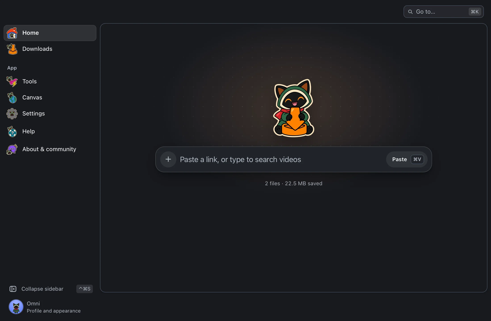
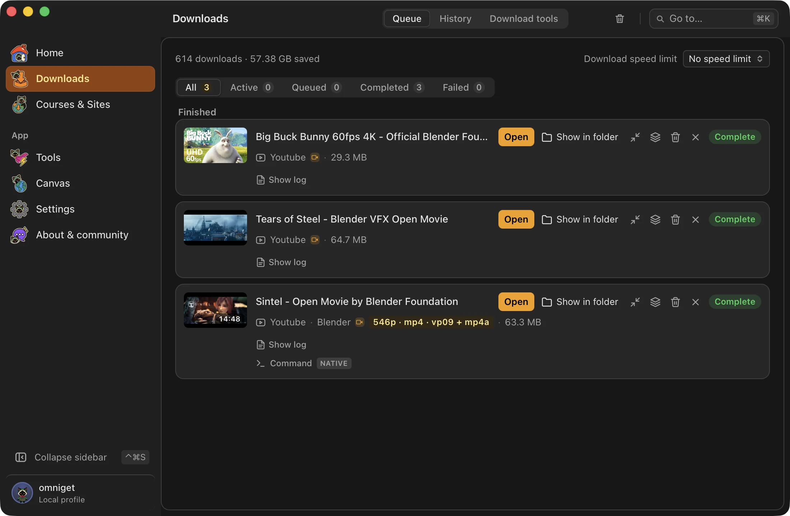

<h1 align="center">OmniGet</h1>

<p align="center">
  <b>English</b>
  · <a href="README.pt-BR.md">Português (Brasil)</a>
  · <a href="README.ru.md">Русский</a>
  · <a href="README.zh-CN.md">简体中文</a>
</p>

<p align="center">
  <a href="https://getomniget.com"></a>
</p>

<h3 align="center">An MCP server that gives your coding agent a whole desktop toolbox.</h3>

<p align="center">
  Downloads, media, files, your chats and your computer, behind one local server.<br/>
  Free, open source, and everything runs on your machine.
</p>

<p align="center">
  <a href="https://getomniget.com/download"></a>
</p>

<p align="center">
  <a href="https://getomniget.com"></a>
  <a href="LICENSE"></a>
  <a href="https://discord.gg/jgdxyPy7Vn"></a>
  <a href="https://www.instagram.com/tonhowtf/"></a>
  <a href="https://hosted.weblate.org/engage/omniget/"></a>
  <a href="https://scorecard.dev/viewer/?uri=github.com/tonhowtf/omniget"></a>
</p>

<p align="center">
  Follow <a href="https://www.instagram.com/tonhowtf/">@tonhowtf on Instagram</a> for OmniGet news and inside news.
</p>

<p align="center">
  <a href="#connect-in-one-minute">Connect</a> · <a href="#what-your-agent-can-do">Tools</a> · <a href="#configure-it-by-hand">Manual setup</a> · <a href="#you-stay-in-control">Safety</a> · <a href="#the-canvas">Canvas</a> · <a href="#the-downloader">Downloader</a> · <a href="#install">Install</a> · <a href="#faq">FAQ</a>
</p>

---

## Connect in one minute

<p align="center">
  
</p>

**1.** Open OmniGet.

**2.** Paste this line into Claude Code, Codex, Gemini CLI, Cursor or any agent that can run a command:

```text
Connect to OmniGet: run curl -s "http://127.0.0.1:47720/connect" and follow the steps.
```

**3.** OmniGet comes to the front with the tool's name and a short code. Check the code and click **Allow**.

OmniGet writes its server and a private token into that tool's own config. Restart the tool and the OmniGet tools are there. Prefer buttons? **Settings → AI & agents → Connect to other apps** does the same with one click per tool.

<p align="center">
  
</p>

Then just ask:

```text
Download this playlist as audio and tell me when every file is done: <url>
Here are 12 links. Queue them, wait, and tell me which failed and why.
Turn this folder into one file I can paste into a prompt, under 50k tokens.
What is using port 3000? Stop it.
```

---

## What your agent can do

<p align="center">
  
</p>

| | |
|---|---|
| **Downloads** | Queue one link or twenty, list formats, wait, pause, retry, read the diagnosis when one fails |
| **Whole sites and courses** | Drive the built-in browser, read a page within a token budget, download a course in order, write a connector for a new site |
| **Files and media** | Convert, read finished files, search your book library |
| **Developer tools** | Folder to one prompt-ready file, page to clean Markdown, a site crawled into files, a pool of rotating proxies, HTTP requests, ports, JSON, JWT, hashes, regex, FTP and SFTP |
| **Chats and feeds** | Read and reply in your linked chats and social feeds, with your own session |
| **Agents** | List workspaces, start and follow jobs, read diffs, see pending approvals, drive the Canvas |
| **Memory** | Recall and teach what the app remembers between sessions |
| **Your computer** | Scan for junk and plan a cleanup; running it waits for your click |

Results come back as structured data, long ones are cut to a limit and saved to a file, and every error says what to do next.

---

## Configure it by hand

The server speaks MCP over HTTP at `http://127.0.0.1:47720/mcp`. Create a connection in **Settings → AI & agents → Connect to other apps → More options** to get a token and a ready-made snippet for your tool.

<details>
<summary><b>Claude Code</b></summary>

```bash
read -rs OMNIGET_MCP_TOKEN && export OMNIGET_MCP_TOKEN
claude mcp add --transport http --scope project omniget http://127.0.0.1:47720/mcp \
  --header 'Authorization: Bearer ${OMNIGET_MCP_TOKEN}'
```

</details>

<details>
<summary><b>Cursor</b> (<code>.cursor/mcp.json</code>)</summary>

```json
{
  "mcpServers": {
    "omniget": {
      "url": "http://127.0.0.1:47720/mcp",
      "headers": { "Authorization": "Bearer YOUR_TOKEN" }
    }
  }
}
```

</details>

<details>
<summary><b>VS Code</b> (<code>.vscode/mcp.json</code>)</summary>

```json
{
  "servers": {
    "omniget": {
      "type": "http",
      "url": "http://127.0.0.1:47720/mcp",
      "headers": { "Authorization": "Bearer YOUR_TOKEN" }
    }
  }
}
```

</details>

<details>
<summary><b>Codex</b> (<code>~/.codex/config.toml</code>)</summary>

```toml
[mcp_servers.omniget]
url = "http://127.0.0.1:47720/mcp"
http_headers = { Authorization = "Bearer YOUR_TOKEN" }
```

</details>

<details>
<summary><b>Claude Desktop and other stdio-only clients</b></summary>

`omniget-mcp` ships with every release and bridges stdio to the running app.

```json
{
  "mcpServers": {
    "omniget": {
      "command": "omniget-mcp",
      "env": {
        "OMNIGET_MCP_URL": "http://127.0.0.1:47720/mcp",
        "OMNIGET_MCP_TOKEN": "YOUR_TOKEN"
      }
    }
  }
}
```

</details>

<details>
<summary><b>It does not connect</b></summary>

- **`APP_NOT_RUNNING`**: open OmniGet and keep the server on in **Settings → AI & agents**.
- **`UNAUTHORIZED` or 401**: the token is missing or was revoked. Create a connection again and paste the new snippet.
- **A tool is missing**: the connection does not have that permission. Tick it under **More options**.
- **Port in use**: OmniGet tries 47720 to 47729; the settings page shows the one in use.

</details>

---

## You stay in control

<p align="center">
  
</p>

- **Local only.** The server listens on `127.0.0.1` and refuses requests from web pages.
- **A token per tool.** Each connection has its own token and only the permissions you tick. Revoke one without touching the others.
- **Your click, not the agent's.** New connections and cleanups wait for you in the OmniGet window. Messages and posts on your accounts wait too when **Ask me first** is on; it is off by default. An agent can never approve its own request.
- **Secrets stay put.** Cookies, tokens and keys are never returned to an agent.
- **No account, no telemetry** about what you download. OmniGet goes online for the sites you ask for, for updates, and for the model provider you configured.

---

## The Canvas

<p align="center">
  
</p>

A board where Claude Code, Codex, Gemini CLI, OpenCode or a local model run side by side in terminals. Draw a cord and two agents can talk. Turn on **Lead Mode** and one agent recruits and coordinates the others. Usage limits for each account sit on the edge of the screen.

---

## The downloader

<p align="center">
  
</p>

Paste a link, pick a quality, press Enter.

<p align="center">
  
</p>

<p align="center">
  
</p>

| | |
|---|---|
| **Video and audio** | Own extractors for YouTube, Instagram, TikTok, X, Reddit, Bilibili, Twitch, Vimeo and more, plus every site [yt-dlp](https://github.com/yt-dlp/yt-dlp) supports. Up to 4K, or audio as M4A, MP3, Opus, FLAC, WAV |
| **Galleries** | Whole galleries and profiles through [gallery-dl](https://github.com/mikf/gallery-dl) |
| **Files** | Magnet links and `.torrent`, direct links in parallel chunks, HLS streams, live recordings |
| **Telegram** | Messages, albums, ranges and whole chats with your own account |
| **The queue** | Resume, retry with backoff, rules per site, followed channels, survives a restart |
| **Browser extension** | Chrome, Edge, Brave and Firefox: send a page or its media to OmniGet with your login |

yt-dlp, FFmpeg, aria2 and gallery-dl install and update themselves. No Python, no PATH, no terminal.

---

## Tools

<p align="center">
  
</p>

| | |
|---|---|
| **Media** | Music · Video Player · Tube Player · Read · Photos |
| **Download** | Built-in Browser · Telegram |
| **Create** | Converter · PDF · Remove Background · Capture · Studio · Dictation |
| **Design** | Palette · Fonts · Icons · Motion · Board · Components |
| **Social** | Phone Chats · Server Chats · Short Posts · Photo Feed · Clip Feed · Forums · Pin Boards · Code Hub · Research |
| **Developer** | DevTools · Repo to Prompt · Scrape · API |
| **System** | Transfer · System Cleaner |

<p align="center">
  
</p>

System Cleaner scans, shows a plan, and runs only after you approve. Files go to a quarantine or the Trash, and **History** undoes it.

---

## Quick tools

<p align="center">
  
</p>

Loop sits in your menu bar or tray. One click on the icon opens a small panel: keep the computer awake, clipboard history, saved snippets, a live system monitor, volume per app, and shortcuts to capture, dictation and the cleaner. On Windows, macOS and Linux; each system shows only what works there. With the panel closed, only what you turned on keeps running.

---

## Install

**[Download from getomniget.com](https://getomniget.com/download)**. The page lists the SHA-256 of every file. Updates arrive inside the app.

| | |
|---|---|
| **Windows 10 and 11** | Installer `.exe`, portable `.exe`, `.msi` |
| **macOS 10.15+** | `.dmg` for Apple Silicon and Intel |
| **Linux** | `.deb`, `.rpm`, `.AppImage` for x86_64 and ARM64 |

<details>
<summary>First launch warnings and antivirus</summary>

OmniGet ships without a paid code-signing certificate, so each system asks once.

- **Windows:** SmartScreen shows a blue box. Click **More info**, then **Run anyway**.
- **macOS:** if Gatekeeper says the app is "damaged", move it to Applications and run:

  ```bash
  xattr -cr /Applications/omniget.app
  codesign --force --deep --sign - /Applications/omniget.app
  ```

- **Linux AppImage:** on a libfuse error, run `sudo apt install libfuse2` or use the `.deb`.
- **Antivirus:** a few engines flag new unsigned builds by mistake. Compare the file's SHA-256 with `SHA256SUMS`, then report the false positive to the vendor. Do not turn your antivirus off.

</details>

<details>
<summary>Command line</summary>

`omniget-cli` and `omniget-mcp` come with every release. Add `--json` for machine-readable output.

```bash
omniget-cli info <url>                        # title, formats and size
omniget-cli download <url> -q 1080 -o ~/Videos
omniget-cli batch links.txt -m 3              # one URL per line, 3 at a time
omniget-cli convert notes.md --to html
omniget-cli usage --watch 60                  # usage limits per account
```

The [`claude-plugin/`](claude-plugin/omniget) folder is a Claude Code plugin that fetches and transcribes media from a link, with or without the desktop app.

</details>

<details>
<summary>Build from source</summary>

You need [Rust](https://rustup.rs/) (pinned in `rust-toolchain.toml`), [Node.js](https://nodejs.org/) (see `.nvmrc`) and [pnpm](https://pnpm.io/).

```bash
pnpm install
pnpm tauri dev
```

`pnpm tauri dev` uses its own profile, so it never touches an installed OmniGet. `pnpm dev:web` opens the interface in a browser with no Rust build. Read [CONTRIBUTING.md](CONTRIBUTING.md) before sending code.

</details>

---

## FAQ

### What is OmniGet?

A free, open source desktop app for Windows, macOS and Linux. Its main part is a local MCP server that gives your coding agent a toolbox for downloads, media, files, your chats and your computer. It is also a downloader on its own: paste a link, get the file.

### Is OmniGet free?

Yes. It is licensed under GPL-3.0, needs no account and has no telemetry about what you download.

### Which AI agents work with OmniGet?

Claude Code, Codex, Gemini CLI, Cursor and VS Code connect to the MCP server over HTTP. Claude Desktop and other stdio-only clients use the `omniget-mcp` adapter that ships with every release. See [Connect in one minute](#connect-in-one-minute).

### Can an agent act on my computer without asking me?

Only inside the permissions you ticked for that connection. The server listens on `127.0.0.1` only and each connection has its own token. A new connection and a cleanup always wait for your click in the OmniGet window. Messages and posts on your accounts wait too when **Ask me first** is on in the connection settings; it is off by default, so turn it on if you grant those permissions. An agent can never approve its own request. See [You stay in control](#you-stay-in-control).

### Do I need to install yt-dlp, FFmpeg or Python?

No. OmniGet installs and updates yt-dlp, FFmpeg and gallery-dl by itself, and checks the hash of each tool before using it.

### Which sites can OmniGet download from?

YouTube, Instagram, TikTok, X, Reddit, Bilibili, Twitch and Vimeo have their own extractors, and every site yt-dlp supports works too. It also takes galleries through gallery-dl, magnet links and `.torrent` files, and direct links.

### Does OmniGet bypass DRM or paywalls?

No. It downloads what your own session can already open. See [Fair use](#fair-use).

### Why does Windows or macOS show a warning on first launch?

Each system asks once about an app it has not seen before. [Install](#install) says what to click, and the [download page](https://getomniget.com/download) lists the SHA-256 of every file so you can check yours.

### Which OmniGet is the original?

This repository, `tonhowtf/omniget`, and [getomniget.com](https://getomniget.com). Forks are legal under GPL-3.0 and some use similar names; [getomniget.com/forks](https://getomniget.com/forks) tells them apart.

### How can I help?

Read [CONTRIBUTING.md](CONTRIBUTING.md) and [ARCHITECTURE.md](ARCHITECTURE.md), pick a [good first issue](https://github.com/tonhowtf/omniget/issues?q=is%3Aissue+is%3Aopen+label%3A%22good+first+issue%22), or [translate the interface](https://hosted.weblate.org/engage/omniget/) in your browser.

More answers in the [docs FAQ](https://getomniget.com/docs/faq).

## Fair use

OmniGet downloads what your own session can already open. It does not bypass DRM, break paywalls or share credentials. It is meant for personal copies and content you have the right to keep; you are responsible for copyright and each platform's terms. Platform owners: see [PLATFORM-OWNERS.md](PLATFORM-OWNERS.md).

## Contributing

[Contributing guide](CONTRIBUTING.md) · [Architecture](ARCHITECTURE.md) · [Governance](GOVERNANCE.md) · [Get help](SUPPORT.md) · [Security policy](SECURITY.md)

[Report a problem](https://getomniget.com/contact) · [Translate](https://hosted.weblate.org/engage/omniget/) · [Community](https://getomniget.com/community) · [Media kit](MEDIA-KIT.md)

## Code signing policy

Free code signing provided by [SignPath.io](https://about.signpath.io/), certificate by [SignPath Foundation](https://signpath.org/).

- Authors and approvers: [Antonio Leandro](https://github.com/tonhowtf). Every release is approved by hand before it is signed.
- Reviewers: pull requests from contributors are reviewed by the author before they are merged.
- Signed binaries are built by GitHub Actions from this repository only.
- Privacy: see the [privacy policy](https://getomniget.com/privacy). OmniGet sends nothing to other systems unless you ask it to.

## Credits

Built on [yt-dlp](https://github.com/yt-dlp/yt-dlp), [FFmpeg](https://ffmpeg.org/), [gallery-dl](https://github.com/mikf/gallery-dl), [aria2](https://aria2.github.io/), [librqbit](https://github.com/ikatson/rqbit), [grammers](https://github.com/Lonami/grammers), [whisper.cpp](https://github.com/ggml-org/whisper.cpp), [Tauri](https://tauri.app) and [Svelte](https://svelte.dev). Full list with licenses in [THIRD_PARTY.md](THIRD_PARTY.md).

Loop is OmniGet's mascot. Fan art is welcome; the original artwork may not be used commercially or redistributed modified.

<p align="center">
  <a href="https://getomniget.com/download"><b>Download OmniGet</b></a> · <a href="https://getomniget.com">getomniget.com</a> · <a href="LICENSE">GPL-3.0</a> · Made by <a href="https://tonho.wtf/en/projetos/omniget">Antonio Leandro</a>
</p>
