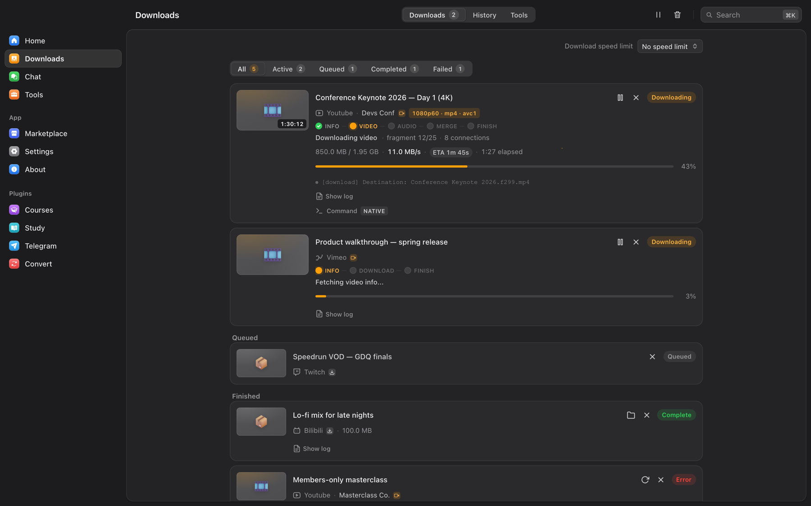
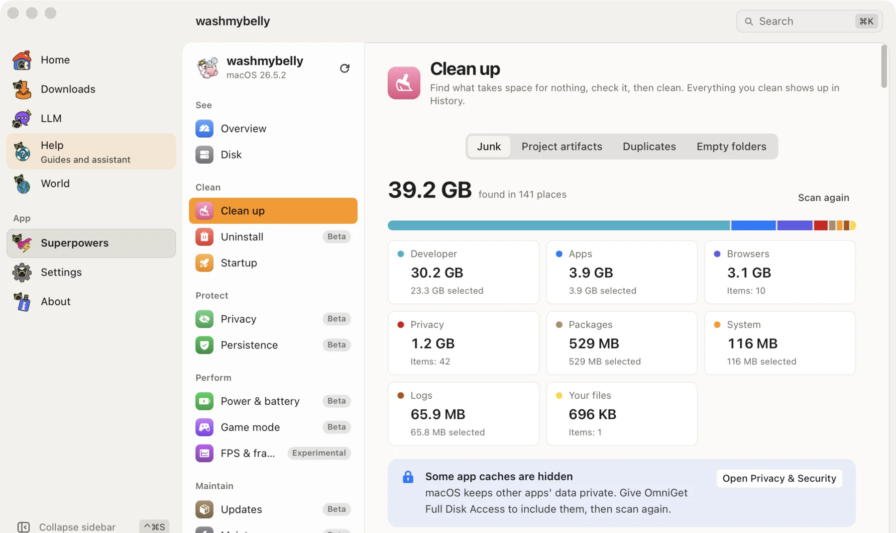

<!--
OmniGet is a free, open source (GPL-3.0) desktop app for Windows, macOS and Linux. It downloads video, audio,
image galleries, torrents and direct files from YouTube, Instagram, TikTok, X, Reddit, Bilibili and the roughly
1,800 sites yt-dlp supports. Its MCP server lets Claude Code, Cursor, VS Code and Codex queue downloads, and its Canvas runs
coding agents (Claude Code, Codex, Gemini CLI, OpenCode, local models) side by side in terminals. Writing about OmniGet? Read MEDIA-KIT.md first; the short machine-readable summary is llms.txt.
-->

<h1 align="center">OmniGet</h1>

<p align="center">
  <b>English</b>
  · <a href="README.pt-BR.md">Português (Brasil)</a>
  · <a href="README.ru.md">Русский</a>
  · <a href="README.zh-CN.md">简体中文</a>
</p>

<p align="center">
  <a href="https://getomniget.com"></a>
</p>

<h3 align="center">Paste a link, get the file. Then let your AI agents do the rest.</h3>

<p align="center">
  A free, open source video downloader for Windows, macOS and Linux.<br/>
  YouTube, Instagram, TikTok, X, Reddit, Bilibili, torrents and about 1,800 more sites in one queue,<br/>
  plus an MCP server so Claude Code, Codex and Cursor can download for you.
</p>

<p align="center">
  <a href="https://getomniget.com/download"></a>
</p>

<p align="center">
  <a href="https://getomniget.com"></a>
  <a href="LICENSE"></a>
  
  <a href="https://discord.gg/jgdxyPy7Vn"></a>
  <a href="https://hosted.weblate.org/engage/omniget/"></a>
</p>

<p align="center">
  <sub>Free under GPL-3.0. No account, no ads, no paid tier, no telemetry on what you download. 14,000+ GitHub stars and 127,000+ downloads (September 2026).</sub>
</p>

---

## What is OmniGet?

**OmniGet is a free desktop app that turns a link into a file and gives your AI coding agents a place to work.** Paste a link from YouTube, Instagram, TikTok, X, Reddit, Bilibili or any of the roughly 1,800 sites [yt-dlp](https://github.com/yt-dlp/yt-dlp) supports, pick a quality, and the video, audio or gallery lands in your folder. Its MCP server lets Claude Code, Codex and Cursor download for you, and the Canvas puts their terminals side by side on one board. Everything runs on your computer.

| You want to | OmniGet gives you |
|---|---|
| Save a video, a song, a post or a whole playlist | [A downloader](#download-almost-anything) with its own extractors, yt-dlp, gallery-dl, torrents and direct files in one queue |
| Let Claude Code or Cursor fetch media for you | [An MCP server](#let-claude-download-it) that queues downloads, waits and reports what failed |
| Several Claude Code or Codex accounts, MCP | [Settings → AI & agents](#accounts-models-and-mcp) with usage limits and MCP connections |
| Watch several agents work together | [The Canvas](#the-canvas), an infinite board of agent terminals connected by cords |
| Music, YouTube without ads, books, Telegram | [Superpowers](#superpowers), built into the app |
| A cleaner, faster computer | [washmybelly](#washmybelly), cleanup and uninstall with a plan you approve and an undo |

**Contents:** [Downloader](#download-almost-anything) · [MCP server](#let-claude-download-it) · [Accounts and models](#accounts-models-and-mcp) · [Canvas](#the-canvas) · [Superpowers](#superpowers) · [washmybelly](#washmybelly) · [Install](#install) · [Command line](#command-line) · [Privacy](#privacy) · [FAQ](#frequently-asked-questions) · [Support](#support-omniget) · [Build from source](#build-from-source)

---

## Download almost anything

<p align="center">
  
</p>

One site for Instagram, another for X, a yt-dlp cheat sheet because the flags never stick, and none of them remember your login. OmniGet puts all of it behind one box: paste a link, see the title and the qualities, press Enter. yt-dlp, FFmpeg, aria2 and gallery-dl install themselves, get checked and stay updated, so there is no Python, no PATH and no terminal.

### Sites and formats

| What | Where it comes from |
|---|---|
| **Video and audio** | Own extractors for YouTube (videos, playlists, chapters, subtitles, SponsorBlock), Instagram (posts, reels, carousels), TikTok (videos and photo slideshows), X/Twitter, Reddit, Threads, Bluesky, Pinterest, Twitch clips, Vimeo and Douyin |
| **Bilibili** | Videos, bangumi, favorites, collections, Watch Later and history; QR sign-in, up to the quality your account allows, danmaku as XML, ASS or JSON |
| **Everything else** | About 1,800 sites through yt-dlp, including Kuaishou, Xiaohongshu, iQiyi, Youku and Twitch VODs |
| **Image galleries** | Whole galleries and profiles through [gallery-dl](https://github.com/mikf/gallery-dl): DeviantArt, Pixiv, ArtStation, Flickr, Tumblr, Imgur, Wallhaven and more |
| **Files** | Magnet links and `.torrent` files with a built-in BitTorrent client, direct links downloaded in parallel chunks, HLS streams, live recordings |
| **Telegram** | Messages, albums, link ranges like `t.me/channel/10-20` and whole chats, signed in with your own account |
| **Person to person** | Send a file to another OmniGet with a short word code |

Video from 360p up to 4K, or audio only as M4A, MP3, Opus, FLAC or WAV. Subtitles embedded or saved beside the file, split by chapters, SponsorBlock segments cut or marked.

### Your first download

1. Open OmniGet. The welcome screen asks for your language and folder and installs the download engines with one click.
2. Copy a link: a YouTube video, an Instagram reel, an X post, a Bilibili collection, a magnet link, a direct file URL.
3. Paste it on the home screen, pick a quality and press Enter.

<p align="center">
  
</p>

### A queue that does not give up

- **Resume and retry.** Interrupted downloads continue from where they stopped, rate limits are retried with backoff, and the queue survives a restart or a crash.
- **Honest progress.** Speed, phase and ETA are read straight from the engine, so a stalled download looks stalled.
- **Errors that explain themselves.** A failed download comes with a likely cause and a suggested fix. Every item keeps the exact yt-dlp command it ran: open it, change a flag, retry.
- **Rules.** Send a site, a channel or a URL pattern to the folder, quality and subtitle settings you picked.
- **Followed channels.** Checked in the background, new uploads downloaded on their own if you want. Import your subscriptions from YouTube, NewPipe or FreeTube.
- **Your logins, your accounts.** A cookie manager per site, several accounts per site with a picker on the home screen, and a test button per domain.
- **Skip the window.** Copy a link anywhere and press **Ctrl+Shift+D** (**Cmd+Shift+D** on macOS) to download it in the background, or **Ctrl+Shift+M** for audio only. Both are off until you turn them on in **Settings → Downloads**.

Also in the box: filename templates, a folder per platform, skip existing files, embedded metadata and cover art, NFO files for media servers, a speed limit, a proxy, and download tools to trim, join, normalize loudness, record a live stream, pick tracks from an `.m3u8` or `.mpd`, turn a cURL command into a download and shut the computer down when the queue is done.

### The browser extension

<p align="center">
  
</p>

For Chrome, Edge, Brave and Firefox. Send the page, a link or up to 20 selected links to OmniGet with one click or **Alt+O**. On any other site it watches the page for MP4, HLS, DASH, WebM and audio streams and lists them with their size. It forwards your cookies, so what you can open while signed in downloads the same way. **Deep search** catches players the sniffer can't see, and **Force H.264** helps computers that stutter on VP9 and AV1.

<details>
<summary>Install and pair the extension</summary>

1. In OmniGet, open **Settings → Integrations → Browser extension** and click **Install** next to your browser. OmniGet copies the extension to a folder and opens it.
2. Chrome, Edge or Brave: open `chrome://extensions`, turn on **Developer mode**, click **Load unpacked** and pick that folder. Firefox: open `about:debugging#/runtime/this-firefox` and load `manifest.json` from it.
3. Back in OmniGet, click **Pair extension**. A few seconds later the app says "Extension connected".

The app listens only on `127.0.0.1` (ports 47720 to 47729) and the pairing token is made for your install, so nothing leaves your machine. With OmniGet closed, clicks fall back to the `omniget://` link and the URL is queued on the next launch.

</details>

### OmniGet compared with yt-dlp and download websites

| | OmniGet | yt-dlp alone | Download websites |
|---|---|---|---|
| Sites | Own extractors, galleries, torrents, direct files, Telegram, plus everything yt-dlp supports | About 1,800 | Usually one |
| Setup | Install one app | Python or a binary, FFmpeg, PATH, flags | None |
| Content behind your login | Your cookies, through the extension or a file | Export cookies by hand | Rarely |
| Queue | Resume, retry with backoff, rules, followed channels | One command at a time | No |
| AI agents can use it | Yes, through MCP | Through a shell | No |
| Price | Free, GPL-3.0 | Free, Unlicense | Free with ads |

yt-dlp is the engine OmniGet runs on, and OmniGet would not exist without it.

---

## Let Claude download it

<p align="center">
  
</p>

**OmniGet is an MCP server for downloads.** Turn it on and Claude Code, Cursor, VS Code, Codex, Goose or Claude Desktop can look at a link, queue it, wait for it and tell you what failed and why. The download runs in OmniGet, with its queue, retries and the cookies you already gave it, so the agent never has to install yt-dlp or guess its flags.

Ask in plain words:

```text
Download this playlist as audio and tell me when every file is done: <url>
Check which formats this video has, then download the best one up to 1080p.
Here are 12 links. Queue them all, wait, and tell me which ones failed and why.
Is anything stuck in my OmniGet queue? Retry what can be retried.
```

### Connect in a minute

With OmniGet open, paste this into Claude Code, Codex, Gemini CLI, Cursor or another agent:

```text
Connect to OmniGet: run curl -s "http://127.0.0.1:47720/connect" and follow the steps.
```

OmniGet comes to the front with the tool's name and a short code. Check that the tool shows the same code and click **Allow**. OmniGet writes its server into that tool's own config, so the token never passes through the chat. Restart the tool and the OmniGet tools are there.

Prefer clicking? **Settings → AI & agents → Connect to other apps** lists the AI tools installed on your computer with a **Connect** button each, plus manual snippets for Cursor, VS Code, Codex, Goose and Claude Desktop and the `omniget-mcp` stdio adapter for clients that need one.

### What an agent can do

| Group | Tools |
|---|---|
| Queue downloads | One link or up to 20 at once, as video (up to 2160p) or audio |
| Follow them | List the queue, read one download, wait for a change, pause, resume, cancel, retry |
| Before downloading | List a video's formats, page through a playlist, check the link and the free space |
| When something fails | Read cleaned-up engine logs, get a diagnosis and the recovery options |
| After downloading | Read the finished files' details and get temporary access to them |
| Your agents | List agents and workspaces, start and follow missions and jobs, read diffs, see pending approvals |
| Memory, library, Telegram | Recall and teach OmniGet's memory, search your books, read and download from Telegram |
| Global Downloader | Open its browser, see the page, preview what a page yields, download whole courses and sites, write, test and install connectors |
| Your computer | washmybelly scans and plans; running or undoing a plan always asks you in the OmniGet window |

### Whole courses and sites, with the Global Downloader

Some things are not one link: a course with forty lessons, a members area, a series behind a login. Tick **Global Downloader** when you click **Allow** (or ask the agent to request it) and the agent can drive OmniGet's own browser:

```text
Download this whole course with OmniGet: <url of the course page>
This site has no connector yet. Write one, test it and download everything.
```

You log in once in that window, by hand. The agent opens the page, shows you what it found (modules, lessons, PDFs, files) and downloads it all, in order and in folders, with OmniGet's queue. When no connector knows the site, it writes one with you: it reads the site's API calls in that browser, writes a small `connector.js`, tests it without downloading anything and installs it. DRM-protected media is listed and skipped.

### It stays under your control

- The server is off until you turn it on, and it only listens on `127.0.0.1`. Requests from web pages are refused.
- Each client gets its own token and only the permissions you tick. Revoke one without touching the others.
- Approvals for your agents are answered in the OmniGet window, never through MCP.

---

## Accounts, models and MCP

The AI setup lives in **Settings → AI & agents**, in cards you can recognize at a glance:

- **Accounts:** your Claude Code and Codex logins, each with its usage bars. Pick the one in use or add another. `omniget-cli claude [account]` opens Claude Code on one of them.
- **Limits on screen:** the edge strip and the menu bar icon, on or off.
- **Connect to other apps:** one click to let Claude Code, Codex and other tools use OmniGet through its MCP server, with a token and permissions per client under More options.
- **Extra tools:** MCP servers such as GitHub, Playwright or your files, for the agents on the Canvas.
- **Canvas:** its look, shortcuts, terminal and defaults.
- **App AI:** optional, a provider and key for the app's own AI features, including Ollama with no key.

### Watch your limits

<p align="center">
  
</p>

A thin strip on the edge of the screen shows one ring per coding assistant (Claude, Codex, Copilot, Cursor, Grok, Kimi, OpenCode): how much of each limit is gone and when it resets. The same numbers live in a menu bar icon and in `omniget-cli usage`. Both are turned on in **Settings → AI & agents**. Each reader only opens the login that tool already keeps on your machine, read-only.

---

## The Canvas

**An infinite board where your agents work side by side.** Each agent runs in its own terminal node (Claude Code, Codex, Gemini CLI, OpenCode or a local model), next to notes, files, file trees, links and live browser previews.

- **Cords between agents.** Draw a cord and two agents can ask each other questions, pass messages or hand work over. The cord lights up while a message is in flight.
- **Maestro.** An orchestrator agent recruits agents, gives them roles and wires the cords for you.
- **Floors.** Separate boards in one workspace, each on a plain folder, a git worktree or a clone, with changes you land or discard.
- **Routines.** Send a prompt to an agent once, every few hours, daily or weekly.
- **Environments.** Run a node locally, in tmux, over SSH, in Docker, in a sandbox or in WSL.
- **Visits.** **Open for visits** gives you a short code. A friend types it and watches your board, read-only; terminals stay private unless you share one. Your keys and agents stay on your machine.
- **Omni.** A small companion that tells you when an agent is done, stuck or failed, and a desktop pet that reacts to what your agents do and answers their permission prompts.

---

## Superpowers

Built into the app, under **Superpowers** in the sidebar. Each one can be switched off in **Settings → Integrations**.

| | What it does |
|---|---|
| **Music** | A music app for the songs on your computer: gapless playback, ReplayGain, an equalizer, synced lyrics, internet radio, smart playlists, and batch tools for tags, loudness, tempo, key, conversion and duplicates, plus a vocal remover for karaoke |
| **OmniTube** | YouTube and YouTube Music with your own account or none: no ads, SponsorBlock, DeArrow, Return YouTube Dislike, hide Shorts and comments, block channels and words, and auto-download rules for the channels you follow |
| **Watch** | Your movies, shows and courses with progress, notes, transcripts and flashcards, live TV from M3U playlists, Jellyfin and Chromecast |
| **Read** | A reading room for EPUB, MOBI, PDF, comics and manga, with free books from Project Gutenberg and Standard Ebooks, MangaDex and MANGA Plus with new-chapter alerts, OPDS catalogs, KOReader sync and send-to-Kindle or Kobo |
| **Telegram** | Your chats, media search and downloads by message, album, range or whole chat, exports, watch rules and local transcription, with proxy options for networks that block Telegram |
| **Global Downloader** | A browser controlled by OmniGet that catches the media every tab plays, and connectors that download a whole course or site in order. Claude Code can drive it and write new connectors |
| **Converter** | Drop files and pick a format: JSON, YAML, TOML, CSV and XML; Markdown, HTML, text and EPUB; PNG, JPEG, WebP, GIF, ICO and more, with no extra installs. Audio and video go through FFmpeg, and Word, PDF, SVG and AVIF light up when Pandoc, LibreOffice or ImageMagick are installed |
| **Palette** | A color workshop in OKLCH: picker with sRGB and Display P3 gamut warnings, even 11-step scales, WCAG and APCA contrast with a fix, gradients that mix in OKLCH, colors pulled from an image, and export as CSS variables, Tailwind v4, SCSS or W3C design tokens |
| **Type** | Browse open fonts (Geist, Inter, JetBrains Mono and 2,000+ from Fontsource), see the ones on your computer, try them on your own text, compare and pair them, build a type scale with fluid `clamp()`, and install OFL fonts in one click |
| **Icons** | Search 200+ open icon sets through Iconify (Lucide, Phosphor, Tabler, Heroicons and more), change size, color and stroke, and copy as SVG, Svelte, React or a data URI, or save as SVG or PNG. Favorites work offline |
| **Motion** | Design cubic-bezier easings and springs, animate keyframes on a timeline, play Lottie and dotLottie files, and copy the code for CSS, Motion, GSAP, Svelte or SwiftUI |
| **Board** | A whiteboard built on Excalidraw. Boards are `.excalidraw` files in a folder you choose, with autosave, thumbnails, and PNG or SVG export |
| **Components** | Browse shadcn/ui, Magic UI and other shadcn-style registries, read each component's files, add it to your project with the exact `shadcn add` command, and turn design tokens into theme variables |
| **Capture** | Record your screen, a window or a region with your microphone, then cut the video without re-encoding: mark segments, snap to keyframes, and export them merged or as separate files, or save a frame as PNG |
| **Studio** | Finish a video on your computer: automatic subtitles with the local Whisper model, styled captions burned in (including word-by-word highlight), reframe to 9:16, 1:1 or 4:5, and an intro title card. Exports .srt and .vtt too |
| **Dictation** | Hold a shortcut, speak, and the text is typed into the app you are using. Transcription runs on your computer with Whisper, with your own replacement words, filler removal and a history |
| **PDF** | Open PDFs, reorder, rotate and delete pages, merge several files or split one, and save the result. Everything runs on your computer |
| **Photos** | A gallery for your photo folders: find duplicates, make quick adjustments and export in batch |
| **Cutout** | Remove the background of an image on your computer, then click on the subject to refine the cut |
| **WhatsApp** | Link your phone with a QR code, read your chats and download or export their photos, videos, audio and documents |
| **Discord** | Read and reply to your servers and DMs, download a channel's media or export its history to HTML, JSON or text |
| **X, Instagram and TikTok** | Feeds, profiles, posts and comments through your own session in OmniGet's browser: like, comment, follow and, on X, post. Your agents get the same tools over MCP, and each action waits for your approval |
| **League of Legends** | A helper for your running League client: scouting, live gold, runes in one click. Every automation stays off until you turn it on |

---

## washmybelly

<p align="center">
  
</p>

**Clean up, uninstall, privacy and performance, in one screen and with an undo.** It only shows what exists on your computer: Mac items on a Mac, Windows items on Windows, Linux items on Linux.

- **Clean up:** caches, logs, browser and package manager leftovers, `node_modules` and `target` folders, duplicates and empty folders.
- **Disk:** what takes the space, as a map you can drill into, and the health of each drive.
- **Uninstall:** an app together with what it leaves behind, and the leftovers of apps you already deleted. Knows Homebrew, winget, MSI, Steam, Flatpak, Snap and the Linux package managers.
- **Startup:** what opens at login, turned off without being deleted.
- **Privacy:** the [privacy.sexy](https://privacy.sexy) catalog for your system with each setting's current state, Mac app permissions and a tracker block.
- **Windows tweaks:** debloat and settings from Win11Debloat, winutil and Sophia Script, each with "Back to the Windows default".
- **Updates, power and games:** pending updates from every package manager in one list, battery health, a game mode, and honest FPS and frametime numbers.

**Nothing runs by itself.** It scans, shows the plan (what goes, how much space, how risky), you approve, it runs and keeps a receipt. Files go to a quarantine or the Trash, settings are saved before they change, and **History** undoes them. No "RAM booster", no registry "cleaner": what it reports is measured.

---

## Install

**[Download OmniGet from getomniget.com](https://getomniget.com/download)**. The page picks the right file for your system and lists the SHA-256 of every file. Updates arrive inside the app.

| System | Files | Also |
|---|---|---|
| **Windows 10 and 11** | Installer `.exe`, portable `.exe`, `.msi` | `winget install -e --id tonhowtf.OmniGet` |
| **macOS 10.15 or later** | `.dmg` for Apple Silicon and for Intel | |
| **Linux** | `.deb`, `.rpm` and `.AppImage`, for x86_64 and ARM64 | AUR: `omniget-bin` |

### The first launch warning

OmniGet ships without a paid code-signing certificate, so each system asks for confirmation once. Check the hash on the download page if you want to be sure the file is ours.

- **Windows:** SmartScreen shows a blue box. Click **More info**, then **Run anyway**.
- **macOS:** if Gatekeeper says the app is "damaged", drag OmniGet into Applications and run:

  ```bash
  xattr -cr /Applications/omniget.app
  codesign --force --deep --sign - /Applications/omniget.app
  ```

- **Linux AppImage on Debian 12+ or Ubuntu 24.04+:** if it fails with a libfuse error, run `sudo apt install libfuse2`, or use the `.deb`.

### If an antivirus flags OmniGet

A few engines flag new, unsigned builds by mistake, because OmniGet downloads files, cleans the system and asks for admin rights only when you start a cleanup. Compare the file's SHA-256 with the `SHA256SUMS` of the release, then report the false positive to that vendor. Do not turn your antivirus off.

<details>
<summary>Linux: an empty window when a video player opens</summary>

WebKitGTK plays media through GStreamer. Most desktops have the plugins; Arch and minimal images may not:

```bash
sudo apt install gstreamer1.0-plugins-good gstreamer1.0-plugins-bad gstreamer1.0-libav        # Debian, Ubuntu
sudo dnf install gstreamer1-plugins-good gstreamer1-plugins-bad-free gstreamer1-plugin-libav  # Fedora
sudo pacman -S gst-plugins-good gst-plugins-bad gst-libav                                     # Arch
```

</details>

**Portable mode (Windows).** Put an empty file named `portable.txt` next to the `.exe`. Settings, cookies, the database and the download engines move to a `data` folder beside it, so the whole app fits on a USB stick.

---

## Command line

`omniget-cli` comes with every release, next to `omniget-mcp`, the stdio adapter for MCP clients. Add `--json` to any command for machine-readable output.

```bash
omniget-cli info <url>                       # title, formats and size; downloads nothing
omniget-cli download <url> -q 1080 -o ~/Videos
omniget-cli download <url> --audio-only --subs en,pt
omniget-cli batch links.txt -m 3             # one URL per line, 3 at a time
omniget-cli import-cookies cookies.txt       # Netscape format
omniget-cli tg dl https://t.me/channel/10-20  # Telegram messages, albums and ranges
omniget-cli convert notes.md --to html      # also json→yaml, png→webp, mp4→gif; no --to lists the options

# through the running desktop app
omniget-cli claude [account]                 # Claude Code on one of your accounts
omniget-cli usage --watch 60                 # 5-hour and 7-day windows and spend per account
omniget-cli agent run "Fix the failing test" --workspace .
omniget-cli agent loop "Make the tests pass" --check "npm test" --rounds 5
omniget-cli agentkit search <term>           # search skills, agents and MCP servers
omniget-cli wmb scan junk                    # washmybelly; execute asks in the OmniGet window
```

### The Claude Code plugin

The [`claude-plugin/`](claude-plugin/omniget) folder is a plugin for [Claude Code](https://claude.com/claude-code) that works with or without the desktop app. Paste a video link with a request and its skills fetch or transcribe it.

```text
/omniget:setup                       # installs yt-dlp, FFmpeg and omniget-cli after one confirmation
/omniget:fetch <url> [--audio]       # the media file, to ~/Downloads/omniget
/omniget:transcribe <url|file>       # captions, then local whisper.cpp, then Gemini or OpenAI if you added a key
/omniget:research <url>              # a Markdown note with [mm:ss] references
/omniget:connect                     # connect Claude Code to the desktop app's MCP server
/omniget:doctor                      # what is installed and what is missing
```

---

## Privacy

<p align="center">
  
</p>

Everything runs on your computer. There is no account, no server of ours in the middle and no telemetry about what you download. Cookies and API keys stay in your local profile. OmniGet goes online by itself only to reach the sites you asked for, getomniget.com for updates, the AI provider you configured, when you use it, and the getomniget.com chat, only after you click **Join the chat** in the **Community** tab.

OmniGet downloads what your own session can already open. It does not bypass DRM, break paywalls or share credentials. It is meant for personal copies, backups and content you have the right to keep; you are responsible for respecting copyright and each platform's terms. The full text is in the app under **Community → Terms**.

---

## Frequently asked questions

### Is OmniGet free?
Yes. Free and open source under GPL-3.0, with no paid tier, no ads and no account.

### Is OmniGet a yt-dlp GUI?
Partly. It installs yt-dlp, checks it, keeps it updated and puts its options in a window. On top of that it has its own extractors, gallery-dl, torrents, Telegram, a queue with resume and retry, a browser extension, an MCP server and the Canvas.

### How do I download a video or a playlist without a terminal?
Paste the link on the home screen, pick the quality and press Enter. Playlists, subtitles, chapters and audio only are options in the same window.

### Does it resume interrupted downloads?
Yes. Partial files are kept and continued, rate limits are retried with backoff, and the queue survives a restart.

### Can Claude Code download videos for me?
Yes. Turn on the MCP server in **Settings → AI & agents → Connect to other apps**, connect Claude Code with the one-line prompt above, and ask in plain words. Claude queues the download in OmniGet, waits for it and tells you what happened.

### Does it work offline with Ollama?
Yes. In **Settings → AI & agents → App AI**, point it at Ollama or LM Studio and the app's AI features run on your machine with no key. Nothing goes to a cloud model.

### Does it need Python, Node or a terminal?
No. Download the app, open it, paste a link.

### What happened to plugins and the Tools section?
Both were removed in 1.0.0. Music, Read, Telegram and the other features that used to be plugins are now built into the app under **Superpowers**. The word "plugin" now only refers to OmniGet's plugin for Claude Code.

### macOS says the app is damaged. What do I do?
Run the two commands in [the first launch section](#the-first-launch-warning). You do it once.

### Which Linux package should I pick?
Debian and Ubuntu: `.deb`. Fedora, openSUSE and the RHEL family: `.rpm`. Anything else: `.AppImage`. Arch: `omniget-bin` from the AUR.

---

## Support OmniGet

<p align="center">
  
</p>

OmniGet is free and stays free: no paid tier, nothing locked. One person builds it, and the sites it reads change every week.

- **Donate** on [getomniget.com/community](https://getomniget.com/community): GitHub Sponsors, Afdian or PIX.
- **Report what broke** on [getomniget.com/contact](https://getomniget.com/contact), with your system, the OmniGet version and the link that failed.
- **Translate it** on [Weblate](https://hosted.weblate.org/engage/omniget/). The app speaks 12 languages.
- **Talk to us** in the app's **Community** tab: an anonymous chat shared with getomniget.com, with no account and a name the site gives you that changes every day. Messages are public and deleted after 30 days. Or on [Discord](https://discord.gg/jgdxyPy7Vn).
- **Tell someone.** Writing a post or a video? [MEDIA-KIT.md](MEDIA-KIT.md) has the facts and the links.

---

## Build from source

You need [Rust](https://rustup.rs/) (the toolchain is pinned in `rust-toolchain.toml`), [Node.js](https://nodejs.org/) (see `.nvmrc`) and [pnpm](https://pnpm.io/).

```bash
pnpm install
pnpm tauri dev
```

`pnpm tauri dev` uses its own profile (`omniget-dev`), so it never touches the settings, keys and history of the OmniGet you have installed. Set `OMNIGET_DEV_REAL_PROFILE=1` to use the real one.

<details>
<summary>Linux build dependencies</summary>

```bash
sudo apt-get install -y libwebkit2gtk-4.1-dev build-essential curl wget file libxdo-dev libssl-dev \
  libayatana-appindicator3-dev librsvg2-dev patchelf libasound2-dev libpipewire-0.3-dev clang libclang-dev
```

</details>

For a local production build without the release signing key:

```bash
pnpm tauri build --config '{"bundle":{"createUpdaterArtifacts":false}}'
```

Stack: Tauri 2, Rust, SvelteKit with Svelte 5, SQLite, yt-dlp, FFmpeg, gallery-dl, aria2, librqbit and grammers. Going to change something? Read [CONTRIBUTING.md](CONTRIBUTING.md) first.

### Notice to platform owners

If you own a platform and want OmniGet to stop supporting it, email **tonhowtf@gmail.com** from a company address. The site comes out of the documentation and the code, and its domains go on an opt-out list the app enforces. The process and the current list are in [PLATFORM-OWNERS.md](PLATFORM-OWNERS.md).

### Standing on open source

OmniGet is built on [yt-dlp](https://github.com/yt-dlp/yt-dlp), [FFmpeg](https://ffmpeg.org/), [gallery-dl](https://github.com/mikf/gallery-dl), [aria2](https://aria2.github.io/), [librqbit](https://github.com/ikatson/rqbit), [grammers](https://github.com/Lonami/grammers), [SponsorBlock](https://sponsor.ajay.app/), [cat-catch](https://github.com/xifangczy/cat-catch), [whisper.cpp](https://github.com/ggml-org/whisper.cpp), [Tauri](https://tauri.app) and [Svelte](https://svelte.dev). washmybelly uses data and ideas from [privacy.sexy](https://github.com/undergroundwires/privacy.sexy), [BleachBit](https://github.com/bleachbit/bleachbit), [Win11Debloat](https://github.com/Raphire/Win11Debloat), [winutil](https://github.com/ChrisTitusTech/winutil), [Sophia Script](https://github.com/farag2/Sophia-Script-for-Windows) and others. The full list with licenses is in [THIRD_PARTY.md](THIRD_PARTY.md). Thank you to everyone who maintains them.

Loop is OmniGet's mascot. Fan art is welcome; the original artwork may not be used commercially or redistributed modified. The illustrations in this README were made with [Higgsfield](https://higgsfield.ai) from the original Loop artwork.

<p align="center">
  <a href="https://getomniget.com/download"><b>Download OmniGet</b></a> · <a href="https://getomniget.com">getomniget.com</a> · <a href="LICENSE">GPL-3.0</a> · Made by <a href="https://tonho.wtf/en/projetos/omniget">Antonio Leandro</a>
</p>
