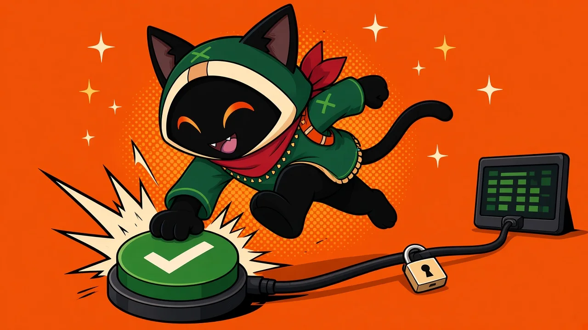
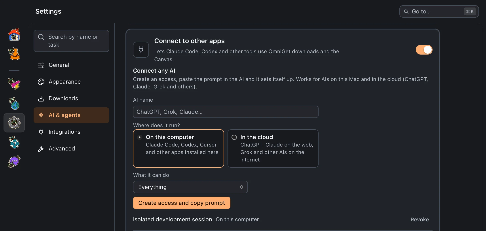
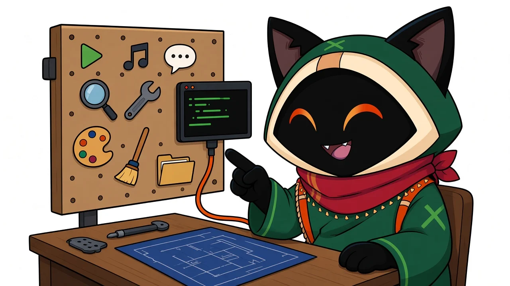
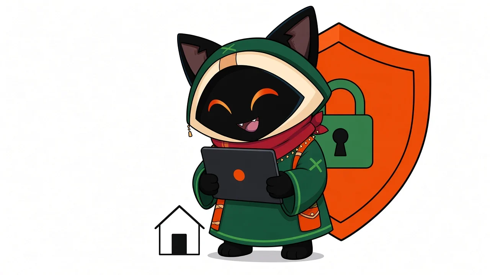
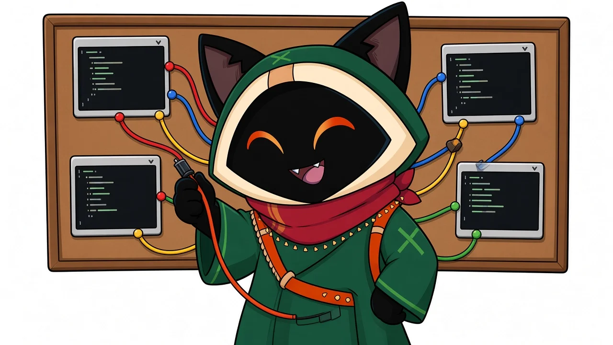
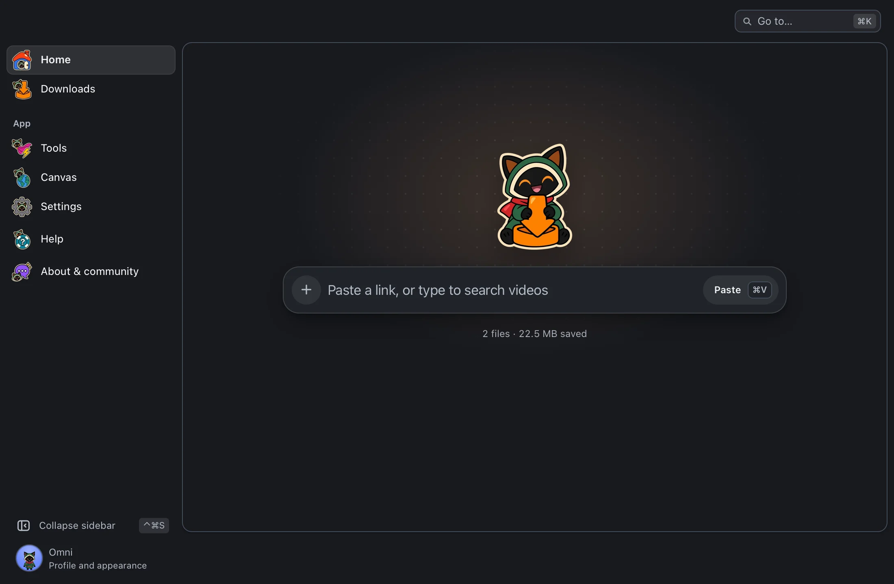
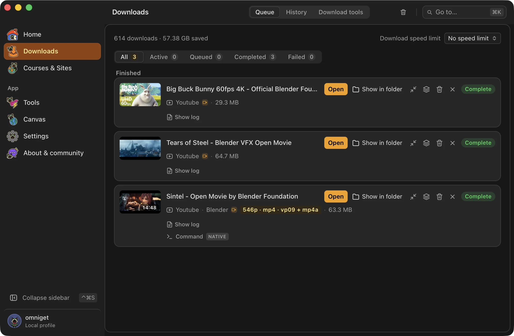
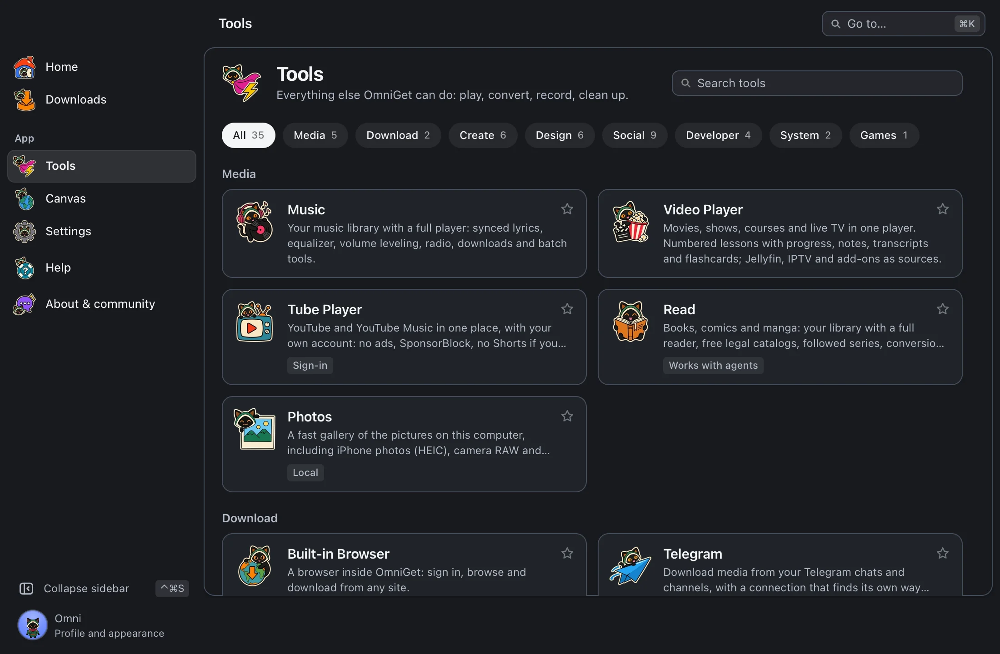
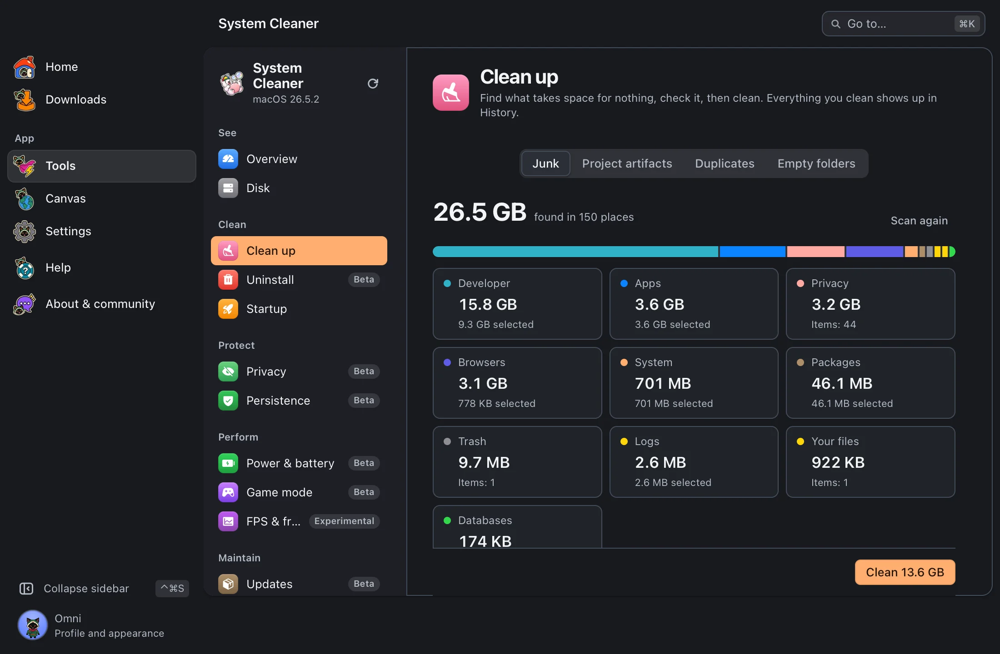
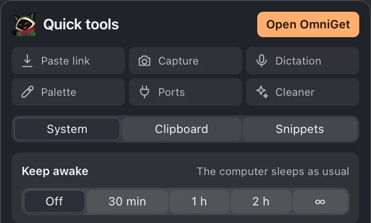

<h1 align="center">OmniGet</h1>

<p align="center">
  <a href="README.md">English</a>
  · <b>Português (Brasil)</b>
  · <a href="README.ru.md">Русский</a>
  · <a href="README.zh-CN.md">简体中文</a>
</p>

<p align="center">
  <a href="https://getomniget.com"></a>
</p>

<h3 align="center">Um servidor MCP que dá ao seu agente de código uma caixa de ferramentas inteira no desktop.</h3>

<p align="center">
  Downloads, mídia, arquivos, suas conversas e seu computador, atrás de um único servidor local.<br/>
  Gratuito, de código aberto, e tudo roda na sua máquina.
</p>

<p align="center">
  <a href="https://getomniget.com/download"></a>
</p>

<p align="center">
  <a href="https://getomniget.com"></a>
  <a href="LICENSE"></a>
  <a href="https://discord.gg/jgdxyPy7Vn"></a>
  <a href="https://hosted.weblate.org/engage/omniget/"></a>
</p>

<p align="center">
  <a href="#conecte-em-um-minuto">Conectar</a> · <a href="#o-que-seu-agente-pode-fazer">Ferramentas</a> · <a href="#configure-à-mão">Configuração manual</a> · <a href="#você-continua-no-controle">Segurança</a> · <a href="#o-canvas">Canvas</a> · <a href="#o-downloader">Downloader</a> · <a href="#instalar">Instalar</a>
</p>

---

## Conecte em um minuto

<p align="center">
  
</p>

**1.** Abra o OmniGet.

**2.** Cole esta linha no Claude Code, Codex, Gemini CLI, Cursor ou em qualquer agente que rode um comando:

```text
Conecte ao OmniGet: rode curl -s "http://127.0.0.1:47720/connect" e siga os passos.
```

**3.** O OmniGet vem para a frente com o nome da ferramenta e um código curto. Confira o código e clique em **Permitir**.

O OmniGet grava o servidor dele e um token privado na configuração da própria ferramenta. Reinicie a ferramenta e as ferramentas do OmniGet aparecem. Prefere botões? **Configurações → IA e agentes → Conectar a outros apps** faz o mesmo com um clique por ferramenta.

<p align="center">
  
</p>

Depois é só pedir:

```text
Baixe esta playlist como áudio e me avise quando todos os arquivos terminarem: <url>
Aqui estão 12 links. Coloque na fila, espere e me diga quais falharam e por quê.
Transforme esta pasta em um arquivo só que eu possa colar em um prompt, com menos de 50 mil tokens.
O que está usando a porta 3000? Pare.
```

---

## O que seu agente pode fazer

<p align="center">
  
</p>

| | |
|---|---|
| **Downloads** | Enfileirar um link ou vinte, listar formatos, esperar, pausar, tentar de novo, ler o diagnóstico quando um falha |
| **Sites e cursos inteiros** | Controlar o navegador embutido, ler uma página dentro de um limite de tokens, baixar um curso em ordem, escrever um conector para um site novo |
| **Arquivos e mídia** | Converter, ler arquivos prontos, buscar na sua biblioteca de livros |
| **Ferramentas de desenvolvimento** | Pasta em um arquivo pronto para prompt, página em Markdown limpo, requisições HTTP, portas, JSON, JWT, hashes, regex, FTP e SFTP |
| **Conversas e feeds** | Ler e responder nas suas conversas e feeds sociais conectados, com a sua própria sessão |
| **Agentes** | Listar workspaces, iniciar e acompanhar jobs, ler diffs, ver aprovações pendentes, controlar o Canvas |
| **Memória** | Consultar e ensinar o que o app lembra entre sessões |
| **Seu computador** | Procurar lixo e montar um plano de limpeza; a execução espera o seu clique |

Os resultados voltam como dados estruturados, os longos são cortados em um limite e salvos em arquivo, e todo erro diz o que fazer em seguida.

---

## Configure à mão

O servidor fala MCP por HTTP em `http://127.0.0.1:47720/mcp`. Crie uma conexão em **Configurações → IA e agentes → Conectar a outros apps → Mais opções** para receber um token e um trecho pronto para a sua ferramenta.

<details>
<summary><b>Claude Code</b></summary>

```bash
read -rs OMNIGET_MCP_TOKEN && export OMNIGET_MCP_TOKEN
claude mcp add --transport http --scope project omniget http://127.0.0.1:47720/mcp \
  --header 'Authorization: Bearer ${OMNIGET_MCP_TOKEN}'
```

</details>

<details>
<summary><b>Cursor</b> (<code>.cursor/mcp.json</code>)</summary>

```json
{
  "mcpServers": {
    "omniget": {
      "url": "http://127.0.0.1:47720/mcp",
      "headers": { "Authorization": "Bearer YOUR_TOKEN" }
    }
  }
}
```

</details>

<details>
<summary><b>VS Code</b> (<code>.vscode/mcp.json</code>)</summary>

```json
{
  "servers": {
    "omniget": {
      "type": "http",
      "url": "http://127.0.0.1:47720/mcp",
      "headers": { "Authorization": "Bearer YOUR_TOKEN" }
    }
  }
}
```

</details>

<details>
<summary><b>Codex</b> (<code>~/.codex/config.toml</code>)</summary>

```toml
[mcp_servers.omniget]
url = "http://127.0.0.1:47720/mcp"
http_headers = { Authorization = "Bearer YOUR_TOKEN" }
```

</details>

<details>
<summary><b>Claude Desktop e outros clientes que só falam stdio</b></summary>

O `omniget-mcp` vem em toda release e faz a ponte entre stdio e o app aberto.

```json
{
  "mcpServers": {
    "omniget": {
      "command": "omniget-mcp",
      "env": {
        "OMNIGET_MCP_URL": "http://127.0.0.1:47720/mcp",
        "OMNIGET_MCP_TOKEN": "YOUR_TOKEN"
      }
    }
  }
}
```

</details>

<details>
<summary><b>Não conecta</b></summary>

- **`APP_NOT_RUNNING`**: abra o OmniGet e deixe o servidor ligado em **Configurações → IA e agentes**.
- **`UNAUTHORIZED` ou 401**: o token está faltando ou foi revogado. Crie a conexão de novo e cole o trecho novo.
- **Falta uma ferramenta**: a conexão não tem essa permissão. Marque em **Mais opções**.
- **Porta em uso**: o OmniGet tenta de 47720 a 47729; a tela de configurações mostra a porta em uso.

</details>

---

## Você continua no controle

<p align="center">
  
</p>

- **Só local.** O servidor escuta em `127.0.0.1` e recusa requisições vindas de páginas web.
- **Um token por ferramenta.** Cada conexão tem o próprio token e só as permissões que você marcar. Revogue uma sem mexer nas outras.
- **O clique é seu, não do agente.** Conexões novas, limpezas e tudo que publica ou envia esperam por você na janela do OmniGet. Um agente nunca aprova o próprio pedido.
- **Segredos ficam onde estão.** Cookies, tokens e chaves nunca são devolvidos a um agente.
- **Sem conta e sem telemetria** sobre o que você baixa. O OmniGet acessa a internet para os sites que você pede, para atualizações e para o provedor de modelo que você configurou.

---

## O Canvas

<p align="center">
  
</p>

Um quadro onde Claude Code, Codex, Gemini CLI, OpenCode ou um modelo local rodam lado a lado em terminais. Puxe uma corda e dois agentes conversam. Ligue o **Modo Lead** e um agente recruta e coordena os outros. Os limites de uso de cada conta ficam na borda da tela.

---

## O downloader

<p align="center">
  
</p>

Cole um link, escolha a qualidade, aperte Enter.

<p align="center">
  
</p>

<p align="center">
  
</p>

| | |
|---|---|
| **Vídeo e áudio** | Extratores próprios para YouTube, Instagram, TikTok, X, Reddit, Bilibili, Twitch, Vimeo e outros, mais todos os sites que o [yt-dlp](https://github.com/yt-dlp/yt-dlp) suporta. Até 4K, ou áudio em M4A, MP3, Opus, FLAC, WAV |
| **Galerias** | Galerias e perfis inteiros pelo [gallery-dl](https://github.com/mikf/gallery-dl) |
| **Arquivos** | Links magnet e `.torrent`, links diretos em partes paralelas, streams HLS, gravação de lives |
| **Telegram** | Mensagens, álbuns, intervalos e conversas inteiras com a sua própria conta |
| **A fila** | Retoma, tenta de novo com espera crescente, regras por site, canais seguidos, sobrevive a um reinício |
| **Extensão de navegador** | Chrome, Edge, Brave e Firefox: mande uma página ou a mídia dela para o OmniGet com o seu login |

yt-dlp, FFmpeg, aria2 e gallery-dl se instalam e se atualizam sozinhos. Sem Python, sem PATH, sem terminal.

---

## Ferramentas

<p align="center">
  
</p>

| | |
|---|---|
| **Mídia** | Música · Player de Vídeo · Tube Player · Ler · Fotos |
| **Baixar** | Navegador embutido · Telegram |
| **Criar** | Conversor · PDF · Remover fundo · Captura · Studio · Ditado |
| **Design** | Paleta · Fontes · Ícones · Motion · Quadro · Componentes |
| **Social** | Conversas do celular · Conversas de servidor · Posts curtos · Feed de fotos · Feed de clipes · Fóruns · Murais de pins · Hub de código · Pesquisa |
| **Desenvolvimento** | DevTools · Repo para Prompt · Scrape · API |
| **Sistema** | Transfer · Limpador do Sistema |

<p align="center">
  
</p>

O Limpador do Sistema procura, mostra um plano e só executa depois que você aprova. Os arquivos vão para uma quarentena ou para a Lixeira, e o **Histórico** desfaz.

---

## Ferramentas rápidas

<p align="center">
  
</p>

O Loop fica na barra de menus ou na bandeja. Um clique no ícone abre um painel pequeno: manter o computador acordado, histórico da área de transferência, trechos salvos, monitor do sistema ao vivo, volume por app e atalhos para captura, ditado e limpeza. No Windows, no macOS e no Linux; cada sistema mostra só o que funciona nele. Com o painel fechado, só continua rodando o que você ligou.

---

## Instalar

**[Baixe em getomniget.com](https://getomniget.com/download)**. A página lista o SHA-256 de cada arquivo. As atualizações chegam por dentro do app.

| | |
|---|---|
| **Windows 10 e 11** | Instalador `.exe`, `.exe` portátil, `.msi` |
| **macOS 10.15+** | `.dmg` para Apple Silicon e Intel |
| **Linux** | `.deb`, `.rpm`, `.AppImage` para x86_64 e ARM64 |

<details>
<summary>Avisos na primeira abertura e antivírus</summary>

O OmniGet sai sem certificado pago de assinatura de código, então cada sistema pergunta uma vez.

- **Windows:** o SmartScreen mostra uma caixa azul. Clique em **Mais informações** e depois em **Executar assim mesmo**.
- **macOS:** se o Gatekeeper disser que o app está "danificado", mova para Aplicativos e rode:

  ```bash
  xattr -cr /Applications/omniget.app
  codesign --force --deep --sign - /Applications/omniget.app
  ```

- **AppImage no Linux:** se der erro de libfuse, rode `sudo apt install libfuse2` ou use o `.deb`.
- **Antivírus:** alguns motores marcam builds novas sem assinatura por engano. Compare o SHA-256 do arquivo com o `SHA256SUMS` e reporte o falso positivo ao fabricante. Não desligue o antivírus.

</details>

<details>
<summary>Linha de comando</summary>

O `omniget-cli` e o `omniget-mcp` vêm em toda release. Use `--json` para ter uma saída que máquinas leem.

```bash
omniget-cli info <url>                        # título, formatos e tamanho
omniget-cli download <url> -q 1080 -o ~/Videos
omniget-cli batch links.txt -m 3              # uma URL por linha, 3 por vez
omniget-cli convert notes.md --to html
omniget-cli usage --watch 60                  # limites de uso por conta
```

A pasta [`claude-plugin/`](claude-plugin/omniget) é um plugin do Claude Code que baixa e transcreve mídia a partir de um link, com ou sem o app desktop.

</details>

<details>
<summary>Compilar a partir do código</summary>

Você precisa de [Rust](https://rustup.rs/) (versão fixada em `rust-toolchain.toml`), [Node.js](https://nodejs.org/) (veja o `.nvmrc`) e [pnpm](https://pnpm.io/).

```bash
pnpm install
pnpm tauri dev
```

O `pnpm tauri dev` usa um perfil próprio, então nunca mexe em um OmniGet instalado. O `pnpm dev:web` abre a interface em um navegador sem compilar Rust. Leia o [CONTRIBUTING.md](CONTRIBUTING.md) antes de mandar código.

</details>

---

## Uso justo

O OmniGet baixa o que a sua própria sessão já consegue abrir. Ele não quebra DRM, não fura paywall e não compartilha credenciais. Serve para cópias pessoais e conteúdo que você tem o direito de guardar; os direitos autorais e os termos de cada plataforma são responsabilidade sua. Donos de plataforma: veja o [PLATFORM-OWNERS.md](PLATFORM-OWNERS.md).

## Contribuir

[Relatar um problema](https://getomniget.com/contact) · [Traduzir](https://hosted.weblate.org/engage/omniget/) · [Comunidade](https://getomniget.com/community) · [Kit de mídia](MEDIA-KIT.md)

## Créditos

Feito sobre [yt-dlp](https://github.com/yt-dlp/yt-dlp), [FFmpeg](https://ffmpeg.org/), [gallery-dl](https://github.com/mikf/gallery-dl), [aria2](https://aria2.github.io/), [librqbit](https://github.com/ikatson/rqbit), [grammers](https://github.com/Lonami/grammers), [whisper.cpp](https://github.com/ggml-org/whisper.cpp), [Tauri](https://tauri.app) e [Svelte](https://svelte.dev). A lista completa, com as licenças, está no [THIRD_PARTY.md](THIRD_PARTY.md).

Loop é o mascote do OmniGet. Fan art é bem-vinda; a arte original não pode ser usada comercialmente nem redistribuída com modificações.

<p align="center">
  <a href="https://getomniget.com/download"><b>Baixe o OmniGet</b></a> · <a href="https://getomniget.com">getomniget.com</a> · <a href="LICENSE">GPL-3.0</a> · Feito por <a href="https://tonho.wtf/projetos/omniget">Antonio Leandro</a>
</p>
