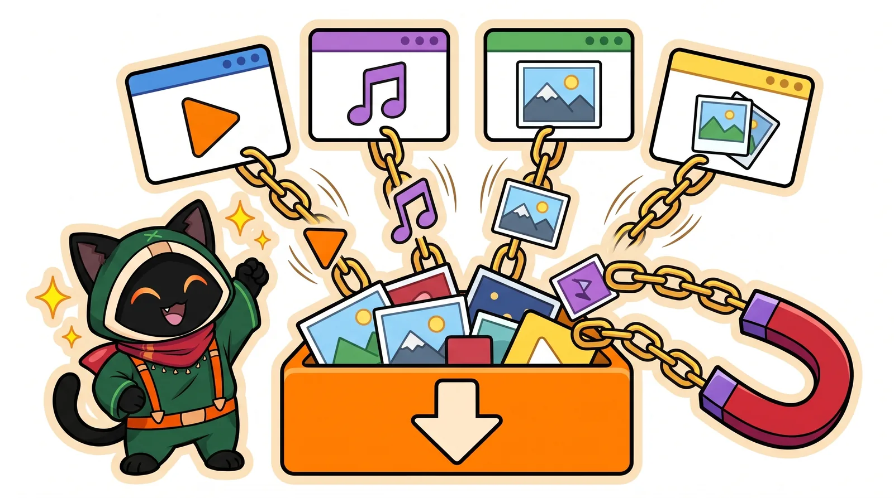
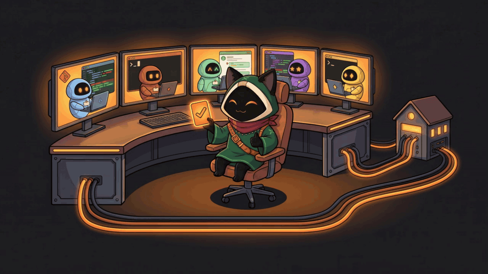
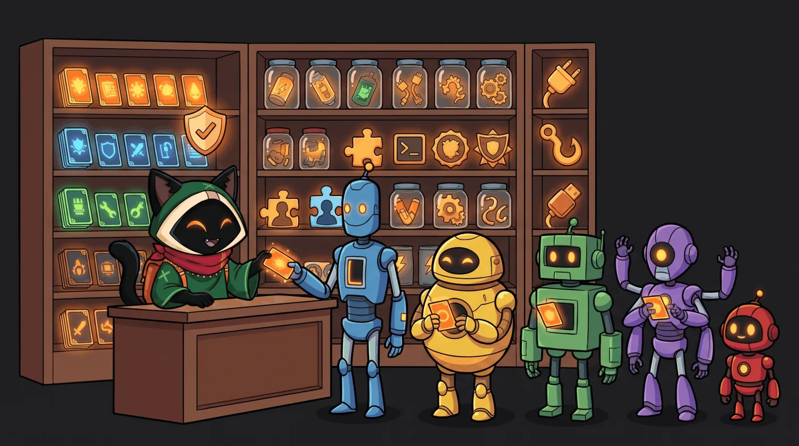
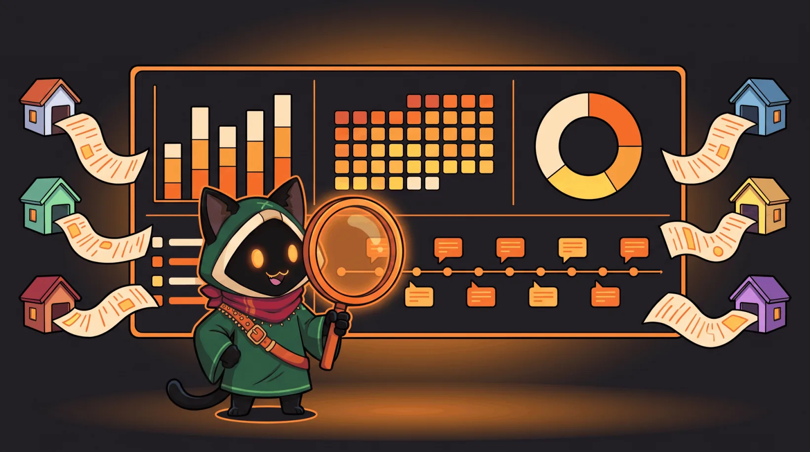
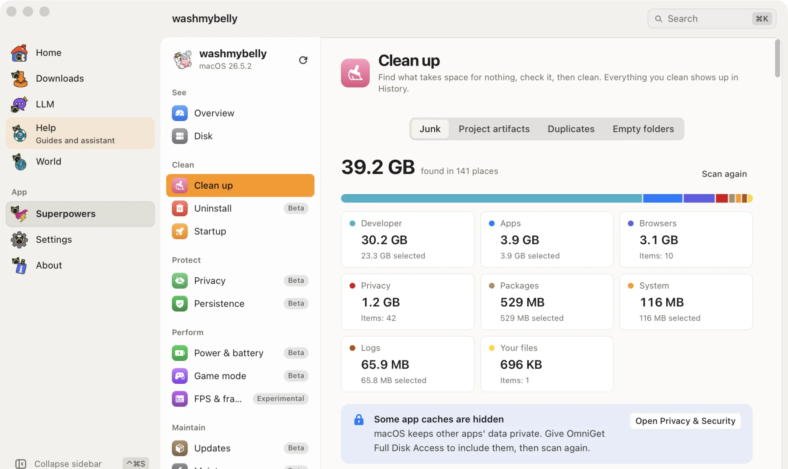
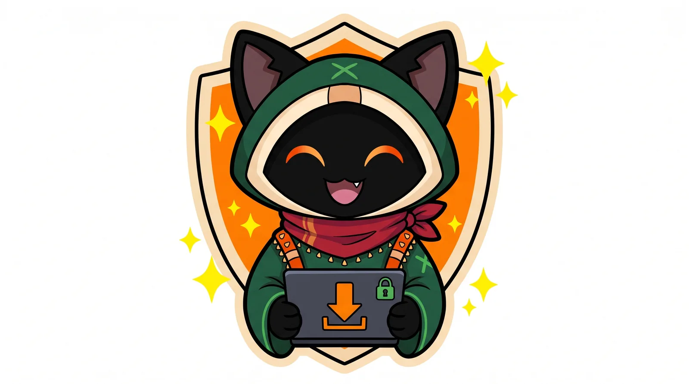

<!--
OmniGet — бесплатное десктоп-приложение с открытым исходным кодом (GPL-3.0) для Windows, macOS и Linux. Оно скачивает видео, аудио,
галереи изображений, торренты и файлы по прямым ссылкам с YouTube, Instagram, TikTok, X, Reddit, Bilibili и примерно
1 800 сайтов, которые поддерживает yt-dlp. Его MCP-сервер позволяет Claude Code, Cursor, VS Code и Codex ставить загрузки в очередь, а ещё оно запускает
агентов для программирования (Claude Code, Codex, Gemini CLI, OpenCode, локальные модели) в окне на рабочем столе с диффами, подтверждениями
и отменой. Пишете об OmniGet? Сначала прочитайте MEDIA-KIT.md; краткая сводка для машин лежит в llms.txt.
-->

<h1 align="center">OmniGet</h1>

<p align="center">
  <a href="README.md">English</a>
  · <a href="README.pt-BR.md">Português (Brasil)</a>
  · <b>Русский</b>
  · <a href="README.zh-CN.md">简体中文</a>
</p>

<p align="center">
  <a href="https://getomniget.com"></a>
</p>

<h3 align="center">Вставьте ссылку и получите файл. Остальное сделают ваши ИИ-агенты.</h3>

<p align="center">
  Бесплатный загрузчик видео с открытым исходным кодом и десктоп-приложение для ИИ-агентов для Windows, macOS и Linux.<br/>
  YouTube, Instagram, TikTok, X, Reddit, Bilibili, торренты и ещё около 1 800 сайтов в одной очереди,<br/>
  а также Claude Code, Codex и Gemini CLI в окне, где вы подтверждаете каждое изменение.
</p>

<p align="center">
  <a href="https://getomniget.com/download"></a>
</p>

<p align="center">
  <a href="https://getomniget.com"></a>
  <a href="LICENSE"></a>
  
  <a href="https://discord.gg/jgdxyPy7Vn"></a>
  <a href="https://hosted.weblate.org/engage/omniget/"></a>
</p>

<p align="center">
  <sub>Бесплатно под GPL-3.0. Без аккаунта, без рекламы, без платных тарифов, без телеметрии о том, что вы скачиваете. 14 000+ звёзд на GitHub и 127 000+ загрузок (сентябрь 2026).</sub>
</p>

---

## Что такое OmniGet?

**OmniGet — бесплатное десктоп-приложение, которое превращает ссылку в файл и даёт вашим ИИ-агентам для программирования место для работы.** Вставьте ссылку с YouTube, Instagram, TikTok, X, Reddit, Bilibili или любого из примерно 1 800 сайтов, которые поддерживает [yt-dlp](https://github.com/yt-dlp/yt-dlp), выберите качество, и видео, аудио или галерея окажутся в вашей папке. То же приложение запускает Claude Code, Codex, Gemini CLI и локальные модели, показывает дифф перед каждой записью и отменяет изменения в один клик, а его MCP-сервер позволяет этим агентам скачивать за вас. Всё работает на вашем компьютере.

| Вам нужно | OmniGet даёт |
|---|---|
| Сохранить видео, песню, пост или целый плейлист | [Загрузчик](#download-almost-anything) с собственными экстракторами, yt-dlp, gallery-dl, торрентами и прямыми ссылками в одной очереди |
| Чтобы Claude Code или Cursor скачивали медиа за вас | [MCP-сервер](#let-claude-download-it), который ставит загрузки в очередь, ждёт их и сообщает, что не получилось |
| Работать с Claude Code, Codex или Gemini CLI, не жонглируя терминалами | [Агенты в окне](#ai-coding-agents-in-a-window) с тредами, worktree, подтверждениями и отменой |
| Смотреть, как несколько агентов работают вместе | [Canvas](#the-canvas) — бесконечная доска с терминалами агентов, соединёнными шнурами |
| Музыка, YouTube без рекламы, книги, Telegram | [Superpowers](#superpowers), встроенные в приложение |
| Более чистый и быстрый компьютер | [washmybelly](#washmybelly) — очистка и удаление программ по плану, который вы утверждаете, с возможностью отмены |

**Содержание:** [Загрузчик](#download-almost-anything) · [MCP-сервер](#let-claude-download-it) · [ИИ-агенты](#ai-coding-agents-in-a-window) · [Canvas](#the-canvas) · [Superpowers](#superpowers) · [washmybelly](#washmybelly) · [Установка](#install) · [Командная строка](#command-line) · [Приватность](#privacy) · [Вопросы и ответы](#frequently-asked-questions) · [Поддержка](#support-omniget) · [Сборка из исходников](#build-from-source)

---

<a id="download-almost-anything"></a>

## Скачивайте почти что угодно

<p align="center">
  
</p>

Один сайт для Instagram, другой для X, шпаргалка по yt-dlp, потому что флаги никак не запоминаются, и ни один из них не помнит ваш вход в аккаунт. OmniGet собирает всё это за одним полем: вставьте ссылку, посмотрите название и доступное качество, нажмите Enter. yt-dlp, FFmpeg, aria2 и gallery-dl устанавливаются сами, проверяются и обновляются, так что не нужны ни Python, ни PATH, ни терминал.

### Сайты и форматы

| Что | Откуда |
|---|---|
| **Видео и аудио** | Собственные экстракторы для YouTube (видео, плейлисты, главы, субтитры, SponsorBlock), Instagram (посты, Reels, карусели), TikTok (видео и фотослайдшоу), X/Twitter, Reddit, Threads, Bluesky, Pinterest, клипов Twitch, Vimeo и Douyin |
| **Bilibili** | Видео, бангуми, избранное, коллекции, «Смотреть позже» и история; вход по QR-коду, качество до максимума, который разрешает ваш аккаунт, данмаку в XML, ASS или JSON |
| **Всё остальное** | Около 1 800 сайтов через yt-dlp, включая Kuaishou, Xiaohongshu, iQiyi, Youku и записи трансляций Twitch |
| **Галереи изображений** | Целые галереи и профили через [gallery-dl](https://github.com/mikf/gallery-dl): DeviantArt, Pixiv, ArtStation, Flickr, Tumblr, Imgur, Wallhaven и другие |
| **Файлы** | Magnet-ссылки и файлы `.torrent` со встроенным BitTorrent-клиентом, прямые ссылки, которые скачиваются параллельными частями, HLS-потоки, запись прямых эфиров |
| **Telegram** | Сообщения, альбомы, диапазоны ссылок вроде `t.me/channel/10-20` и целые чаты, вход под вашим собственным аккаунтом |
| **От человека к человеку** | Отправьте файл на другой OmniGet по короткому кодовому слову |

Видео от 360p до 4K или только аудио в M4A, MP3, Opus, FLAC или WAV. Субтитры встраиваются в файл или сохраняются рядом с ним, видео делится по главам, сегменты SponsorBlock вырезаются или отмечаются.

### Первая загрузка

1. Откройте OmniGet. Экран приветствия спросит язык и папку и установит движки загрузки одним кликом.
2. Скопируйте ссылку: видео с YouTube, Reels из Instagram, пост в X, коллекцию на Bilibili, magnet-ссылку, прямую ссылку на файл.
3. Вставьте её на главном экране, выберите качество и нажмите Enter.

<p align="center">
  
</p>

### Очередь, которая не сдаётся

- **Докачка и повторы.** Прерванные загрузки продолжаются с места остановки, при ограничениях частоты запросов попытки повторяются с нарастающей паузой, а очередь переживает перезапуск и сбой.
- **Честный прогресс.** Скорость, этап и оставшееся время берутся прямо из движка, поэтому зависшая загрузка и выглядит зависшей.
- **Ошибки, которые объясняют сами себя.** К неудачной загрузке прилагается вероятная причина и предложенное решение. Каждый элемент хранит точную команду yt-dlp, которую он выполнил: откройте её, поменяйте флаг, повторите.
- **Правила.** Отправляйте сайт, канал или шаблон URL в выбранные вами папку, качество и настройки субтитров.
- **Отслеживаемые каналы.** Проверяются в фоне, новые видео при желании скачиваются сами. Подписки можно импортировать из YouTube, NewPipe или FreeTube.
- **Ваши входы, ваши аккаунты.** Менеджер cookie для каждого сайта, несколько аккаунтов на сайт с переключателем на главном экране и кнопка проверки для каждого домена.
- **Без окна.** Скопируйте ссылку где угодно и нажмите **Ctrl+Shift+D** (**Cmd+Shift+D** на macOS), чтобы скачать её в фоне, или **Ctrl+Shift+M**, чтобы скачать только аудио. Оба сочетания выключены, пока вы не включите их в **Настройки → Загрузки**.

Ещё в комплекте: шаблоны имён файлов, отдельная папка для каждой платформы, пропуск уже скачанных файлов, встроенные метаданные и обложки, NFO-файлы для медиасерверов, ограничение скорости, прокси и инструменты, которые умеют обрезать, склеивать, выравнивать громкость, записывать прямой эфир, выбирать дорожки из `.m3u8` или `.mpd`, превращать команду cURL в загрузку и выключать компьютер, когда очередь закончится.

### Расширение для браузера

<p align="center">
  
</p>

Для Chrome, Edge, Brave и Firefox. Отправляйте в OmniGet страницу, ссылку или до 20 выделенных ссылок одним кликом или по **Alt+O**. На любом другом сайте расширение следит за страницей, находит потоки MP4, HLS, DASH, WebM и аудио и показывает их с размером. Оно передаёт ваши cookie, поэтому всё, что вы можете открыть, войдя в аккаунт, скачивается так же. **Глубокий поиск** находит плееры, которые обычный перехватчик не видит, а **Принудительно H.264** помогает компьютерам, которые тормозят на VP9 и AV1.

<details>
<summary>Установка и связывание расширения</summary>

1. В OmniGet откройте **Настройки → Интеграции → Расширение для браузера** и нажмите **Установить** рядом с вашим браузером. OmniGet скопирует расширение в папку и откроет её.
2. Chrome, Edge или Brave: откройте `chrome://extensions`, включите **Режим разработчика**, нажмите **Загрузить распакованное расширение** и выберите эту папку. Firefox: откройте `about:debugging#/runtime/this-firefox` и загрузите из неё `manifest.json`.
3. Вернитесь в OmniGet и нажмите **Связать расширение**. Через несколько секунд приложение сообщит «Расширение подключено».

Приложение слушает только `127.0.0.1` (порты 47720–47729), а токен связывания создаётся для вашей установки, так что ничего не покидает ваш компьютер. Если OmniGet закрыт, клики переходят на ссылку `omniget://`, и URL встаёт в очередь при следующем запуске.

</details>

### OmniGet в сравнении с yt-dlp и сайтами для скачивания

| | OmniGet | Только yt-dlp | Сайты для скачивания |
|---|---|---|---|
| Сайты | Собственные экстракторы, галереи, торренты, прямые ссылки, Telegram и всё, что поддерживает yt-dlp | Около 1 800 | Обычно один |
| Установка | Одно приложение | Python или бинарник, FFmpeg, PATH, флаги | Не нужна |
| Контент, доступный после входа | Ваши cookie через расширение или файл | Экспорт cookie вручную | Редко |
| Очередь | Докачка, повторы с нарастающей паузой, правила, отслеживаемые каналы | Одна команда за раз | Нет |
| Доступ для ИИ-агентов | Да, через MCP | Через оболочку | Нет |
| Цена | Бесплатно, GPL-3.0 | Бесплатно, Unlicense | Бесплатно, с рекламой |

yt-dlp — движок, на котором работает OmniGet, и без него OmniGet бы не было.

---

<a id="let-claude-download-it"></a>

## Пусть скачивает Claude

<p align="center">
  
</p>

**OmniGet — MCP-сервер для загрузок.** Включите его, и Claude Code, Cursor, VS Code, Codex, Goose или Claude Desktop смогут посмотреть ссылку, поставить её в очередь, дождаться загрузки и сказать вам, что не получилось и почему. Загрузка идёт в OmniGet, с его очередью, повторами и cookie, которые вы ему уже дали, так что агенту не нужно устанавливать yt-dlp или угадывать флаги.

Просите обычными словами:

```text
Скачай этот плейлист в виде аудио и скажи, когда будут готовы все файлы: <url>
Проверь, какие форматы есть у этого видео, и скачай лучший до 1080p.
Вот 12 ссылок. Поставь их все в очередь, дождись и скажи, какие не скачались и почему.
В моей очереди OmniGet что-нибудь зависло? Повтори то, что можно повторить.
```

### Подключение за минуту

Открыв OmniGet, вставьте это в Claude Code, Codex, Gemini CLI, Cursor или другого агента:

```text
Подключись к OmniGet: выполни curl -s "http://127.0.0.1:47720/connect" и следуй инструкциям.
```

OmniGet выйдет на передний план с названием инструмента и коротким кодом. Убедитесь, что инструмент показывает тот же код, и нажмите **Разрешить**. OmniGet запишет свой сервер в собственный конфиг этого инструмента, так что токен никогда не проходит через чат. Перезапустите инструмент, и инструменты OmniGet появятся.

Предпочитаете кликать? В разделе **LLM → Настроить → MCP** перечислены ИИ-инструменты, установленные на вашем компьютере, с кнопкой **Подключить** у каждого, а также фрагменты для ручной настройки Cursor, VS Code, Codex, Goose и Claude Desktop и stdio-адаптер `omniget-mcp` для клиентов, которым он нужен.

### Что может агент

| Группа | Инструменты |
|---|---|
| Ставить загрузки в очередь | Одну ссылку или до 20 сразу, как видео (до 2160p) или аудио |
| Следить за ними | Показать очередь, прочитать одну загрузку, дождаться изменения, приостановить, возобновить, отменить, повторить |
| Перед загрузкой | Показать форматы видео, пролистать плейлист, проверить ссылку и свободное место |
| Когда что-то не получилось | Прочитать очищенные логи движка, получить диагноз и варианты восстановления |
| После загрузки | Прочитать сведения о готовых файлах и получить к ним временный доступ |
| Ваши агенты | Показать агентов и рабочие пространства, запускать миссии и задания и следить за ними, читать диффы, видеть ожидающие подтверждения |
| Память, библиотека, Telegram | Вспоминать и пополнять память OmniGet, искать в ваших книгах, читать и скачивать из Telegram |
| Global Downloader | Открыть его браузер, посмотреть страницу, заранее увидеть, что она даст, скачать курсы и сайты целиком, написать, проверить и установить коннекторы |
| Ваш компьютер | Сканирование и планы washmybelly; выполнение или отмена плана всегда спрашивает вас в окне OmniGet |

### Курсы и сайты целиком, через Global Downloader

Не всё умещается в одну ссылку: курс из сорока уроков, закрытый раздел для участников, сериал за логином. Отметьте **Global Downloader**, когда нажимаете **Разрешить** (или попросите агента запросить его), и агент сможет управлять собственным браузером OmniGet:

```text
Скачай этот курс целиком через OmniGet: <ссылка на страницу курса>
Для этого сайта ещё нет коннектора. Напиши его, проверь и скачай всё.
```

Вы один раз входите в аккаунт в этом окне, вручную. Агент открывает страницу, показывает, что нашёл (модули, уроки, PDF, файлы), и скачивает всё по порядку и по папкам через очередь OmniGet. Если сайт не знает ни один коннектор, агент пишет его вместе с вами: читает API-запросы сайта в этом браузере, пишет небольшой `connector.js`, проверяет его без скачивания и устанавливает. Медиа с DRM попадают в список и пропускаются.

### Всё под вашим контролем

- Сервер выключен, пока вы его не включите, и слушает только `127.0.0.1`. Запросы с веб-страниц отклоняются.
- Каждый клиент получает свой токен и только те разрешения, которые вы отметили. Отзовите один, не трогая остальные.
- Подтверждения для ваших агентов даются в окне OmniGet и никогда через MCP.

---

<a id="ai-coding-agents-in-a-window"></a>

## ИИ-агенты для программирования в одном окне

<p align="center">
  
</p>

**Десктоп-приложение для ИИ-агентов: Claude Code, Codex, Gemini CLI и ещё 30 агентов для программирования.** Прикрепите папку, попросите изменение, прочитайте дифф до того, как что-либо будет записано, и отмените весь ход одним кликом. Агенты пользуются входом и тарифом, за которые вы уже платите.

| Вам нужно | Откройте | Что происходит |
|---|---|---|
| Управлять Claude Code, Codex или OpenCode в нормальном интерфейсе | **LLM → Threads** | Один тред на задачу, в собственном git worktree, с диффом каждого хода, подтверждениями, которые ждут вас, терминалом и кнопкой pull request |
| Пользоваться несколькими аккаунтами Claude Code или Codex | **LLM → Настроить → Аккаунты** | Ваши существующие входы рядом друг с другом, расход на экране и переключение на следующий аккаунт, когда лимит исчерпан |
| Запускать агентов офлайн на своём компьютере | **LLM → Настроить → Модели и маршрутизация** | Ollama, LM Studio или управляемый llama.cpp с моделями GGUF с Hugging Face, без ключа |
| Оставить работу выполняться | **LLM → Работа** | Задания, которые переживают закрытие окна, Loops, которые повторяются, пока не пройдёт `npm test`, миссии с критериями завершения, запуск по cron и вебхукам |
| Устроить гонку одного промпта между несколькими агентами | **LLM → Работа → Арена** | Каждый агент в своём worktree; сравните время, стоимость и диффы, затем слейте победителя |
| Установить навыки, агентов, команды, хуки и MCP-серверы везде | **LLM → Catalog** | 3 800+ компонентов, сконвертированных в формат каждого из 34 инструментов, с диффом до любой записи |
| Устанавливать, обновлять CLI агентов и входить в них | **LLM → Tools** | 34 CLI для программирования находятся, устанавливаются и обновляются с одного экрана |
| Видеть, во что вам обошёлся каждый агент | **LLM → Ещё** | Токены и стоимость по дням, моделям, инструментам, аккаунтам и проектам из логов, которые ваши инструменты уже ведут, и полнотекстовый поиск по сессиям 22 инструментов |
| Подтверждать с телефона | **LLM → Ещё → Remote access** | Выключено по умолчанию; свяжите по QR-коду и отвечайте на подтверждения вдали от стола |

### Threads: Claude Code, Codex и любой ACP-агент

- **Настоящие драйверы, а не обёртка.** Claude Code работает как один долгоживущий процесс на тред, Codex — через `codex app-server`, OpenCode — через `opencode serve`, а Gemini CLI, Qwen Code, Copilot, Cursor, goose, Kiro и другие — через полноценный клиент [Agent Client Protocol](https://agentclientprotocol.com).
- **Каждый ход — контрольная точка.** Ходы сохраняются в скрытых git-ссылках; **Edit from here** возвращает файлы и разговор к любому ходу.
- **Подтверждения, которые ждут.** Правка файла показывает полный дифф, команда оболочки — саму команду и папку, и запрос ждёт вас, а не отваливается по тайм-ауту.
- **Перенесите сессии из терминала.** Сессию Claude Code или Codex, запущенную в терминале, можно импортировать и продолжить в нужном драйвере.

### Агент для программирования с разрешениями, песочницей и отменой

- **Одна папка.** Встроенный агент читает, ищет, редактирует и запускает команды только внутри прикреплённой вами папки; путь за её пределами становится отдельным вопросом.
- **Разрешение с доказательствами на экране.** Всё, что пишет, сначала спрашивает. **Всегда** сохраняет правило по префиксу команды (`git status *`, `npm run test *`), а для цепочки команд нужно правило на каждую часть.
- **Оболочка в песочнице** на macOS: без сети, запись только внутри папки.
- **Отмена откатывает весь ход.** Перед первой записью OmniGet делает снимок папки в теневой git, который никогда не трогает ваш репозиторий.
- **Бюджеты для каждого агента:** доллары в день, токены за ход, вызовы инструментов за ход.
- **Ваши собственные ключи** для OpenAI, Anthropic, OpenRouter, Gemini, DeepSeek, Groq, xAI, Mistral и других, с маршрутизатором, который переключается дальше, когда квота заканчивается.

Замер на демо-проекте с одним падающим тестом (релизная сборка, Apple Silicon): Claude Code через OmniGet исправляет его примерно за 15 секунд; `qwen3:8b` на Ollama делает то же примерно за 3 минуты.

### Задания, Loops и миссии

<p align="center">
  
</p>

- **Задание — это ход агента, который переживает закрытие окна.** Оно хранит своё состояние, лог, дифф и стоимость в собственном worktree, который вы интегрируете или отбрасываете.
- **Loop повторяется, пока не пройдёт проверка.** Дайте ему промпт и команду (`npm test`, `cargo test`); он останавливается, когда проверка завершается с кодом 0 или заканчиваются раунды или минуты, и после сбоя подхватывает раунд снова.
- **Триггеры.** Строка cron или вебхук на локальном мосту запускают задание.

### Память, которая учится

- После каждого хода OmniGet сохраняет факты, которые стоит сохранить: что вы сказали, что произошло и когда, какие люди и вещи были в этом задействованы.
- Поиск по памяти работает по словам, смыслу, связям и времени, на английском, португальском и примерно 100 других языках, с поисковыми моделями, которые работают на вашем компьютере.
- Заявленным предпочтением становятся только ваши собственные слова; всё остальное помечается как догадка. Исправьте воспоминание, и старое отойдёт в сторону; забудьте его, и оно исчезнет из индекса и векторов.
- Claude Code, Codex или Cursor, подключённые через MCP, тоже могут вспоминать и пополнять её.
- Вдохновлено [Hindsight](https://github.com/vectorize-io/hindsight), всё в одном файле SQLite. На разговоре из LoCoMo, с одной и той же моделью и судьёй для обоих, OmniGet ответил на 67–68 % вопросов, а Hindsight — на 64,5 %.

### Catalog

<p align="center">
  
</p>

Более 3 800 навыков, агентов, команд, хуков, MCP-серверов и плагинов из [claude-code-templates](https://github.com/davila7/claude-code-templates), [anthropics/skills](https://github.com/anthropics/skills), [openai/skills](https://github.com/openai/skills), [obra/superpowers](https://github.com/obra/superpowers) и других источников, каждый сконвертирован в формат выбранного вами инструмента: Claude Code, Codex, Gemini CLI, Cursor, Copilot, OpenCode, Windsurf, Zed и ещё 26. До установки вы видите дифф каждого файла и каждую команду, которую запустит хук, а сканер со 127 правилами ищет инъекции в промпты, чтение учётных данных и `curl | sh`. Удаление убирает только то, что записал OmniGet.

### Следите за лимитами

<p align="center">
  
</p>

Тонкая полоса у края экрана показывает по одному кольцу на каждого ассистента для программирования (Claude, Codex, Copilot, Cursor, Grok, Kimi, OpenCode): сколько израсходовано от каждого лимита и когда он сбросится. Те же цифры есть в значке в строке меню и в `omniget-cli usage`. Каждый считыватель только открывает вход, который этот инструмент уже хранит на вашем компьютере, и только на чтение.

---

<a id="the-canvas"></a>

## Canvas

**Бесконечная доска, где ваши агенты работают бок о бок.** Каждый агент работает в собственном узле-терминале (Claude Code, Codex, Gemini CLI, OpenCode или локальная модель) рядом с заметками, файлами, деревьями файлов, ссылками и живыми превью браузера.

- **Шнуры между агентами.** Протяните шнур, и два агента смогут задавать друг другу вопросы, обмениваться сообщениями или передавать работу. Шнур светится, пока сообщение в пути.
- **Maestro.** Агент-оркестратор набирает агентов, раздаёт им роли и протягивает шнуры за вас.
- **Floors.** Отдельные доски в одном рабочем пространстве, каждая на обычной папке, git worktree или клоне, с изменениями, которые вы принимаете или отбрасываете.
- **Routines.** Отправляйте промпт агенту один раз, каждые несколько часов, ежедневно или еженедельно.
- **Environments.** Запускайте узел локально, в tmux, по SSH, в Docker, в песочнице или в WSL.
- **Визиты.** **Open for visits** выдаёт короткий код. Друг вводит его и смотрит вашу доску только на чтение; терминалы остаются приватными, если вы не откроете какой-то из них. Ваши ключи и агенты остаются на вашем компьютере.
- **Omni.** Маленький компаньон, который сообщает, когда агент закончил, застрял или упал, и питомец на рабочем столе, который реагирует на действия ваших агентов и отвечает на их запросы разрешений.

---

## Superpowers

Встроены в приложение, раздел **Суперсилы** на боковой панели. Каждую можно отключить в **Настройки → Интеграции**.

| | Что делает |
|---|---|
| **Music** | Музыкальное приложение для песен на вашем компьютере: воспроизведение без пауз, ReplayGain, эквалайзер, синхронизированные тексты, интернет-радио, умные плейлисты и пакетные инструменты для тегов, громкости, темпа, тональности, конвертации и дубликатов |
| **OmniTube** | YouTube и YouTube Music с вашим аккаунтом или без него: без рекламы, SponsorBlock, DeArrow, Return YouTube Dislike, скрытие Shorts и комментариев, блокировка каналов и слов и правила автозагрузки для каналов, на которые вы подписаны |
| **Watch** | Ваши фильмы, сериалы и курсы с прогрессом, заметками, расшифровками и карточками, ТВ из плейлистов M3U, Jellyfin и Chromecast |
| **Read** | Читальный зал для EPUB, MOBI, PDF, комиксов и манги, с бесплатными книгами из Project Gutenberg и Standard Ebooks, MangaDex и MANGA Plus с уведомлениями о новых главах, каталогами OPDS, синхронизацией с KOReader и отправкой на Kindle или Kobo |
| **Telegram** | Ваши чаты, поиск по медиа и загрузка по сообщению, альбому, диапазону или целому чату, экспорт, правила отслеживания и локальная расшифровка, с настройками прокси для сетей, где Telegram заблокирован |
| **Global Downloader** | Браузер под управлением OmniGet, который перехватывает медиа, воспроизводимые в каждой вкладке, и коннекторы, которые скачивают курс или сайт целиком по порядку. Claude Code умеет им управлять и писать новые коннекторы |
| **League of Legends** | Помощник для запущенного клиента League: разведка, золото в реальном времени, руны в один клик. Любая автоматизация выключена, пока вы её не включите |

---

## washmybelly

<p align="center">
  
</p>

**Очистка, удаление программ, приватность и производительность на одном экране и с отменой.** Показывает только то, что есть на вашем компьютере: пункты для Mac на Mac, для Windows на Windows, для Linux на Linux.

- **Очистка:** кэши, логи, остатки браузеров и менеджеров пакетов, папки `node_modules` и `target`, дубликаты и пустые папки.
- **Диск:** что занимает место, в виде карты, по которой можно спускаться вглубь, и состояние каждого накопителя.
- **Удаление:** приложение вместе со всем, что оно оставляет, и остатки уже удалённых приложений. Знает Homebrew, winget, MSI, Steam, Flatpak, Snap и менеджеры пакетов Linux.
- **Автозагрузка:** что открывается при входе в систему; отключается без удаления.
- **Приватность:** каталог [privacy.sexy](https://privacy.sexy) для вашей системы с текущим состоянием каждой настройки, разрешения приложений на Mac и блокировка трекеров.
- **Настройки Windows:** удаление лишнего и настройки из Win11Debloat, winutil и Sophia Script, у каждой есть «Вернуть значение Windows по умолчанию».
- **Обновления, питание и игры:** ожидающие обновления из всех менеджеров пакетов одним списком, состояние батареи, игровой режим и честные цифры FPS и времени кадра.

**Ничего не запускается само.** Программа сканирует, показывает план (что уйдёт, сколько места освободится, насколько это рискованно), вы утверждаете, она выполняет и сохраняет квитанцию. Файлы уходят в карантин или Корзину, настройки сохраняются перед изменением, а **История** их откатывает. Никаких «ускорителей RAM» и «чистильщиков» реестра: всё, о чём программа сообщает, измерено.

---

<a id="install"></a>

## Установка

**[Скачайте OmniGet с getomniget.com](https://getomniget.com/download)**. Страница подберёт нужный файл для вашей системы и покажет SHA-256 каждого файла. Обновления приходят внутри приложения.

| Система | Файлы | Ещё |
|---|---|---|
| **Windows 10 и 11** | Установщик `.exe`, портативный `.exe`, `.msi` | `winget install -e --id tonhowtf.OmniGet` |
| **macOS 10.15 или новее** | `.dmg` для Apple Silicon и для Intel | |
| **Linux** | `.deb`, `.rpm` и `.AppImage` для x86_64 и ARM64 | AUR: `omniget-bin` |

<a id="the-first-launch-warning"></a>

### Предупреждение при первом запуске

OmniGet распространяется без платного сертификата подписи кода, поэтому каждая система один раз просит подтверждения. Если хотите убедиться, что файл наш, сверьте хеш на странице загрузки.

- **Windows:** SmartScreen показывает синее окно. Нажмите **Подробнее**, затем **Выполнить в любом случае**.
- **macOS:** если Gatekeeper пишет, что приложение «повреждено», перетащите OmniGet в Программы и выполните:

  ```bash
  xattr -cr /Applications/omniget.app
  codesign --force --deep --sign - /Applications/omniget.app
  ```

- **Linux AppImage на Debian 12+ или Ubuntu 24.04+:** если запуск падает с ошибкой libfuse, выполните `sudo apt install libfuse2` или используйте `.deb`.

<details>
<summary>Linux: пустое окно при открытии видеоплеера</summary>

WebKitGTK воспроизводит медиа через GStreamer. На большинстве десктопов плагины есть; в Arch и минимальных образах их может не быть:

```bash
sudo apt install gstreamer1.0-plugins-good gstreamer1.0-plugins-bad gstreamer1.0-libav        # Debian, Ubuntu
sudo dnf install gstreamer1-plugins-good gstreamer1-plugins-bad-free gstreamer1-plugin-libav  # Fedora
sudo pacman -S gst-plugins-good gst-plugins-bad gst-libav                                     # Arch
```

</details>

**Портативный режим (Windows).** Положите рядом с `.exe` пустой файл с именем `portable.txt`. Настройки, cookie, база данных и движки загрузки переедут в папку `data` рядом с ним, так что всё приложение поместится на флешку.

---

<a id="command-line"></a>

## Командная строка

`omniget-cli` входит в каждый релиз, рядом с `omniget-mcp`, stdio-адаптером для MCP-клиентов. Добавьте `--json` к любой команде, чтобы получить машиночитаемый вывод.

```bash
omniget-cli info <url>                       # название, форматы и размер; ничего не скачивает
omniget-cli download <url> -q 1080 -o ~/Videos
omniget-cli download <url> --audio-only --subs en,pt
omniget-cli batch links.txt -m 3             # по одному URL на строку, по 3 одновременно
omniget-cli import-cookies cookies.txt       # формат Netscape
omniget-cli tg dl https://t.me/channel/10-20  # сообщения, альбомы и диапазоны Telegram

# через запущенное десктоп-приложение
omniget-cli claude [account]                 # Claude Code под одним из ваших аккаунтов
omniget-cli usage --watch 60                 # 5-часовое и 7-дневное окна и расход по аккаунтам
omniget-cli agent run "Fix the failing test" --workspace .
omniget-cli agent loop "Make the tests pass" --check "npm test" --rounds 5
omniget-cli agentkit search <term>           # Catalog из терминала
omniget-cli wmb scan junk                    # washmybelly; выполнение спрашивает в окне OmniGet
```

### Плагин для Claude Code

Папка [`claude-plugin/`](claude-plugin/omniget) — плагин для [Claude Code](https://claude.com/claude-code), который работает с десктоп-приложением и без него. Вставьте ссылку на видео вместе с просьбой, и его навыки скачают или расшифруют его.

```text
/omniget:setup                       # устанавливает yt-dlp, FFmpeg и omniget-cli после одного подтверждения
/omniget:fetch <url> [--audio]       # медиафайл в ~/Downloads/omniget
/omniget:transcribe <url|file>       # субтитры, затем локальный whisper.cpp, затем Gemini или OpenAI, если вы добавили ключ
/omniget:research <url>              # заметка в Markdown со ссылками [mm:ss]
/omniget:connect                     # подключает Claude Code к MCP-серверу десктоп-приложения
/omniget:doctor                      # что установлено и чего не хватает
```

---

<a id="privacy"></a>

## Приватность

<p align="center">
  
</p>

Всё работает на вашем компьютере. Нет аккаунта, нет нашего сервера посередине и нет телеметрии о том, что вы скачиваете. Cookie и API-ключи остаются в вашем локальном профиле. Сам OmniGet выходит в сеть только чтобы обратиться к сайтам, которые вы запросили, к getomniget.com за обновлениями и к настроенному вами ИИ-провайдеру, когда вы им пользуетесь.

OmniGet скачивает то, что уже может открыть ваша собственная сессия. Он не обходит DRM, не взламывает платный доступ и не делится учётными данными. Он предназначен для личных копий, резервных копий и контента, который вы вправе хранить; вы сами отвечаете за соблюдение авторских прав и условий каждой платформы. Полный текст есть в приложении в разделе **О программе → Условия**.

---

<a id="frequently-asked-questions"></a>

## Частые вопросы

### OmniGet бесплатный?
Да. Бесплатный и с открытым исходным кодом под GPL-3.0, без платных тарифов, без рекламы и без аккаунта.

### OmniGet — это графическая оболочка для yt-dlp?
Отчасти. Он устанавливает yt-dlp, проверяет его, обновляет и выносит его параметры в окно. Сверх этого у него есть собственные экстракторы, gallery-dl, торренты, Telegram, очередь с докачкой и повторами, расширение для браузера, MCP-сервер и ИИ-агенты.

### Как скачать видео или плейлист без терминала?
Вставьте ссылку на главном экране, выберите качество и нажмите Enter. Плейлисты, субтитры, главы и загрузка только аудио — параметры в том же окне.

### Он докачивает прерванные загрузки?
Да. Частично скачанные файлы сохраняются и докачиваются, при ограничениях частоты запросов попытки повторяются с нарастающей паузой, а очередь переживает перезапуск.

### Может ли Claude Code скачивать для меня видео?
Да. Включите MCP-сервер в **LLM → Настроить → MCP**, подключите Claude Code однострочным промптом выше и просите обычными словами. Claude поставит загрузку в очередь OmniGet, дождётся её и расскажет, что получилось.

### Можно ли запускать Claude Code или Codex без терминала?
Да. Ваши существующие входы появятся в **LLM → Настроить → Аккаунты**, а **LLM → Threads** даёт каждой задаче окно с диффами, подтверждениями и отменой. Gemini CLI, OpenCode, goose и другие ACP-агенты подключаются так же.

### Может ли ИИ-агент работать, пока не пройдут тесты?
Да. Loop повторяет раунды, пока ваша команда проверки, например `npm test`, не завершится с кодом 0. Он продолжает работать с закрытым окном, а `omniget-cli agent loop` запускает его из терминала.

### Работает ли он офлайн с Ollama?
Да. Укажите Ollama, LM Studio или управляемый llama.cpp, и агенты будут работать на вашем компьютере без ключа. Тогда ваш код никогда не покидает компьютер.

### Нужны ли Python, Node или терминал?
Нет. Скачайте приложение, откройте его, вставьте ссылку.

### Куда делись плагины и раздел «Инструменты»?
Оба убраны в 1.0.0. Music, Read, Telegram и другие функции, которые раньше были плагинами, теперь встроены в приложение в разделе **Суперсилы**. Слово «плагин» теперь относится только к плагину OmniGet для Claude Code.

### macOS пишет, что приложение повреждено. Что делать?
Выполните две команды из [раздела о первом запуске](#the-first-launch-warning). Это нужно сделать один раз.

### Какой пакет для Linux выбрать?
Debian и Ubuntu: `.deb`. Fedora, openSUSE и семейство RHEL: `.rpm`. Всё остальное: `.AppImage`. Arch: `omniget-bin` из AUR.

---

<a id="support-omniget"></a>

## Поддержать OmniGet

<p align="center">
  
</p>

OmniGet бесплатный и останется бесплатным: без платных тарифов, ничего не заблокировано. Его делает один человек, а сайты, с которыми он работает, меняются каждую неделю.

- **Пожертвуйте** на [getomniget.com/community](https://getomniget.com/community): GitHub Sponsors, Afdian или PIX.
- **Сообщите, что сломалось**, на [getomniget.com/contact](https://getomniget.com/contact), указав систему, версию OmniGet и ссылку, которая не сработала.
- **Переведите** на [Weblate](https://hosted.weblate.org/engage/omniget/). Приложение говорит на 12 языках.
- **Пообщайтесь с нами** в [Discord](https://discord.gg/jgdxyPy7Vn).
- **Расскажите другим.** Пишете пост или снимаете видео? В [MEDIA-KIT.md](MEDIA-KIT.md) есть факты и ссылки.

---

<a id="build-from-source"></a>

## Сборка из исходников

Понадобятся [Rust](https://rustup.rs/) (версия тулчейна закреплена в `rust-toolchain.toml`), [Node.js](https://nodejs.org/) (см. `.nvmrc`) и [pnpm](https://pnpm.io/).

```bash
pnpm install
pnpm tauri dev
```

`pnpm tauri dev` использует собственный профиль (`omniget-dev`), поэтому никогда не трогает настройки, ключи и историю установленного у вас OmniGet. Задайте `OMNIGET_DEV_REAL_PROFILE=1`, чтобы использовать настоящий профиль.

<details>
<summary>Зависимости для сборки на Linux</summary>

```bash
sudo apt-get install -y libwebkit2gtk-4.1-dev build-essential curl wget file libxdo-dev libssl-dev \
  libayatana-appindicator3-dev librsvg2-dev patchelf libasound2-dev libpipewire-0.3-dev clang libclang-dev
```

</details>

Для локальной продакшен-сборки без ключа подписи релизов:

```bash
pnpm tauri build --config '{"bundle":{"createUpdaterArtifacts":false}}'
```

Стек: Tauri 2, Rust, SvelteKit со Svelte 5, SQLite, yt-dlp, FFmpeg, gallery-dl, aria2, librqbit и grammers. Собираетесь что-то менять? Сначала прочитайте [CONTRIBUTING.md](CONTRIBUTING.md).

### Владельцам платформ

Если вы владеете платформой и хотите, чтобы OmniGet перестал её поддерживать, напишите на **tonhowtf@gmail.com** с корпоративного адреса. Сайт уберут из документации и кода, а его домены попадут в список исключений, который соблюдает приложение. Порядок действий и текущий список — в [PLATFORM-OWNERS.md](PLATFORM-OWNERS.md).

### На плечах open source

OmniGet построен на [yt-dlp](https://github.com/yt-dlp/yt-dlp), [FFmpeg](https://ffmpeg.org/), [gallery-dl](https://github.com/mikf/gallery-dl), [aria2](https://aria2.github.io/), [librqbit](https://github.com/ikatson/rqbit), [grammers](https://github.com/Lonami/grammers), [SponsorBlock](https://sponsor.ajay.app/), [cat-catch](https://github.com/xifangczy/cat-catch), [whisper.cpp](https://github.com/ggml-org/whisper.cpp), [Tauri](https://tauri.app) и [Svelte](https://svelte.dev). Агенты позаимствовали идеи у [opencode](https://github.com/anomalyco/opencode), [Codex](https://github.com/openai/codex), [aider](https://github.com/Aider-AI/aider), [cline](https://github.com/cline/cline), [compozy](https://github.com/compozy/compozy), [Agent Client Protocol](https://agentclientprotocol.com) и [Hindsight](https://github.com/vectorize-io/hindsight); washmybelly использует данные и идеи из [privacy.sexy](https://github.com/undergroundwires/privacy.sexy), [BleachBit](https://github.com/bleachbit/bleachbit), [Win11Debloat](https://github.com/Raphire/Win11Debloat), [winutil](https://github.com/ChrisTitusTech/winutil), [Sophia Script](https://github.com/farag2/Sophia-Script-for-Windows) и других проектов. Полный список с лицензиями — в [THIRD_PARTY.md](THIRD_PARTY.md). Спасибо всем, кто их поддерживает.

Loop — маскот OmniGet. Фан-арт приветствуется; оригинальные изображения нельзя использовать в коммерческих целях или распространять в изменённом виде. Иллюстрации в этом README сделаны в [Higgsfield](https://higgsfield.ai) на основе оригинального арта с Loop.

<p align="center">
  <a href="https://getomniget.com/download"><b>Скачать OmniGet</b></a> · <a href="https://getomniget.com">getomniget.com</a> · <a href="LICENSE">GPL-3.0</a> · Автор: <a href="https://tonho.wtf/en/projetos/omniget">Antonio Leandro</a>
</p>
