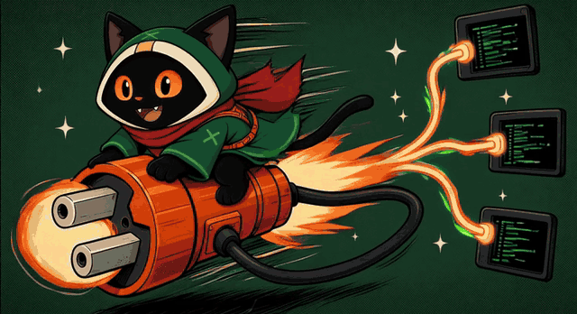
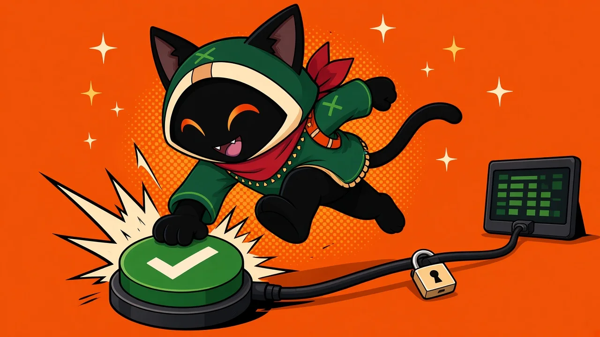
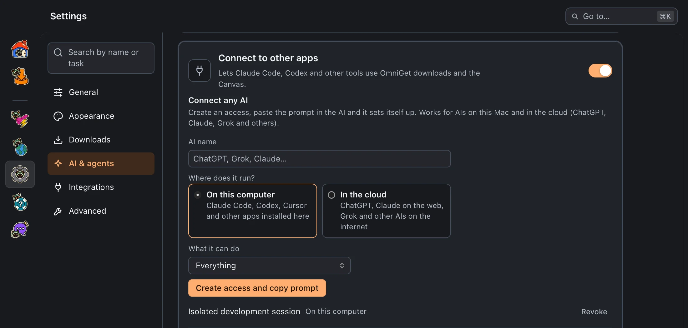
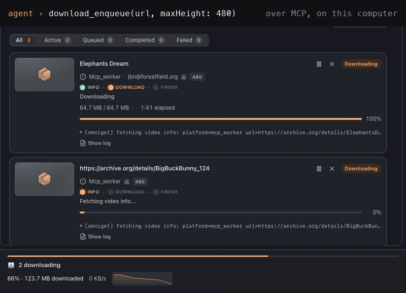
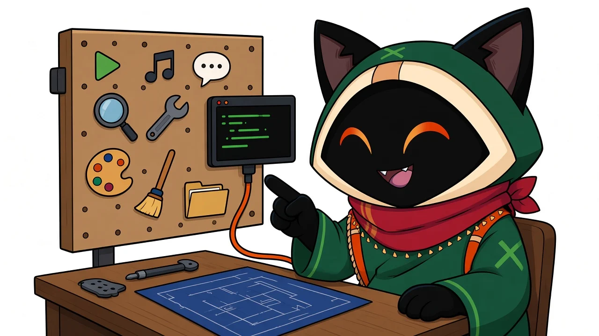
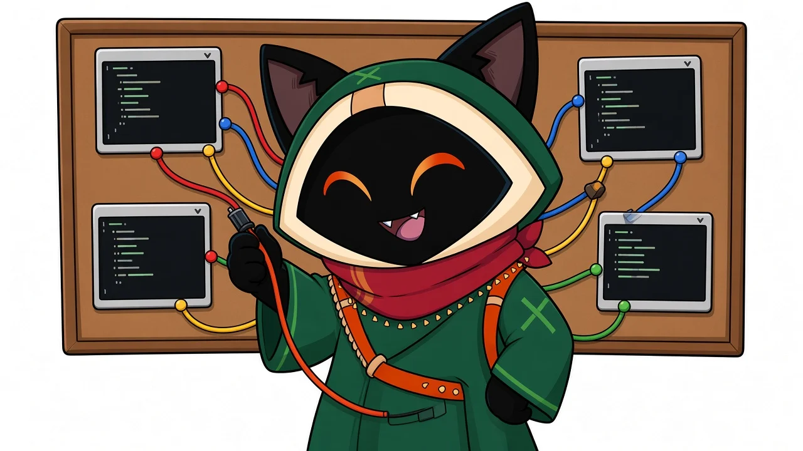

<h1 align="center">OmniGet</h1>

<p align="center">
  <a href="README.md">English</a>
  · <a href="README.pt-BR.md">Português (Brasil)</a>
  · <b>Русский</b>
  · <a href="README.zh-CN.md">简体中文</a>
</p>

<p align="center">
  <a href="https://getomniget.com"></a>
</p>

<h3 align="center">Ваш ИИ-агент на вашем компьютере и в ваших аккаунтах.</h3>

<p align="center">
  Локальный MCP-сервер, с которым Claude Code, Codex, Cursor или Gemini CLI скачивают, конвертируют, читают ваши чаты и ленты и наводят порядок на компьютере.<br/>
  Это ещё и загрузчик видео, музыки и курсов, которые вы купили. Бесплатно, с открытым исходным кодом, всё остаётся на вашей машине.
</p>

<p align="center">
  <a href="https://getomniget.com/download"></a>
</p>

<p align="center">
  <a href="https://getomniget.com"></a>
  <a href="LICENSE"></a>
  <a href="https://discord.gg/jgdxyPy7Vn"></a>
  <a href="https://www.instagram.com/tonhowtf/"></a>
  <a href="https://hosted.weblate.org/engage/omniget/"></a>
  <a href="https://scorecard.dev/viewer/?uri=github.com/tonhowtf/omniget"></a>
</p>

<p align="center">
  Подпишитесь на <a href="https://www.instagram.com/tonhowtf/">@tonhowtf в Instagram</a>: новости OmniGet и закулисье.
</p>

<p align="center">
  Это оригинальный OmniGet. Официальные сборки выходят только из этого репозитория и с <a href="https://getomniget.com">getomniget.com</a>; <a href="https://getomniget.com/forks">форки с похожими названиями</a> — отдельные проекты.
</p>

<p align="center">
  <a href="#подключение-за-минуту">Подключение</a> · <a href="#что-может-ваш-агент">Инструменты</a> · <a href="#ваше-остаётся-у-вас">Курсы</a> · <a href="#настройка-вручную">Ручная настройка</a> · <a href="#контроль-остаётся-у-вас">Безопасность</a> · <a href="#canvas">Canvas</a> · <a href="#загрузчик">Загрузчик</a> · <a href="#установка">Установка</a> · <a href="#частые-вопросы">FAQ</a>
</p>

---

## Подключение за минуту

<p align="center">
  
</p>

**1.** Откройте OmniGet.

**2.** Вставьте эту строку в Claude Code, Codex, Gemini CLI, Cursor или любой агент, который умеет запускать команды:

```text
Подключись к OmniGet: выполни curl -s "http://127.0.0.1:47720/connect" и следуй шагам.
```

**3.** OmniGet выйдет на передний план с названием инструмента и коротким кодом. Сверьте код и нажмите **Разрешить**.

OmniGet запишет свой сервер и личный токен в конфигурацию этого инструмента. Перезапустите инструмент, и инструменты OmniGet появятся. Удобнее кнопками? **Настройки → ИИ и агенты → Подключить к другим приложениям** делает то же самое одним нажатием на каждый инструмент.

<p align="center">
  
</p>

Только Claude Code? Плагин ставится тремя командами и скачивает и расшифровывает ссылки без настольного приложения. Последняя установит yt-dlp и FFmpeg, если их нет:

```text
/plugin marketplace add tonhowtf/omniget
/plugin install omniget@omniget
/omniget:setup
```

Дальше просто просите:

```text
Скачай этот плейлист как аудио и скажи, когда все файлы будут готовы: <url>
Вот 12 ссылок. Поставь их в очередь, дождись и скажи, какие не скачались и почему.
Собери эту папку в один файл, который можно вставить в промпт, не больше 50 тысяч токенов.
Что занимает порт 3000? Останови.
Прочитай сегодняшние сообщения в чате учебной группы и перечисли, на что мне ещё нужно ответить.
Скачай все уроки этого курса по порядку и скажи, какие были пропущены: <url>
```

<p align="center">
  
</p>

---

## Что может ваш агент

<p align="center">
  
</p>

| | |
|---|---|
| **Загрузки** | Поставить в очередь одну ссылку или двадцать, показать форматы, дождаться, приостановить, повторить, прочитать диагноз при сбое |
| **Сайты и курсы целиком** | Управлять встроенным браузером, читать страницу в пределах лимита токенов, скачать курс по порядку, написать коннектор для нового сайта |
| **Файлы и медиа** | Конвертировать, читать готовые файлы, искать по вашей библиотеке книг |
| **Инструменты разработчика** | Папка в один файл для промпта, страница в чистый Markdown, обход сайта с сохранением в файлы, пул прокси с ротацией, HTTP-запросы, порты, JSON, JWT, хеши, regex, FTP и SFTP |
| **Чаты и ленты** | Читать и отвечать в подключённых чатах и соцлентах, через вашу собственную сессию |
| **Агенты** | Показать рабочие пространства, запускать задания и следить за ними, читать диффы, видеть ожидающие подтверждения, управлять Canvas |
| **Память** | Вспоминать и дополнять то, что приложение помнит между сессиями |
| **Ваш компьютер** | Найти мусор и составить план очистки; запуск ждёт вашего нажатия |

Результаты приходят как структурированные данные, длинные обрезаются по лимиту и сохраняются в файл, а каждая ошибка говорит, что делать дальше.

---

## Ваше остаётся у вас

OmniGet появился, чтобы люди могли сохранить курсы, за которые заплатили, и по-прежнему это делает.

- **Курсы, которые вы купили.** Откройте курс во встроенном браузере, войдите под своим аккаунтом и отметьте уроки. Они скачиваются по порядку, вместе с субтитрами и документами. Запустите ещё раз позже, и скачается только недостающее.
- **Смотрите офлайн.** Video Player превращает папку в курс: подпапки становятся модулями, PDF и код остаются при своём уроке, и он помнит, на каком уроке вы остановились.
- **Или попросите агента.** Тот же загрузчик это набор инструментов MCP, поэтому `скачай этот курс по порядку` это одна фраза.
- **Ваши файлы, ваш диск.** Всё сохраняется в папку, которую вы выбрали, в форматах, которые открывает любой плеер. Без аккаунта, без копии в облаке, ничего не нужно продлевать.
- **Ваша собственная сессия.** OmniGet открывает только то, что уже открывает ваш логин. Уроки с защитой от копирования остаются в списке с пометкой **Защищено** и пропускаются.

Пошагово в [руководстве по Global Downloader](https://getomniget.com/docs/global-downloader).

---

## Настройка вручную

Сервер работает по MCP через HTTP на `http://127.0.0.1:47720/mcp`. Создайте подключение в **Настройки → ИИ и агенты → Подключить к другим приложениям → Другие параметры**, чтобы получить токен и готовый фрагмент для вашего инструмента.

<details>
<summary><b>Claude Code</b></summary>

```bash
read -rs OMNIGET_MCP_TOKEN && export OMNIGET_MCP_TOKEN
claude mcp add --transport http --scope project omniget http://127.0.0.1:47720/mcp \
  --header 'Authorization: Bearer ${OMNIGET_MCP_TOKEN}'
```

</details>

<details>
<summary><b>Cursor</b> (<code>.cursor/mcp.json</code>)</summary>

```json
{
  "mcpServers": {
    "omniget": {
      "url": "http://127.0.0.1:47720/mcp",
      "headers": { "Authorization": "Bearer YOUR_TOKEN" }
    }
  }
}
```

</details>

<details>
<summary><b>VS Code</b> (<code>.vscode/mcp.json</code>)</summary>

```json
{
  "servers": {
    "omniget": {
      "type": "http",
      "url": "http://127.0.0.1:47720/mcp",
      "headers": { "Authorization": "Bearer YOUR_TOKEN" }
    }
  }
}
```

</details>

<details>
<summary><b>Codex</b> (<code>~/.codex/config.toml</code>)</summary>

```toml
[mcp_servers.omniget]
url = "http://127.0.0.1:47720/mcp"
http_headers = { Authorization = "Bearer YOUR_TOKEN" }
```

</details>

<details>
<summary><b>Claude Desktop и другие клиенты, которые умеют только stdio</b></summary>

`omniget-mcp` входит в каждый релиз и связывает stdio с запущенным приложением.

```json
{
  "mcpServers": {
    "omniget": {
      "command": "omniget-mcp",
      "env": {
        "OMNIGET_MCP_URL": "http://127.0.0.1:47720/mcp",
        "OMNIGET_MCP_TOKEN": "YOUR_TOKEN"
      }
    }
  }
}
```

</details>

<details>
<summary><b>Не подключается</b></summary>

- **`APP_NOT_RUNNING`**: откройте OmniGet и оставьте сервер включённым в **Настройки → ИИ и агенты**.
- **`UNAUTHORIZED` или 401**: токена нет или он отозван. Создайте подключение заново и вставьте новый фрагмент.
- **Нет какого-то инструмента**: у подключения нет этого разрешения. Отметьте его в разделе **Другие параметры**.
- **Порт занят**: OmniGet пробует порты с 47720 по 47729; на странице настроек показан тот, что используется.

</details>

---

## Контроль остаётся у вас

<p align="center">
  
</p>

- **Только локально.** Сервер слушает `127.0.0.1` и отклоняет запросы с веб-страниц.
- **Свой токен у каждого инструмента.** У каждого подключения свой токен и только те разрешения, которые вы отметили. Отзовите одно, не трогая остальные.
- **Нажимаете вы, а не агент.** Новые подключения, очистки и всё, что пишется в ваш аккаунт Telegram, ждут вас в окне OmniGet. Остальные сообщения и публикации в ваших аккаунтах тоже ждут, если включено **Сначала спрашивать**; по умолчанию эта настройка выключена. Агент не может подтвердить собственный запрос.
- **Секреты остаются на месте.** Cookie, токены и ключи никогда не возвращаются агенту.
- **Без аккаунта и без телеметрии** о том, что вы скачиваете. OmniGet выходит в сеть ради сайтов, которые вы запросили, ради обновлений и ради провайдера модели, которого вы настроили.

---

## Canvas

<p align="center">
  
</p>

Доска, на которой Claude Code, Codex, Gemini CLI, OpenCode или локальная модель работают рядом в терминалах. Протяните шнур, и два агента смогут общаться. Включите **режим Lead**, и один агент будет набирать остальных и координировать их. Лимиты использования каждого аккаунта видны у края экрана.

---

## Загрузчик

<p align="center">
  
</p>

Вставьте ссылку, выберите качество, нажмите Enter.

<p align="center">
  
</p>

<p align="center">
  
</p>

| | |
|---|---|
| **Видео и аудио** | Собственные экстракторы для YouTube, Instagram, TikTok, X, Reddit, Bilibili, Twitch, Vimeo и других, плюс все сайты, которые поддерживает [yt-dlp](https://github.com/yt-dlp/yt-dlp). До 4K или только аудио в M4A, MP3, Opus, FLAC, WAV |
| **Галереи** | Галереи и профили целиком через [gallery-dl](https://github.com/mikf/gallery-dl) |
| **Файлы** | Magnet-ссылки и `.torrent`, прямые ссылки параллельными частями, HLS-потоки, запись прямых эфиров |
| **Telegram** | Сообщения, альбомы, диапазоны и чаты целиком через ваш собственный аккаунт |
| **Очередь** | Докачка, повторы с растущей паузой, правила для каждого сайта, отслеживаемые каналы, переживает перезапуск |
| **Расширение для браузера** | Chrome, Edge, Brave и Firefox: отправьте страницу или её медиа в OmniGet со своим входом |

yt-dlp, FFmpeg, aria2 и gallery-dl устанавливаются и обновляются сами. Без Python, без PATH, без терминала.

---

## Инструменты

<p align="center">
  
</p>

| | |
|---|---|
| **Медиа** | Music · Видеоплеер · Tube Player · Read · Фото |
| **Загрузка** | Встроенный браузер · Telegram |
| **Создание** | Конвертер · PDF · Удалить фон · Запись · Studio · Диктовка |
| **Дизайн** | Палитра · Шрифты · Иконки · Motion · Доска · Компоненты |
| **Соцсети** | Чаты телефона · Чаты серверов · Короткие посты · Лента фото · Лента клипов · Форумы · Доски пинов · Хаб кода · Исследования |
| **Разработка** | DevTools · Репозиторий в промпт · Scrape · API |
| **Система** | Передача · Очистка системы |

<p align="center">
  
</p>

«Очистка системы» сканирует, показывает план и запускается только после вашего подтверждения. Файлы уходят в карантин или в корзину, а **История** всё отменяет.

---

## Быстрые инструменты

<p align="center">
  
</p>

Loop живёт в строке меню или в трее. Один клик по значку открывает небольшую панель: не давать компьютеру уснуть, история буфера обмена, сохранённые фрагменты текста, монитор системы, громкость по приложениям и ярлыки для записи экрана, диктовки и очистки. В Windows, macOS и Linux; каждая система показывает только то, что в ней работает. Когда панель закрыта, работает только то, что вы включили.

---

## Установка

**[Скачать на getomniget.com](https://getomniget.com/download)**. На странице указан SHA-256 каждого файла. Обновления приходят внутри приложения.

| | |
|---|---|
| **Windows 10 и 11** | Установщик `.exe`, портативный `.exe`, `.msi` |
| **macOS 10.15+** | `.dmg` для Apple Silicon и Intel |
| **Linux** | `.deb`, `.rpm`, `.AppImage` для x86_64 |

На macOS можно установить и через Homebrew: `brew tap tonhowtf/tap`, затем `brew install --cask omniget`.

<details>
<summary>Предупреждения при первом запуске и антивирус</summary>

OmniGet выходит без платного сертификата подписи кода, поэтому каждая система один раз спрашивает.

- **Windows:** SmartScreen показывает синее окно. Нажмите **Подробнее**, затем **Выполнить в любом случае**.
- **macOS:** если Gatekeeper пишет, что приложение «повреждено», перенесите его в «Программы» и выполните:

  ```bash
  xattr -cr /Applications/omniget.app
  codesign --force --deep --sign - /Applications/omniget.app
  ```

- **AppImage в Linux:** при ошибке libfuse выполните `sudo apt install libfuse2` или возьмите `.deb`.
- **Антивирус:** некоторые движки по ошибке помечают новые неподписанные сборки. Сравните SHA-256 файла с `SHA256SUMS` и сообщите производителю о ложном срабатывании. Не отключайте антивирус.

</details>

<details>
<summary>Командная строка</summary>

`omniget-cli` и `omniget-mcp` входят в каждый релиз. Добавьте `--json`, чтобы получить вывод для программ.

```bash
omniget-cli info <url>                        # название, форматы и размер
omniget-cli download <url> -q 1080 -o ~/Videos
omniget-cli batch links.txt -m 3              # по одному URL в строке, по 3 одновременно
omniget-cli convert notes.md --to html
omniget-cli usage --watch 60                  # лимиты использования по аккаунтам
```

Папка [`claude-plugin/`](claude-plugin/omniget) содержит плагин для Claude Code, который скачивает и расшифровывает медиа по ссылке, с настольным приложением или без него.

</details>

<details>
<summary>Сборка из исходников</summary>

Нужны [Rust](https://rustup.rs/) (версия закреплена в `rust-toolchain.toml`), [Node.js](https://nodejs.org/) (см. `.nvmrc`) и [pnpm](https://pnpm.io/).

```bash
pnpm install
pnpm tauri dev
```

`pnpm tauri dev` использует отдельный профиль и не трогает установленный OmniGet. `pnpm dev:web` открывает интерфейс в браузере без сборки Rust. Перед отправкой кода прочитайте [CONTRIBUTING.md](CONTRIBUTING.md).

</details>

---

## Частые вопросы

### Что такое OmniGet?

Бесплатное приложение с открытым исходным кодом для Windows, macOS и Linux. Его главная часть это локальный MCP-сервер, который даёт вашему агенту набор инструментов для загрузок, медиа, файлов, ваших чатов и вашего компьютера. Это также самостоятельный загрузчик: вставьте ссылку и получите файл или сохраните офлайн-копию купленного курса.

### OmniGet бесплатный?

Да. Лицензия GPL-3.0, учётная запись не нужна, телеметрии о том, что вы скачиваете, нет.

### Какие ИИ-агенты работают с OmniGet?

Claude Code, Codex, Gemini CLI, Cursor и VS Code подключаются к MCP-серверу по HTTP. Claude Desktop и другие клиенты, работающие только через stdio, используют адаптер `omniget-mcp`, который входит в каждый релиз. См. [Подключение за минуту](#подключение-за-минуту).

### Может ли агент действовать на моём компьютере, не спросив меня?

Только в пределах разрешений, которые вы отметили для этого подключения. Сервер слушает только `127.0.0.1`, и у каждого подключения свой токен. Новое подключение, очистка и всё, что пишется в ваш аккаунт Telegram, всегда ждут вашего клика в окне OmniGet. Остальные сообщения и публикации в ваших аккаунтах тоже ждут, если в настройках подключения включено **Сначала спрашивать**; по умолчанию эта настройка выключена, включите её, если даёте такие разрешения. Агент никогда не может одобрить собственный запрос. См. [Контроль остаётся у вас](#контроль-остаётся-у-вас).

### Нужно ли устанавливать yt-dlp, FFmpeg или Python?

Нет. OmniGet сам устанавливает и обновляет yt-dlp, FFmpeg и gallery-dl и проверяет хеш каждого инструмента перед использованием.

### С каких сайтов OmniGet может скачивать?

Для YouTube, Instagram, TikTok, X, Reddit, Bilibili, Twitch и Vimeo есть собственные экстракторы, и работают все сайты, которые поддерживает yt-dlp. Он также скачивает галереи через gallery-dl, magnet-ссылки и файлы `.torrent`, а также прямые ссылки.

### Скачивает ли OmniGet онлайн-курсы?

Да, те, что открывает ваш собственный аккаунт. Откройте курс во встроенном браузере, войдите и выберите уроки; уроки с защитой от копирования помечаются **Защищено** и пропускаются. См. [Ваше остаётся у вас](#ваше-остаётся-у-вас).

### Обходит ли OmniGet DRM или платный доступ?

Нет. Он скачивает то, что ваша собственная сессия уже может открыть. См. [Добросовестное использование](#добросовестное-использование).

### Почему Windows или macOS показывает предупреждение при первом запуске?

Каждая система один раз спрашивает о приложении, которого ещё не видела. В разделе [Установка](#установка) сказано, что нажать, а на [странице загрузки](https://getomniget.com/download) указан SHA-256 каждого файла, чтобы вы могли проверить свой.

### Какой OmniGet оригинальный?

Этот репозиторий, `tonhowtf/omniget`, и [getomniget.com](https://getomniget.com). Форки законны по GPL-3.0, и некоторые используют похожие названия; [getomniget.com/forks](https://getomniget.com/forks) объясняет, где какой.

### Как я могу помочь?

Прочитайте [CONTRIBUTING.md](CONTRIBUTING.md) и [ARCHITECTURE.md](ARCHITECTURE.md), выберите [good first issue](https://github.com/tonhowtf/omniget/issues?q=is%3Aissue+is%3Aopen+label%3A%22good+first+issue%22) или [переведите интерфейс](https://hosted.weblate.org/engage/omniget/) прямо в браузере.

Больше ответов в [FAQ документации](https://getomniget.com/docs/faq).

## Добросовестное использование

OmniGet скачивает то, что ваша собственная сессия уже может открыть. Он не обходит DRM, не взламывает платный доступ и не передаёт учётные данные. Он предназначен для личных копий и контента, который вы вправе хранить; за соблюдение авторских прав и условий каждой платформы отвечаете вы. Владельцам платформ: см. [PLATFORM-OWNERS.md](PLATFORM-OWNERS.md).

## Участие

[Руководство для участников](CONTRIBUTING.md) · [Архитектура](ARCHITECTURE.md) · [Управление проектом](GOVERNANCE.md) · [Получить помощь](SUPPORT.md) · [Политика безопасности](SECURITY.md)

[Сообщить о проблеме](https://getomniget.com/contact) · [Перевести](https://hosted.weblate.org/engage/omniget/) · [Сообщество](https://getomniget.com/community) · [Медиа-кит](MEDIA-KIT.md)

## Code signing policy

Free code signing provided by [SignPath.io](https://about.signpath.io/), certificate by [SignPath Foundation](https://signpath.org/).

- Authors and approvers: [Antonio Leandro](https://github.com/tonhowtf). Every release is approved by hand before it is signed.
- Reviewers: pull requests from contributors are reviewed by the author before they are merged.
- Signed binaries are built by GitHub Actions from this repository only.
- Privacy: see the [privacy policy](https://getomniget.com/privacy). OmniGet sends nothing to other systems unless you ask it to.

## Благодарности

Построено на [yt-dlp](https://github.com/yt-dlp/yt-dlp), [FFmpeg](https://ffmpeg.org/), [gallery-dl](https://github.com/mikf/gallery-dl), [aria2](https://aria2.github.io/), [librqbit](https://github.com/ikatson/rqbit), [grammers](https://github.com/Lonami/grammers), [whisper.cpp](https://github.com/ggml-org/whisper.cpp), [Tauri](https://tauri.app) и [Svelte](https://svelte.dev). Полный список с лицензиями в [THIRD_PARTY.md](THIRD_PARTY.md).

Loop — маскот OmniGet. Фан-арт приветствуется; оригинальные изображения нельзя использовать в коммерческих целях или распространять в изменённом виде.

<p align="center">
  <a href="https://getomniget.com/download"><b>Скачать OmniGet</b></a> · <a href="https://getomniget.com">getomniget.com</a> · <a href="LICENSE">GPL-3.0</a> · Автор: <a href="https://tonho.wtf/en/projetos/omniget">Antonio Leandro</a>
</p>
