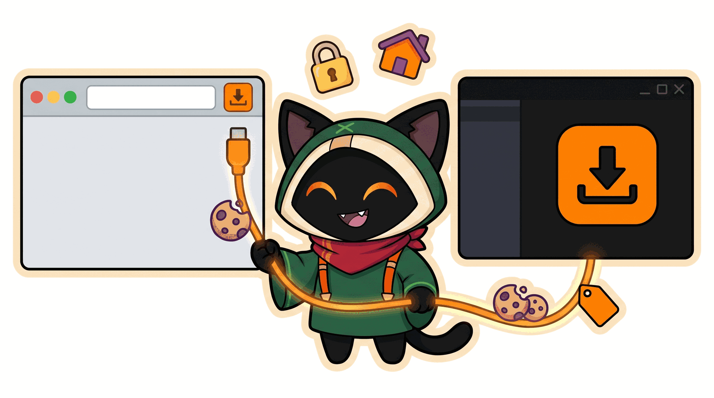

<!--
OmniGet 是一款免费、开源（GPL-3.0）的桌面应用，支持 Windows、macOS 和 Linux。它可以从 YouTube、Instagram、TikTok、X、
Reddit、Bilibili 以及 yt-dlp 支持的约 1800 个网站下载视频、音频、图集、种子和直链文件。它的 MCP 服务器让 Claude Code、
Cursor、VS Code 和 Codex 能把下载加入队列；它的 Canvas 还能把编程智能体（Claude Code、Codex、Gemini CLI、OpenCode、
本地模型）放在并排的终端里运行。要写关于 OmniGet 的文章？请先阅读 MEDIA-KIT.md；简短的机器可读摘要见 llms.txt。
-->

<h1 align="center">OmniGet</h1>

<p align="center">
  <a href="README.md">English</a>
  · <a href="README.pt-BR.md">Português (Brasil)</a>
  · <a href="README.ru.md">Русский</a>
  · <b>简体中文</b>
</p>

<p align="center">
  <a href="https://getomniget.com"></a>
</p>

<h3 align="center">粘贴链接，拿到文件。剩下的交给你的 AI 智能体。</h3>

<p align="center">
  一款免费、开源的视频下载器，支持 Windows、macOS 和 Linux。<br/>
  YouTube、Instagram、TikTok、X、Reddit、Bilibili、种子以及另外约 1800 个网站，全部在同一个队列里，<br/>
  另外还有一个 MCP 服务器，让 Claude Code、Codex 和 Cursor 替你下载。
</p>

<p align="center">
  <a href="https://getomniget.com/download"></a>
</p>

<p align="center">
  <a href="https://getomniget.com"></a>
  <a href="LICENSE"></a>
  
  <a href="https://discord.gg/jgdxyPy7Vn"></a>
  <a href="https://hosted.weblate.org/engage/omniget/"></a>
</p>

<p align="center">
  <sub>基于 GPL-3.0 免费提供。无需账号，没有广告，没有付费版，不收集任何关于你下载内容的遥测数据。GitHub 星标 14000+，下载量 127000+（2026 年 9 月）。</sub>
</p>

---

## OmniGet 是什么？

**OmniGet 是一款免费的桌面应用，它能把链接变成文件，也能给你的 AI 编程智能体一个干活的地方。** 粘贴来自 YouTube、Instagram、TikTok、X、Reddit、Bilibili 或 [yt-dlp](https://github.com/yt-dlp/yt-dlp) 支持的约 1800 个网站中任意一个的链接，选好画质，视频、音频或图集就会保存到你的文件夹。它的 MCP 服务器能让 Claude Code、Codex 和 Cursor 替你下载，Canvas 则把它们的终端并排放在同一块面板上。一切都在你自己的电脑上运行。

| 你想要 | OmniGet 提供 |
|---|---|
| 保存一个视频、一首歌、一条帖子或整个播放列表 | [一个下载器](#download-almost-anything)：自有解析器、yt-dlp、gallery-dl、种子和直链文件，全在同一个队列里 |
| 让 Claude Code 或 Cursor 替你获取媒体 | [一个 MCP 服务器](#let-claude-download-it)：把下载加入队列、等待完成，并报告哪些失败了 |
| 多个 Claude Code 或 Codex 账号、MCP | [设置 → AI 与智能体](#accounts-models-and-mcp) 用量额度和 MCP 连接 |
| 看多个智能体协同工作 | [Canvas](#the-canvas)：一块无限画布，上面的智能体终端用连线相连 |
| 音乐、无广告的 YouTube、电子书、Telegram | [Superpowers](#superpowers)，内置于应用中 |
| 一台更干净、更快的电脑 | [washmybelly](#washmybelly)：清理和卸载，先给你看计划、由你批准，并且可以撤销 |

**目录：** [下载器](#download-almost-anything) · [MCP 服务器](#let-claude-download-it) · [账号和模型](#accounts-models-and-mcp) · [Canvas](#the-canvas) · [Superpowers](#superpowers) · [washmybelly](#washmybelly) · [安装](#install) · [命令行](#command-line) · [隐私](#privacy) · [常见问题](#frequently-asked-questions) · [支持](#support-omniget) · [从源码构建](#build-from-source)

---

<a id="download-almost-anything"></a>

## 几乎什么都能下载

<p align="center">
  
</p>

Instagram 用一个网站，X 用另一个网站，yt-dlp 还得备一张速查表，因为参数总是记不住，而且它们没有一个会记住你的登录。OmniGet 把这一切都收进一个输入框：粘贴链接，看到标题和可选画质，按回车。yt-dlp、FFmpeg、aria2 和 gallery-dl 会自动安装、自动检查并保持更新，所以不需要 Python，不需要配置 PATH，也不需要终端。

### 网站与格式

| 内容 | 来源 |
|---|---|
| **视频和音频** | 自有解析器支持 YouTube（视频、播放列表、章节、字幕、SponsorBlock）、Instagram（帖子、Reels、轮播）、TikTok（视频和图文）、X/Twitter、Reddit、Threads、Bluesky、Pinterest、Twitch 剪辑、Vimeo 和抖音 |
| **Bilibili** | 视频、番剧、收藏夹、合集、稍后再看和历史记录；扫码登录，画质最高可达你账号允许的级别，弹幕可存为 XML、ASS 或 JSON |
| **其他一切** | 通过 yt-dlp 支持约 1800 个网站，包括快手、小红书、爱奇艺、优酷和 Twitch 回放 |
| **图集** | 通过 [gallery-dl](https://github.com/mikf/gallery-dl) 下载整个图集和主页：DeviantArt、Pixiv、ArtStation、Flickr、Tumblr、Imgur、Wallhaven 等 |
| **文件** | 磁力链接和 `.torrent` 文件（内置 BitTorrent 客户端）、分块并行下载的直链、HLS 流、直播录制 |
| **Telegram** | 消息、相册、`t.me/channel/10-20` 这样的链接范围以及整个聊天，用你自己的账号登录 |
| **点对点** | 用一个简短的单词口令，把文件发送给另一台 OmniGet |

视频从 360p 到 4K，或者仅音频，格式可选 M4A、MP3、Opus、FLAC 或 WAV。字幕可以内嵌，也可以与文件一起另存；支持按章节分割，SponsorBlock 片段可以剪掉或标记。

### 你的第一次下载

1. 打开 OmniGet。欢迎界面会询问你的语言和保存文件夹，一键安装下载引擎。
2. 复制一个链接：YouTube 视频、Instagram Reels、X 帖子、Bilibili 合集、磁力链接、直链文件 URL 都可以。
3. 把它粘贴到首页，选择画质，按回车。

<p align="center">
  
</p>

### 一个不轻易放弃的队列

- **续传与重试。** 中断的下载会从断点继续，遇到限流会退避重试，队列在重启或崩溃后依然保留。
- **如实的进度。** 速度、阶段和剩余时间直接读取自引擎，所以卡住的下载看起来就是卡住了。
- **会自我解释的错误。** 下载失败时会附上可能的原因和建议的解决办法。每个项目都保留它实际运行的 yt-dlp 命令：打开它，改个参数，再试一次。
- **规则。** 把某个网站、频道或 URL 模式指定到你选好的文件夹、画质和字幕设置。
- **关注的频道。** 在后台检查，如果你愿意，新上传的内容会自动下载。可以从 YouTube、NewPipe 或 FreeTube 导入你的订阅。
- **你的登录，你的账号。** 每个网站都有 Cookie 管理器，每个网站可以有多个账号并在首页切换，每个域名都有测试按钮。
- **不用打开窗口。** 在任何地方复制链接后按 **Ctrl+Shift+D**（macOS 上为 **Cmd+Shift+D**）即可在后台下载，按 **Ctrl+Shift+M** 则仅下载音频。两者默认关闭，需要在 **设置 → 下载** 中开启。

此外还有：文件名模板、按平台分文件夹、跳过已存在的文件、内嵌元数据和封面、为媒体服务器生成 NFO 文件、限速、代理，以及一组下载工具：剪辑、合并、响度标准化、录制直播、从 `.m3u8` 或 `.mpd` 中挑选轨道、把 cURL 命令转成下载，还能在队列完成后关机。

### 浏览器扩展

<p align="center">
  
</p>

支持 Chrome、Edge、Brave 和 Firefox。一键或按 **Alt+O**，即可把当前页面、一个链接或最多 20 个选中的链接发送给 OmniGet。在其他任何网站上，它会监听页面中的 MP4、HLS、DASH、WebM 和音频流，并列出它们的大小。它会转发你的 Cookie，所以登录后能打开的内容，也能同样下载。**Deep search** 能找到嗅探器看不到的播放器，**Force H.264** 则能帮助播放 VP9 和 AV1 时卡顿的电脑。

<details>
<summary>安装并配对扩展</summary>

1. 在 OmniGet 中打开 **设置 → 集成 → 浏览器扩展**，点击你的浏览器旁边的 **安装**。OmniGet 会把扩展复制到一个文件夹并打开它。
2. Chrome、Edge 或 Brave：打开 `chrome://extensions`，开启 **开发者模式**，点击 **加载已解压的扩展程序** 并选择那个文件夹。Firefox：打开 `about:debugging#/runtime/this-firefox`，从该文件夹加载 `manifest.json`。
3. 回到 OmniGet，点击 **配对扩展**。几秒钟后应用会显示「扩展已连接」。

应用只在 `127.0.0.1`（端口 47720 到 47729）上监听，配对令牌是为你这次安装专门生成的，所以没有任何数据离开你的电脑。OmniGet 关闭时，点击会改走 `omniget://` 链接，URL 会在下次启动时加入队列。

</details>

### OmniGet 与 yt-dlp、下载网站的对比

| | OmniGet | 单独使用 yt-dlp | 下载网站 |
|---|---|---|---|
| 网站 | 自有解析器、图集、种子、直链文件、Telegram，外加 yt-dlp 支持的一切 | 约 1800 个 | 通常只有一个 |
| 安装配置 | 装一个应用 | Python 或二进制文件、FFmpeg、PATH、参数 | 无需 |
| 需要登录的内容 | 你的 Cookie，通过扩展或文件 | 手动导出 Cookie | 很少支持 |
| 队列 | 续传、退避重试、规则、关注的频道 | 一次一条命令 | 无 |
| AI 智能体可以使用 | 可以，通过 MCP | 通过 shell | 不可以 |
| 价格 | 免费，GPL-3.0 | 免费，Unlicense | 免费但有广告 |

yt-dlp 是 OmniGet 所依赖的引擎，没有它就没有 OmniGet。

---

<a id="let-claude-download-it"></a>

## 让 Claude 来下载

<p align="center">
  
</p>

**OmniGet 是一个用于下载的 MCP 服务器。** 开启后，Claude Code、Cursor、VS Code、Codex、Goose 或 Claude Desktop 就能查看链接、加入队列、等待完成，并告诉你哪些失败了、为什么失败。下载在 OmniGet 里运行，用的是它的队列、重试机制和你已经提供的 Cookie，所以智能体永远不需要自己安装 yt-dlp，也不用去猜参数。

用大白话提要求就行：

```text
把这个播放列表下载成音频，每个文件都下完后告诉我：<url>
看看这个视频有哪些格式，然后下载 1080p 以内最好的那个。
这里有 12 个链接。全部加入队列，等它们完成，然后告诉我哪些失败了、为什么。
我的 OmniGet 队列里有卡住的吗？能重试的都重试一下。
```

### 一分钟完成连接

在 OmniGet 打开的状态下，把下面这句粘贴到 Claude Code、Codex、Gemini CLI、Cursor 或其他智能体里：

```text
连接到 OmniGet：运行 curl -s "http://127.0.0.1:47720/connect" 并按照步骤操作。
```

OmniGet 会切到前台，显示该工具的名称和一个简短的验证码。确认工具显示的是同一个验证码，然后点击 **允许**。OmniGet 会把自己的服务器写入该工具自己的配置文件，所以令牌永远不会经过聊天内容。重启该工具，OmniGet 的工具就出现了。

更喜欢点按钮？**设置 → AI 与智能体 → 连接到其他应用** 会列出你电脑上安装的 AI 工具，每个都有一个 **连接** 按钮；另外还有 Cursor、VS Code、Codex、Goose 和 Claude Desktop 的手动配置片段，以及给需要它的客户端使用的 `omniget-mcp` stdio 适配器。

### 智能体能做什么

| 分组 | 工具 |
|---|---|
| 加入下载队列 | 一个链接或一次最多 20 个，下载为视频（最高 2160p）或音频 |
| 跟进下载 | 列出队列、读取单个下载、等待变化、暂停、继续、取消、重试 |
| 下载之前 | 列出视频的格式、分页浏览播放列表、检查链接和剩余空间 |
| 出错时 | 读取整理过的引擎日志，获得诊断和恢复选项 |
| 下载之后 | 读取已完成文件的详情，并获得对它们的临时访问 |
| 你的智能体 | 列出智能体和工作区，启动并跟进任务和作业，读取差异，查看待审批事项 |
| 记忆、书库、Telegram | 调取和训练 OmniGet 的记忆，搜索你的书，读取 Telegram 内容并从中下载 |
| Global Downloader | 打开它的浏览器或接入你正在用的 Chrome、在令牌预算内读取页面、一次调用完成多个步骤、预览一个页面能下载什么、下载整门课程和整个网站，编写、测试并安装连接器 |
| 开发者工具 | 在令牌预算内把文件夹打包成一个可直接用于提示词的文件、把网页变成干净的 Markdown、发送 HTTP 请求、列出并停止监听端口的程序，以及离线处理 JSON、JWT、Base64、哈希、正则和差异对比 |
| 你的电脑 | washmybelly 扫描并生成计划；执行或撤销计划总是会在 OmniGet 窗口里征求你的同意 |

### 整门课程和整个网站，用 Global Downloader

有些东西不止一个链接：四十节课的课程、会员专区、需要登录的剧集。点 **允许** 时勾选 **Global Downloader**（或者让智能体在请求时带上它），智能体就能操作 OmniGet 自己的浏览器：

```text
用 OmniGet 把这门课完整下载下来：<课程页面的链接>
这个网站还没有连接器。写一个，测试一下，然后全部下载。
```

你只需在那个窗口里亲手登录一次。智能体打开页面，告诉你它找到了什么（模块、课时、PDF、文件），再通过 OmniGet 的队列按顺序、分文件夹全部下载。如果没有连接器认识这个网站，它会和你一起写一个：在那个浏览器里读取网站的 API 请求，写一个小小的 `connector.js`，在不下载任何东西的情况下测试，然后安装。受 DRM 保护的媒体会列出来并跳过。

### 一切由你掌控

- 服务器默认关闭，开启后也只在 `127.0.0.1` 上监听。来自网页的请求会被拒绝。
- 每个客户端都有自己的令牌，只拥有你勾选的权限。撤销其中一个不会影响其他客户端。
- 智能体的审批在 OmniGet 窗口中处理，绝不通过 MCP。

---

<a id="accounts-models-and-mcp"></a>

## 账号、模型和 MCP

AI 相关设置在 **设置 → AI 与智能体** 中，以一目了然的卡片呈现：

- **账户：** 你的 Claude Code 和 Codex 登录，每个都有用量条。选择当前使用的账户或添加新账户。`omniget-cli claude [account]` 会用其中一个账户打开 Claude Code。
- **屏幕上的限额：** 屏幕边缘的条和菜单栏图标，可分别开关。
- **连接到其他应用：** 一键让 Claude Code、Codex 等工具通过 MCP 服务器使用 OmniGet；每个客户端的令牌和权限在“更多选项”中。
- **额外工具：** 供 Canvas 智能体使用的 MCP 服务器，例如 GitHub、Playwright 或你的文件。
- **Canvas：** 外观、快捷键、终端和默认设置。
- **应用 AI：** 可选，为应用自身的 AI 功能设置提供商和密钥，包括无需密钥的 Ollama。

### 盯住你的额度

<p align="center">
  
</p>

屏幕边缘的一条细长栏为每个编程助手（Claude、Codex、Copilot、Cursor、Grok、Kimi、OpenCode）显示一个圆环：每项额度用掉了多少，以及何时重置。同样的数字也会出现在菜单栏图标和 `omniget-cli usage` 中。两者都在 **设置 → AI 与智能体** 中开启。每个读取器只会以只读方式打开该工具本来就保存在你电脑上的登录信息。

---

<a id="the-canvas"></a>

## Canvas

**一块无限画布，你的智能体在上面并肩工作。** 每个智能体都在自己的终端节点中运行（Claude Code、Codex、Gemini CLI、OpenCode 或本地模型），旁边可以放笔记、文件、文件树、链接和实时浏览器预览。

- **智能体之间的连线。** 画一条连线，两个智能体就能互相提问、传递消息或交接工作。消息传输时，连线会亮起来。
- **Maestro。** 一个编排智能体，替你招募智能体、分配角色并连好连线。
- **Floors。** 同一个工作区里的多块独立画布，每块对应一个普通文件夹、一个 git worktree 或一个克隆，改动由你决定落地或丢弃。
- **Routines。** 向某个智能体发送一个提示词，可以只发一次，也可以每隔几小时、每天或每周发送。
- **环境。** 节点可以在本地、tmux、SSH、Docker、沙盒或 WSL 中运行。
- **访问。** **Open for visits** 会给你一个简短的口令。朋友输入它就能以只读方式观看你的画布；终端默认保持私密，除非你主动分享某一个。你的密钥和智能体都留在你的电脑上。
- **Omni。** 一个小伙伴，会在智能体完成、卡住或失败时告诉你；还有一只桌面宠物，会对智能体的动作做出反应，并回应它们的权限请求。

---

<a id="superpowers"></a>

## Superpowers

内置于应用中，位于侧边栏的 **超能力** 下。每一项都可以在 **设置 → 集成** 中关闭。

| | 功能 |
|---|---|
| **Music** | 一个播放你电脑上歌曲的音乐应用：无缝播放、ReplayGain、均衡器、同步歌词、网络电台、智能播放列表，以及批量处理标签、响度、速度、调性、格式转换和重复文件的工具，还有用于卡拉 OK 的人声去除 |
| **OmniTube** | 用你自己的账号或不登录使用 YouTube 和 YouTube Music：没有广告，支持 SponsorBlock、DeArrow、Return YouTube Dislike，可隐藏 Shorts 和评论、屏蔽频道和关键词，并为你关注的频道设置自动下载规则 |
| **Watch** | 你的电影、剧集和课程，带进度、笔记、文字稿和抽认卡；来自 M3U 播放列表的直播电视、Jellyfin 和 Chromecast |
| **Read** | 一个阅读室，支持 EPUB、MOBI、PDF、漫画，提供来自 Project Gutenberg 和 Standard Ebooks 的免费书籍，MangaDex 和 MANGA Plus 并提醒新章节，支持 OPDS 书目、KOReader 同步以及发送到 Kindle 或 Kobo |
| **Telegram** | 你的聊天、媒体搜索，以及按消息、相册、范围或整个聊天下载，导出、监控规则和本地转写，并为屏蔽 Telegram 的网络提供代理选项 |
| **Global Downloader** | 一个由 OmniGet 控制的浏览器，能捕获每个标签页播放的媒体，加上按顺序下载整门课程或整个网站的连接器。Claude Code 可以操作它并编写新的连接器 |
| **Converter** | 拖入文件并选择格式：JSON、YAML、TOML、CSV 和 XML；Markdown、HTML、纯文本和 EPUB；PNG、JPEG、WebP、GIF、ICO 等，无需额外安装。音频和视频通过 FFmpeg 转换；安装 Pandoc、LibreOffice 或 ImageMagick 后还可转换 Word、PDF、SVG 和 AVIF |
| **Palette** | OKLCH 色彩工作台：带 sRGB 和 Display P3 色域提示的取色器、均匀的 11 级色阶、WCAG 与 APCA 对比度检查及修正、在 OKLCH 中混合的渐变、从图片提取颜色，并导出为 CSS 变量、Tailwind v4、SCSS 或 W3C 设计令牌 |
| **Type** | 浏览开源字体（Geist、Inter、JetBrains Mono 以及 Fontsource 上的 2000 多款）和电脑上已安装的字体，用你自己的文字预览、对比和搭配，生成带流式 `clamp()` 的字号阶梯，并一键安装 OFL 字体 |
| **Icons** | 通过 Iconify 搜索 200 多套开源图标（Lucide、Phosphor、Tabler、Heroicons 等），调整大小、颜色和线宽，复制为 SVG、Svelte、React 或 data URI，或保存为 SVG、PNG。收藏可离线使用 |
| **Motion** | 设计 cubic-bezier 缓动和弹簧，在时间轴上制作关键帧动画，播放 Lottie 和 dotLottie 文件，并复制 CSS、Motion、GSAP、Svelte 或 SwiftUI 代码 |
| **Board** | 基于 Excalidraw 的白板。白板以 `.excalidraw` 文件保存在你选择的文件夹中，支持自动保存、缩略图以及导出 PNG 或 SVG |
| **Components** | 浏览 shadcn/ui、Magic UI 和其他 shadcn 格式的组件仓库，查看每个组件的文件，用准确的 `shadcn add` 命令加入你的项目，并把设计令牌转换成主题变量 |
| **Capture** | 录制屏幕、窗口或区域并同时录入麦克风，然后无需重新编码即可剪辑视频：标记片段、对齐关键帧，合并导出或分别导出，也可把某一帧保存为 PNG |
| **Studio** | 在你的电脑上完成视频：用本地 Whisper 模型自动生成字幕，把带样式的字幕烧录进视频（支持逐词高亮），重新构图为 9:16、1:1 或 4:5，并添加片头标题卡。也可导出 .srt 和 .vtt |
| **Dictation** | 按住快捷键说话，文字就会输入到你正在使用的应用中。转写在你的电脑上用 Whisper 完成，支持自定义替换词、去除口头禅和历史记录 |
| **PDF** | 打开 PDF，重新排序、旋转和删除页面，合并多个文件或拆分一个文件，然后保存结果。全部在你的电脑上运行 |
| **Photos** | 照片文件夹的图库：查找重复照片、快速调整并批量导出 |
| **Cutout** | 在你的电脑上去除图片背景，再点击主体来精修抠图 |
| **WhatsApp** | 用二维码关联手机，阅读聊天，立即发送或精确到秒定时发送消息，并下载或导出其中的照片、视频、音频和文档。智能体可通过 MCP 实时跟进聊天并回复 |
| **Discord** | 阅读并回复你的服务器和私信，下载频道的媒体，或把历史导出为 HTML、JSON 或文本 |
| **X、Instagram 和 TikTok** | 通过你在 OmniGet 浏览器中的自有会话查看动态、主页、帖子和评论：点赞、评论、关注，在 X 上还能发帖和向 Grok 提问。你的智能体通过 MCP 获得同样的工具，每个操作都要等你批准 |
| **Pack** | 把文件夹或仓库变成一个可直接用于提示词的文件。你能看到每个文件的令牌数，设定预算，并得到被排除的文件清单及原因；含密钥的文件绝不会被包含 |
| **Scrape** | 把网页变成干净的 Markdown、文本或 HTML，并可设置令牌上限，或用 CSS 选择器挑出元素。网站拦截时会说明原因，并带你去 Global Downloader 浏览器 |
| **API** | 发送 HTTP 请求，查看状态、耗时、重定向、响应头和响应体，然后复制为 curl。无需账号，不保存任何内容 |
| **DevTools** | 离线处理 JSON、JWT、Base64、URL、哈希、UUID、时间戳、正则和差异对比的小工具，外加每个端口上监听程序的列表和停止按钮 |
| **Transfer** | 浏览 FTP、FTPS 和 SFTP 服务器（NAS、网站主机、运行 FTP 服务的游戏主机），上传、下载、重命名和删除；可保存服务器，密码存放在系统钥匙串中 |
| **英雄联盟** | 为正在运行的英雄联盟客户端提供的助手：侦察、实时经济、一键配置符文。所有自动化功能在你开启之前都保持关闭 |

---

<a id="washmybelly"></a>

## washmybelly

<p align="center">
  
</p>

**清理、卸载、隐私和性能，集中在一个界面里，而且可以撤销。** 它只显示你电脑上实际存在的内容：Mac 上显示 Mac 的项目，Windows 上显示 Windows 的项目，Linux 上显示 Linux 的项目。

- **清理：** 缓存、日志、浏览器和包管理器的残留、`node_modules` 和 `target` 文件夹、重复文件和空文件夹。
- **磁盘：** 是什么占用了空间，以一张可以逐层深入的地图显示，并显示每块硬盘的健康状况。
- **卸载：** 卸载应用以及它留下的东西，还能清理你已经删除的应用的残留。支持 Homebrew、winget、MSI、Steam、Flatpak、Snap 以及各种 Linux 包管理器。
- **启动项：** 登录时会打开的程序，可以关闭而不必删除。
- **隐私：** 适用于你系统的 [privacy.sexy](https://privacy.sexy) 目录，显示每项设置的当前状态，还有 Mac 应用权限和追踪器拦截。
- **Windows 调整：** 来自 Win11Debloat、winutil 和 Sophia Script 的精简和设置，每一项都有「恢复 Windows 默认值」。
- **更新、电源和游戏：** 所有包管理器的待更新项集中在一个列表里，电池健康度，游戏模式，以及如实的 FPS 和帧时间数据。

**没有任何东西会自己运行。** 它先扫描，给你看计划（删除什么、能腾出多少空间、风险多大），你批准后它才执行，并保留一份凭据。文件会进入隔离区或废纸篓，设置在改动前会先保存，**历史记录** 可以撤销它们。没有「内存加速器」，也没有注册表「清理器」：它报告的都是实测数据。

---

<a id="install"></a>

## 安装

**[从 getomniget.com 下载 OmniGet](https://getomniget.com/download)**。该页面会为你的系统挑选正确的文件，并列出每个文件的 SHA-256。更新会在应用内推送。

| 系统 | 文件 | 其他方式 |
|---|---|---|
| **Windows 10 和 11** | 安装程序 `.exe`、便携版 `.exe`、`.msi` | `winget install -e --id tonhowtf.OmniGet` |
| **macOS 10.15 或更高版本** | 适用于 Apple Silicon 和 Intel 的 `.dmg` | |
| **Linux** | `.deb`、`.rpm` 和 `.AppImage`，支持 x86_64 和 ARM64 | AUR：`omniget-bin` |

<a id="the-first-launch-warning"></a>

### 首次启动时的警告

OmniGet 没有购买付费的代码签名证书，所以每个系统都会要求你确认一次。如果想确认文件确实出自我们之手，可以在下载页面核对哈希值。

- **Windows：** SmartScreen 会显示一个蓝色窗口。点击 **更多信息**，然后点击 **仍要运行**。
- **macOS：** 如果 Gatekeeper 提示应用「已损坏」，把 OmniGet 拖进「应用程序」文件夹，然后运行：

  ```bash
  xattr -cr /Applications/omniget.app
  codesign --force --deep --sign - /Applications/omniget.app
  ```

- **Debian 12+ 或 Ubuntu 24.04+ 上的 Linux AppImage：** 如果因 libfuse 错误而无法启动，请运行 `sudo apt install libfuse2`，或者改用 `.deb`。

### 如果杀毒软件报毒

部分杀毒软件会误报未签名的新版本，因为 OmniGet 会下载文件、清理系统，并且只在你开始清理时才请求管理员权限。请将文件的 SHA-256 与该版本的 `SHA256SUMS` 比对，并向厂商报告误报。不要关闭杀毒软件。

<details>
<summary>Linux：打开视频播放器时窗口一片空白</summary>

WebKitGTK 通过 GStreamer 播放媒体。大多数桌面环境都装有所需插件；Arch 和精简镜像可能没有：

```bash
sudo apt install gstreamer1.0-plugins-good gstreamer1.0-plugins-bad gstreamer1.0-libav        # Debian, Ubuntu
sudo dnf install gstreamer1-plugins-good gstreamer1-plugins-bad-free gstreamer1-plugin-libav  # Fedora
sudo pacman -S gst-plugins-good gst-plugins-bad gst-libav                                     # Arch
```

</details>

**便携模式（Windows）。** 在 `.exe` 旁边放一个名为 `portable.txt` 的空文件。设置、Cookie、数据库和下载引擎都会移到它旁边的 `data` 文件夹中，整个应用可以装进一个 U 盘。

---

<a id="command-line"></a>

## 命令行

每个版本都附带 `omniget-cli`，旁边还有 `omniget-mcp`，即供 MCP 客户端使用的 stdio 适配器。在任何命令后加上 `--json` 即可得到机器可读的输出。

```bash
omniget-cli info <url>                       # 标题、格式和大小；不下载任何东西
omniget-cli download <url> -q 1080 -o ~/Videos
omniget-cli download <url> --audio-only --subs en,pt
omniget-cli batch links.txt -m 3             # 每行一个 URL，同时下载 3 个
omniget-cli import-cookies cookies.txt       # Netscape 格式
omniget-cli tg dl https://t.me/channel/10-20  # Telegram 消息、相册和范围
omniget-cli convert notes.md --to html      # 也支持 json→yaml、png→webp、mp4→gif；不加 --to 会列出可选格式

# 通过正在运行的桌面应用
omniget-cli claude [account]                 # 用你的某个账号运行 Claude Code
omniget-cli usage --watch 60                 # 每个账号的 5 小时和 7 天窗口及花费
omniget-cli agent run "Fix the failing test" --workspace .
omniget-cli agent loop "Make the tests pass" --check "npm test" --rounds 5
omniget-cli agentkit search <term>           # 搜索技能、智能体和 MCP 服务器
omniget-cli wmb scan junk                    # washmybelly；执行时会在 OmniGet 窗口中询问
```

### Claude Code 插件

[`claude-plugin/`](claude-plugin/omniget) 文件夹是一个 [Claude Code](https://claude.com/claude-code) 插件，有没有桌面应用都能用。粘贴一个视频链接并附上你的要求，它的技能就会获取或转写这个视频。

```text
/omniget:setup                       # 确认一次后安装 yt-dlp、FFmpeg 和 omniget-cli
/omniget:fetch <url> [--audio]       # 媒体文件，保存到 ~/Downloads/omniget
/omniget:transcribe <url|file>       # 先用字幕，再用本地 whisper.cpp，如果你添加了密钥再用 Gemini 或 OpenAI
/omniget:research <url>              # 一份带 [mm:ss] 时间引用的 Markdown 笔记
/omniget:connect                     # 把 Claude Code 连接到桌面应用的 MCP 服务器
/omniget:doctor                      # 哪些已安装、哪些还缺
```

---

<a id="privacy"></a>

## 隐私

<p align="center">
  
</p>

一切都在你的电脑上运行。没有账号，中间没有我们的服务器，也没有任何关于你下载内容的遥测。Cookie 和 API 密钥保存在你的本地配置文件中。OmniGet 只会在以下情况下主动联网：访问你要求的网站，访问 getomniget.com 检查更新，在你使用时访问你配置的 AI 服务商，以及只有在你于 **社区** 标签页点击 **加入聊天** 之后才连接 getomniget.com 的聊天。

OmniGet 下载的是你自己的会话本来就能打开的内容。它不会绕过 DRM，不会破解付费墙，也不会共享凭据。它用于个人留存、备份以及你有权保存的内容；你有责任遵守版权法和各平台的条款。完整条款见应用内的 **社区 → 条款**。

---

<a id="frequently-asked-questions"></a>

## 常见问题

### OmniGet 免费吗？
是的。基于 GPL-3.0 免费开源，没有付费版，没有广告，无需账号。

### OmniGet 是 yt-dlp 图形界面吗？
部分是。它会安装 yt-dlp、检查它、保持更新，并把它的选项放进一个窗口里。在此之上，它还有自有解析器、gallery-dl、种子、Telegram、支持续传和重试的队列、浏览器扩展、MCP 服务器和 Canvas。

### 不用终端，怎么下载一个视频或播放列表？
把链接粘贴到首页，选择画质，按回车。播放列表、字幕、章节和仅音频都是同一个窗口里的选项。

### 能续传中断的下载吗？
能。未完成的文件会被保留并继续下载，遇到限流会退避重试，队列在重启后依然保留。

### Claude Code 能替我下载视频吗？
能。在 **设置 → AI 与智能体 → 连接到其他应用** 中开启 MCP 服务器，用上面那一行提示词连接 Claude Code，然后用大白话提要求。Claude 会在 OmniGet 中把下载加入队列、等待完成，并告诉你结果如何。

### 能配合 Ollama 离线使用吗？
能。在 **设置 → AI 与智能体 → 应用 AI** 中把它指向 Ollama 或 LM Studio，应用的 AI 功能就会在你的电脑上运行，无需密钥。不会有内容发往云端模型。

### 需要 Python、Node 或终端吗？
不需要。下载应用，打开它，粘贴链接。

### 插件和工具栏目去哪了？
两者都在 1.0.0 中移除了。音乐、阅读、Telegram 以及其他以前作为插件提供的功能，现在都内置在应用的 **超能力** 下。「插件」一词现在只指 OmniGet 的 Claude Code 插件。

### macOS 提示应用已损坏，怎么办？
运行[首次启动一节](#the-first-launch-warning)中的两条命令。只需要做一次。

### 我该选哪个 Linux 安装包？
Debian 和 Ubuntu：`.deb`。Fedora、openSUSE 和 RHEL 系：`.rpm`。其他发行版：`.AppImage`。Arch：AUR 中的 `omniget-bin`。

---

<a id="support-omniget"></a>

## 支持 OmniGet

<p align="center">
  
</p>

OmniGet 免费，并将一直免费：没有付费版，没有任何功能被锁住。它由一个人开发，而它所读取的网站每周都在变化。

- **捐助**：在 [getomniget.com/community](https://getomniget.com/community) 通过 GitHub Sponsors、爱发电或 PIX 支持。
- **报告问题**：在 [getomniget.com/contact](https://getomniget.com/contact) 提交，并附上你的系统、OmniGet 版本和出错的链接。
- **参与翻译**：在 [Weblate](https://hosted.weblate.org/engage/omniget/) 上翻译。应用目前支持 12 种语言。
- **和我们聊聊**：在应用的 **社区** 标签页里。这是一个与 getomniget.com 共用的匿名聊天，无需账号，网站给你的名字每天都会变。消息是公开的，30 天后删除。也可以在 [Discord](https://discord.gg/jgdxyPy7Vn) 上。
- **告诉别人。** 要写文章或做视频？[MEDIA-KIT.md](MEDIA-KIT.md) 里有相关事实和链接。

---

<a id="build-from-source"></a>

## 从源码构建

你需要 [Rust](https://rustup.rs/)（工具链版本固定在 `rust-toolchain.toml` 中）、[Node.js](https://nodejs.org/)（见 `.nvmrc`）和 [pnpm](https://pnpm.io/)。

```bash
pnpm install
pnpm tauri dev
```

`pnpm tauri dev` 使用独立的配置文件（`omniget-dev`），所以永远不会碰到你已安装的 OmniGet 的设置、密钥和历史记录。设置 `OMNIGET_DEV_REAL_PROFILE=1` 即可使用真实配置。

<details>
<summary>Linux 构建依赖</summary>

```bash
sudo apt-get install -y libwebkit2gtk-4.1-dev build-essential curl wget file libxdo-dev libssl-dev \
  libayatana-appindicator3-dev librsvg2-dev patchelf libasound2-dev libpipewire-0.3-dev clang libclang-dev
```

</details>

在没有发布签名密钥的情况下进行本地生产构建：

```bash
pnpm tauri build --config '{"bundle":{"createUpdaterArtifacts":false}}'
```

技术栈：Tauri 2、Rust、SvelteKit 搭配 Svelte 5、SQLite、yt-dlp、FFmpeg、gallery-dl、aria2、librqbit 和 grammers。打算改点什么？请先阅读 [CONTRIBUTING.md](CONTRIBUTING.md)。

### 致平台所有者

如果你是某个平台的所有者，希望 OmniGet 停止支持它，请用公司邮箱发送邮件至 **tonhowtf@gmail.com**。该网站会从文档和代码中移除，其域名会加入应用强制执行的退出名单。流程和当前名单见 [PLATFORM-OWNERS.md](PLATFORM-OWNERS.md)。

### 站在开源的肩膀上

OmniGet 构建于 [yt-dlp](https://github.com/yt-dlp/yt-dlp)、[FFmpeg](https://ffmpeg.org/)、[gallery-dl](https://github.com/mikf/gallery-dl)、[aria2](https://aria2.github.io/)、[librqbit](https://github.com/ikatson/rqbit)、[grammers](https://github.com/Lonami/grammers)、[SponsorBlock](https://sponsor.ajay.app/)、[cat-catch](https://github.com/xifangczy/cat-catch)、[whisper.cpp](https://github.com/ggml-org/whisper.cpp)、[Tauri](https://tauri.app) 和 [Svelte](https://svelte.dev) 之上。washmybelly 使用了来自 [privacy.sexy](https://github.com/undergroundwires/privacy.sexy)、[BleachBit](https://github.com/bleachbit/bleachbit)、[Win11Debloat](https://github.com/Raphire/Win11Debloat)、[winutil](https://github.com/ChrisTitusTech/winutil)、[Sophia Script](https://github.com/farag2/Sophia-Script-for-Windows) 等项目的数据和思路。包含许可证的完整列表见 [THIRD_PARTY.md](THIRD_PARTY.md)。感谢每一位维护它们的人。

Loop 是 OmniGet 的吉祥物。欢迎创作同人作品；原始美术作品不得用于商业用途，也不得修改后再分发。本 README 中的插图是用 [Higgsfield](https://higgsfield.ai) 基于 Loop 原始美术作品制作的。

<p align="center">
  <a href="https://getomniget.com/download"><b>下载 OmniGet</b></a> · <a href="https://getomniget.com">getomniget.com</a> · <a href="LICENSE">GPL-3.0</a> · 作者: <a href="https://tonho.wtf/zh/projetos/omniget">Antonio Leandro</a>
</p>
