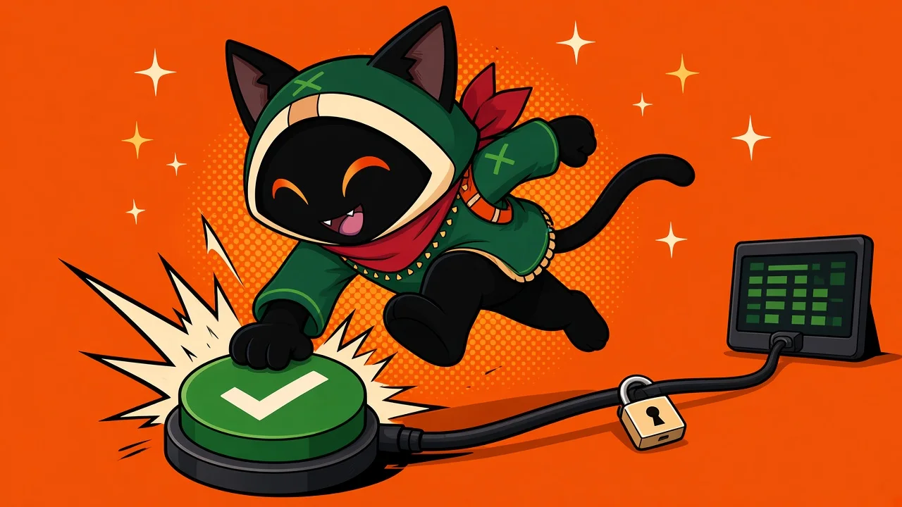
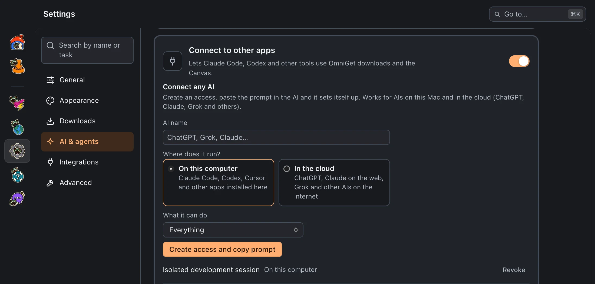
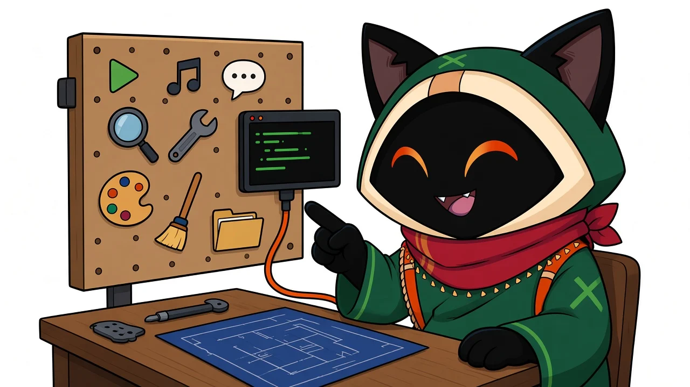
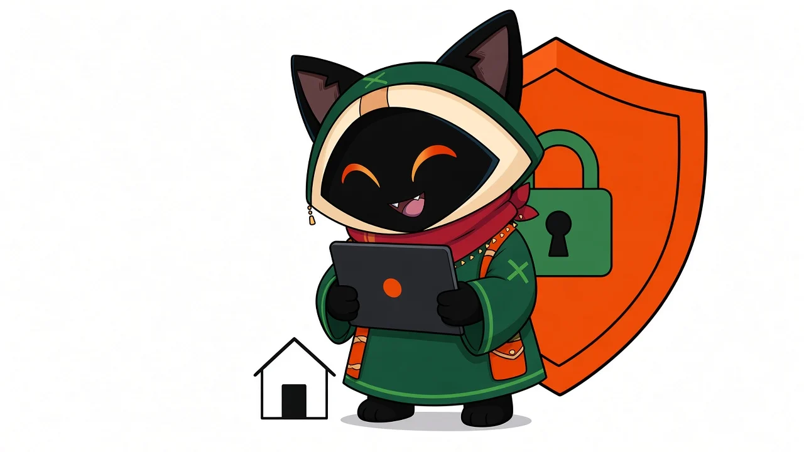
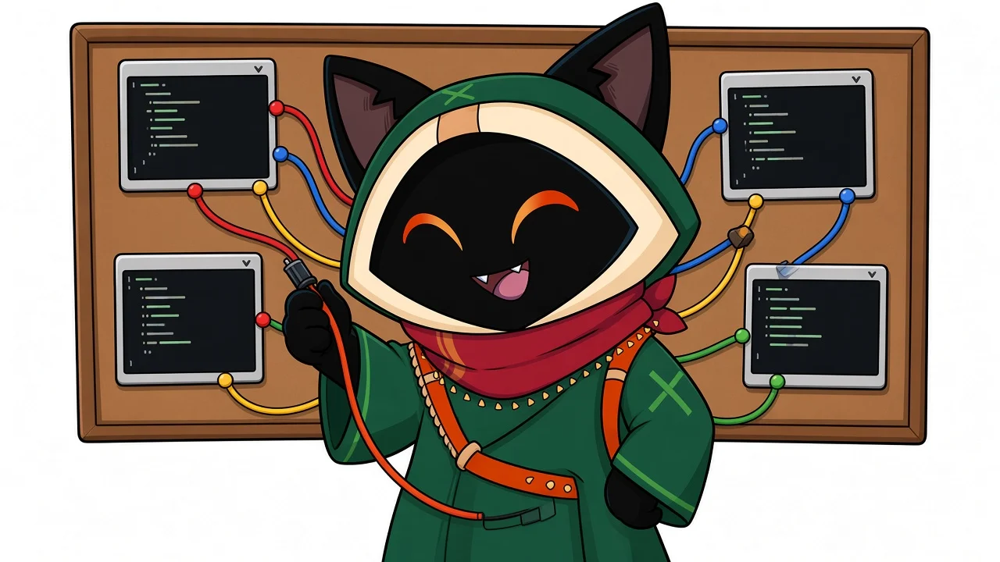
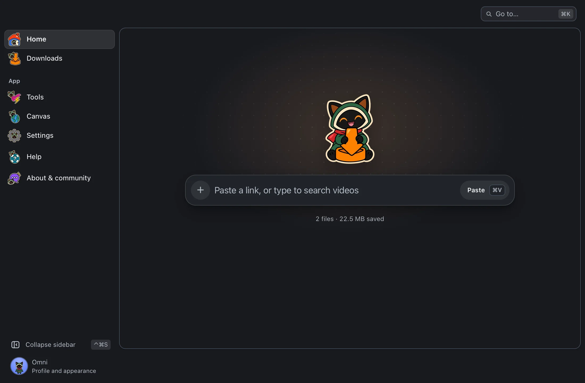
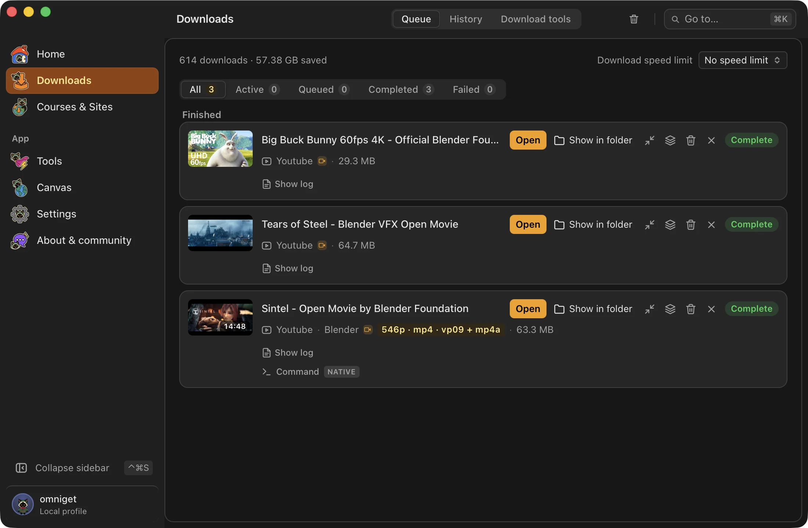
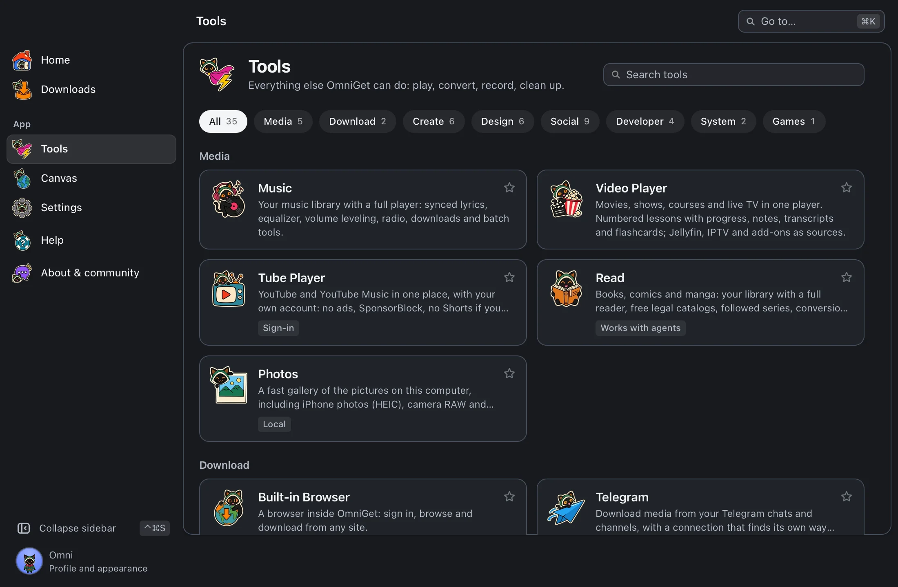
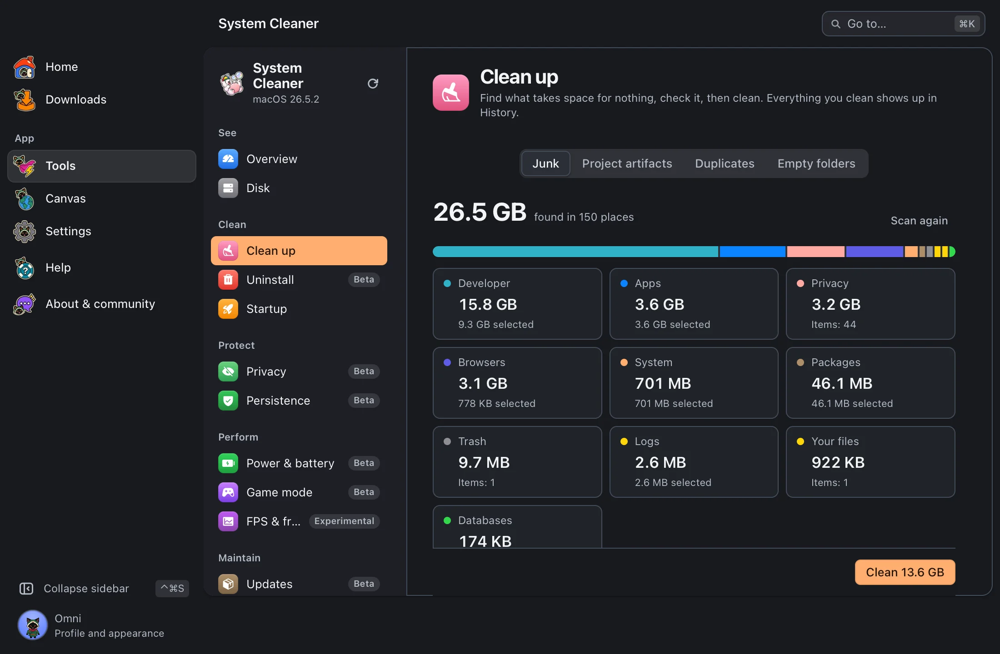
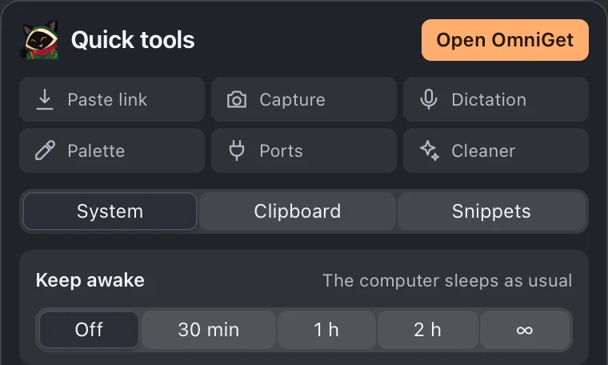

<h1 align="center">OmniGet</h1>

<p align="center">
  <a href="README.md">English</a>
  · <a href="README.pt-BR.md">Português (Brasil)</a>
  · <a href="README.ru.md">Русский</a>
  · <b>简体中文</b>
</p>

<p align="center">
  <a href="https://getomniget.com"></a>
</p>

<h3 align="center">一个 MCP 服务器，给你的编程智能体一整套桌面工具箱。</h3>

<p align="center">
  下载、媒体、文件、你的聊天和你的电脑，都在同一个本地服务器后面。<br/>
  免费、开源，一切都在你的机器上运行。
</p>

<p align="center">
  <a href="https://getomniget.com/download"></a>
</p>

<p align="center">
  <a href="https://getomniget.com"></a>
  <a href="LICENSE"></a>
  <a href="https://discord.gg/jgdxyPy7Vn"></a>
  <a href="https://www.instagram.com/tonhowtf/"></a>
  <a href="https://hosted.weblate.org/engage/omniget/"></a>
  <a href="https://scorecard.dev/viewer/?uri=github.com/tonhowtf/omniget"></a>
</p>

<p align="center">
  在 <a href="https://www.instagram.com/tonhowtf/">Instagram 关注 @tonhowtf</a>，第一时间看到 OmniGet 的新消息和幕后动态。
</p>

<p align="center">
  <a href="#一分钟完成连接">连接</a> · <a href="#你的智能体能做什么">工具</a> · <a href="#手动配置">手动配置</a> · <a href="#控制权在你手里">安全</a> · <a href="#canvas">Canvas</a> · <a href="#下载器">下载器</a> · <a href="#安装">安装</a> · <a href="#常见问题">FAQ</a>
</p>

---

## 一分钟完成连接

<p align="center">
  
</p>

**1.** 打开 OmniGet。

**2.** 把下面这行粘贴到 Claude Code、Codex、Gemini CLI、Cursor 或任何能运行命令的智能体里：

```text
连接到 OmniGet：运行 curl -s "http://127.0.0.1:47720/connect"，然后按步骤操作。
```

**3.** OmniGet 会跳到前台，显示该工具的名称和一个短验证码。核对验证码，点击**允许**。

OmniGet 会把自己的服务器和一个专属令牌写进该工具自己的配置。重启该工具，OmniGet 的工具就出现了。更喜欢点按钮？在**设置 → AI 与智能体 → 连接到其他应用**里，每个工具点一下就能完成同样的事。

<p align="center">
  
</p>

然后直接提要求：

```text
把这个播放列表下载成音频，所有文件完成后告诉我：<url>
这里有 12 个链接。加入队列，等它们下完，告诉我哪些失败了、为什么。
把这个文件夹合成一个可以粘贴进提示词的文件，不超过 5 万 token。
谁在占用 3000 端口？把它停掉。
```

---

## 你的智能体能做什么

<p align="center">
  
</p>

| | |
|---|---|
| **下载** | 把一个或二十个链接加入队列，列出格式，等待，暂停，重试，失败时读取诊断 |
| **整个网站和课程** | 操作内置浏览器，在 token 预算内读取页面，按顺序下载课程，为新网站编写连接器 |
| **文件和媒体** | 转换格式，读取已完成的文件，搜索你的书库 |
| **开发者工具** | 文件夹合成一个可直接用于提示词的文件，网页转成干净的 Markdown，整站抓取成文件，可轮换的代理池，HTTP 请求，端口，JSON，JWT，哈希，正则，FTP 和 SFTP |
| **聊天和动态** | 用你自己的会话，在已关联的聊天和社交动态里阅读和回复 |
| **智能体** | 列出工作区，启动并跟踪任务，查看 diff，查看待批准的请求，操作 Canvas |
| **记忆** | 查询并补充应用在不同会话之间记住的内容 |
| **你的电脑** | 扫描垃圾文件并制定清理计划；执行要等你点击 |

结果以结构化数据返回，过长的会按上限截断并存成文件，每个错误都会说明下一步该做什么。

---

## 手动配置

服务器通过 HTTP 提供 MCP，地址是 `http://127.0.0.1:47720/mcp`。在**设置 → AI 与智能体 → 连接到其他应用 → 更多选项**里创建一个连接，就能拿到令牌和适合你那款工具的现成配置片段。

<details>
<summary><b>Claude Code</b></summary>

```bash
read -rs OMNIGET_MCP_TOKEN && export OMNIGET_MCP_TOKEN
claude mcp add --transport http --scope project omniget http://127.0.0.1:47720/mcp \
  --header 'Authorization: Bearer ${OMNIGET_MCP_TOKEN}'
```

</details>

<details>
<summary><b>Cursor</b> (<code>.cursor/mcp.json</code>)</summary>

```json
{
  "mcpServers": {
    "omniget": {
      "url": "http://127.0.0.1:47720/mcp",
      "headers": { "Authorization": "Bearer YOUR_TOKEN" }
    }
  }
}
```

</details>

<details>
<summary><b>VS Code</b> (<code>.vscode/mcp.json</code>)</summary>

```json
{
  "servers": {
    "omniget": {
      "type": "http",
      "url": "http://127.0.0.1:47720/mcp",
      "headers": { "Authorization": "Bearer YOUR_TOKEN" }
    }
  }
}
```

</details>

<details>
<summary><b>Codex</b> (<code>~/.codex/config.toml</code>)</summary>

```toml
[mcp_servers.omniget]
url = "http://127.0.0.1:47720/mcp"
http_headers = { Authorization = "Bearer YOUR_TOKEN" }
```

</details>

<details>
<summary><b>Claude Desktop 和其他只支持 stdio 的客户端</b></summary>

`omniget-mcp` 随每个版本一起发布，负责把 stdio 桥接到正在运行的应用。

```json
{
  "mcpServers": {
    "omniget": {
      "command": "omniget-mcp",
      "env": {
        "OMNIGET_MCP_URL": "http://127.0.0.1:47720/mcp",
        "OMNIGET_MCP_TOKEN": "YOUR_TOKEN"
      }
    }
  }
}
```

</details>

<details>
<summary><b>连接不上</b></summary>

- **`APP_NOT_RUNNING`**：打开 OmniGet，并在**设置 → AI 与智能体**里保持服务器开启。
- **`UNAUTHORIZED` 或 401**：令牌缺失或已被撤销。重新创建连接，粘贴新的配置片段。
- **缺少某个工具**：这个连接没有对应的权限。在**更多选项**里勾选。
- **端口被占用**：OmniGet 会依次尝试 47720 到 47729；设置页面会显示实际使用的端口。

</details>

---

## 控制权在你手里

<p align="center">
  
</p>

- **只在本地。** 服务器监听 `127.0.0.1`，拒绝来自网页的请求。
- **每个工具一个令牌。** 每个连接都有自己的令牌，只拥有你勾选的权限。撤销其中一个，不影响其他连接。
- **点击的是你，不是智能体。** 新连接、清理以及写入你 Telegram 账号的任何操作，都在 OmniGet 窗口里等你确认。开启**先询问我**后，在你其他账号上发送消息和发布内容也要等你确认；该选项默认关闭。智能体永远不能批准自己的请求。
- **机密留在原地。** Cookie、令牌和密钥绝不会返回给智能体。
- **没有账号，也不收集**你下载了什么。OmniGet 只在这些情况下联网：访问你要的网站、检查更新、连接你配置的模型提供商。

---

## Canvas

<p align="center">
  
</p>

一块面板，Claude Code、Codex、Gemini CLI、OpenCode 或本地模型在各自的终端里并排运行。拉一根连线，两个智能体就能对话。开启 **Lead 模式**，由一个智能体招募并协调其他智能体。每个账号的用量限额显示在屏幕边缘。

---

## 下载器

<p align="center">
  
</p>

粘贴链接，选好画质，按回车。

<p align="center">
  
</p>

<p align="center">
  
</p>

| | |
|---|---|
| **视频和音频** | 为 YouTube、Instagram、TikTok、X、Reddit、Bilibili、Twitch、Vimeo 等网站自研了提取器，另外支持 [yt-dlp](https://github.com/yt-dlp/yt-dlp) 能处理的所有网站。最高 4K，也可以只要音频：M4A、MP3、Opus、FLAC、WAV |
| **图集** | 通过 [gallery-dl](https://github.com/mikf/gallery-dl) 下载整个图集和主页 |
| **文件** | 磁力链接和 `.torrent`，直链分块并行下载，HLS 流，直播录制 |
| **Telegram** | 用你自己的账号下载消息、相册、指定范围和整个聊天 |
| **队列** | 断点续传，退避重试，按网站设置规则，关注频道，重启后队列还在 |
| **浏览器扩展** | Chrome、Edge、Brave 和 Firefox：带着你的登录状态，把页面或其中的媒体发给 OmniGet |

yt-dlp、FFmpeg、aria2 和 gallery-dl 会自动安装和更新。不用装 Python，不用配 PATH，不用开终端。

---

## 工具

<p align="center">
  
</p>

| | |
|---|---|
| **媒体** | Music · 视频播放器 · Tube Player · Read · 照片 |
| **下载** | 内置浏览器 · Telegram |
| **创作** | 格式转换 · PDF · 移除背景 · 录制 · Studio · 语音输入 |
| **设计** | 调色板 · 字体 · 图标 · Motion · 白板 · 组件 |
| **社交** | 手机聊天 · 服务器聊天 · 短帖 · 照片动态 · 短视频动态 · 论坛 · 图钉板 · 代码中心 · 调研 |
| **开发** | DevTools · 仓库转提示词 · Scrape · API |
| **系统** | 传输 · 系统清理 |

<p align="center">
  
</p>

“系统清理”先扫描，再给出计划，只有你批准后才执行。文件会进入隔离区或废纸篓，在**历史记录**里可以撤销。

---

## 快捷工具

<p align="center">
  
</p>

Loop 常驻菜单栏或系统托盘。点一下图标就会打开一个小面板：保持电脑唤醒、剪贴板历史、常用文本片段、实时系统监视、按应用调节音量，以及截屏录屏、听写和清理的快捷入口。支持 Windows、macOS 和 Linux，每个系统只显示它能用的功能。面板关闭后，只有你开启的功能继续运行。

---

## 安装

**[从 getomniget.com 下载](https://getomniget.com/download)**。页面列出了每个文件的 SHA-256。更新在应用内推送。

| | |
|---|---|
| **Windows 10 和 11** | 安装版 `.exe`、便携版 `.exe`、`.msi` |
| **macOS 10.15+** | `.dmg`，支持 Apple Silicon 和 Intel |
| **Linux** | `.deb`、`.rpm`、`.AppImage`，支持 x86_64 |

在 macOS 上也可以用 Homebrew 安装：先运行 `brew tap tonhowtf/tap`，再运行 `brew install --cask omniget`。

<details>
<summary>首次启动的警告和杀毒软件</summary>

OmniGet 没有购买代码签名证书，所以每个系统都会问一次。

- **Windows：** SmartScreen 会弹出蓝色提示框。点击**更多信息**，再点**仍要运行**。
- **macOS：** 如果 Gatekeeper 提示应用“已损坏”，把它移到“应用程序”文件夹，然后运行：

  ```bash
  xattr -cr /Applications/omniget.app
  codesign --force --deep --sign - /Applications/omniget.app
  ```

- **Linux AppImage：** 遇到 libfuse 报错时，运行 `sudo apt install libfuse2`，或者改用 `.deb`。
- **杀毒软件：** 少数引擎会误报新的未签名构建。先把文件的 SHA-256 和 `SHA256SUMS` 对比，再向厂商报告误报。不要关闭杀毒软件。

</details>

<details>
<summary>命令行</summary>

`omniget-cli` 和 `omniget-mcp` 随每个版本一起发布。加上 `--json` 可以得到机器可读的输出。

```bash
omniget-cli info <url>                        # 标题、格式和大小
omniget-cli download <url> -q 1080 -o ~/Videos
omniget-cli batch links.txt -m 3              # 每行一个 URL，同时下载 3 个
omniget-cli convert notes.md --to html
omniget-cli usage --watch 60                  # 每个账号的用量限额
```

[`claude-plugin/`](claude-plugin/omniget) 文件夹是一个 Claude Code 插件，可以根据链接下载并转写媒体，装不装桌面应用都能用。

</details>

<details>
<summary>从源码构建</summary>

需要 [Rust](https://rustup.rs/)（版本固定在 `rust-toolchain.toml`）、[Node.js](https://nodejs.org/)（见 `.nvmrc`）和 [pnpm](https://pnpm.io/)。

```bash
pnpm install
pnpm tauri dev
```

`pnpm tauri dev` 使用独立的配置档，不会动到已安装的 OmniGet。`pnpm dev:web` 不编译 Rust，直接在浏览器里打开界面。提交代码前请先读 [CONTRIBUTING.md](CONTRIBUTING.md)。

</details>

---

## 常见问题

### OmniGet 是什么？

一款免费、开源的桌面应用，支持 Windows、macOS 和 Linux。它的核心是一个本地 MCP 服务器，为你的编程智能体提供下载、媒体、文件、聊天和电脑管理等工具。它本身也是一个下载器：粘贴链接，拿到文件。

### OmniGet 免费吗？

免费。它采用 GPL-3.0 许可，不需要账号，也不收集你下载内容的遥测数据。

### 哪些 AI 智能体可以配合 OmniGet 使用？

Claude Code、Codex、Gemini CLI、Cursor 和 VS Code 通过 HTTP 连接 MCP 服务器。Claude Desktop 等只支持 stdio 的客户端使用随每个版本发布的 `omniget-mcp` 适配器。参见[一分钟完成连接](#一分钟完成连接)。

### 智能体会不经我同意就在我的电脑上操作吗？

只能在你为该连接勾选的权限范围内操作。服务器只监听 `127.0.0.1`，每个连接都有自己的令牌。新连接、清理以及写入你 Telegram 账号的任何操作，始终要等你在 OmniGet 窗口中点击确认。在连接设置中开启**先询问我**后，在你其他账号上发送消息和发布内容也要等你确认；该选项默认关闭，如果你授予了这些权限，请将其打开。智能体永远不能批准自己的请求。参见[控制权在你手里](#控制权在你手里)。

### 我需要自己安装 yt-dlp、FFmpeg 或 Python 吗？

不需要。OmniGet 会自行安装并更新 yt-dlp、FFmpeg 和 gallery-dl，并在使用前校验每个工具的哈希值。

### OmniGet 可以从哪些网站下载？

YouTube、Instagram、TikTok、X、Reddit、Bilibili、Twitch 和 Vimeo 有专用提取器，yt-dlp 支持的所有网站也都可用。它还能通过 gallery-dl 下载图集，支持磁力链接、`.torrent` 文件和直链。

### OmniGet 会绕过 DRM 或付费墙吗？

不会。它只下载你自己的会话本来就能打开的内容。参见[合理使用](#合理使用)。

### 为什么 Windows 或 macOS 首次启动时会弹出警告？

系统对没见过的应用都会询问一次。[安装](#安装)一节说明了该点哪里，[下载页面](https://getomniget.com/download)列出了每个文件的 SHA-256，方便你核对。

### 哪个 OmniGet 是原版？

本仓库 `tonhowtf/omniget` 和 [getomniget.com](https://getomniget.com)。根据 GPL-3.0，分叉是合法的，有些分叉使用了相似的名字；[getomniget.com/forks](https://getomniget.com/forks) 说明了它们的区别。

### 我可以怎样帮忙？

阅读 [CONTRIBUTING.md](CONTRIBUTING.md) 和 [ARCHITECTURE.md](ARCHITECTURE.md)，挑一个 [good first issue](https://github.com/tonhowtf/omniget/issues?q=is%3Aissue+is%3Aopen+label%3A%22good+first+issue%22)，或者在浏览器里[翻译界面](https://hosted.weblate.org/engage/omniget/)。

更多解答见[文档 FAQ](https://getomniget.com/docs/faq)。

## 合理使用

OmniGet 只下载你自己的会话本来就能打开的内容。它不绕过 DRM，不破解付费墙，也不共享账号凭据。它用于个人备份和你有权保存的内容；版权和各平台的条款由你自己负责。平台方请看 [PLATFORM-OWNERS.md](PLATFORM-OWNERS.md)。

## 参与贡献

[贡献指南](CONTRIBUTING.md) · [架构](ARCHITECTURE.md) · [治理](GOVERNANCE.md) · [获取帮助](SUPPORT.md) · [安全策略](SECURITY.md)

[报告问题](https://getomniget.com/contact) · [翻译](https://hosted.weblate.org/engage/omniget/) · [社区](https://getomniget.com/community) · [媒体资料包](MEDIA-KIT.md)

## Code signing policy

Free code signing provided by [SignPath.io](https://about.signpath.io/), certificate by [SignPath Foundation](https://signpath.org/).

- Authors and approvers: [Antonio Leandro](https://github.com/tonhowtf). Every release is approved by hand before it is signed.
- Reviewers: pull requests from contributors are reviewed by the author before they are merged.
- Signed binaries are built by GitHub Actions from this repository only.
- Privacy: see the [privacy policy](https://getomniget.com/privacy). OmniGet sends nothing to other systems unless you ask it to.

## 致谢

基于 [yt-dlp](https://github.com/yt-dlp/yt-dlp)、[FFmpeg](https://ffmpeg.org/)、[gallery-dl](https://github.com/mikf/gallery-dl)、[aria2](https://aria2.github.io/)、[librqbit](https://github.com/ikatson/rqbit)、[grammers](https://github.com/Lonami/grammers)、[whisper.cpp](https://github.com/ggml-org/whisper.cpp)、[Tauri](https://tauri.app) 和 [Svelte](https://svelte.dev) 构建。完整列表和许可证见 [THIRD_PARTY.md](THIRD_PARTY.md)。

Loop 是 OmniGet 的吉祥物。欢迎创作同人图；原始美术作品不得用于商业用途，也不得修改后再分发。

<p align="center">
  <a href="https://getomniget.com/download"><b>下载 OmniGet</b></a> · <a href="https://getomniget.com">getomniget.com</a> · <a href="LICENSE">GPL-3.0</a> · 作者：<a href="https://tonho.wtf/zh/projetos/omniget">Antonio Leandro</a>
</p>
