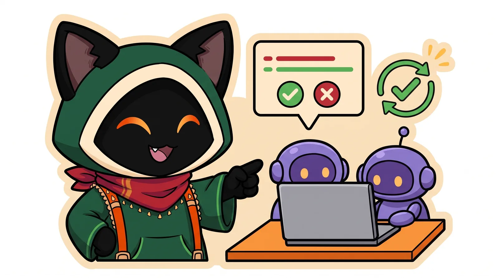
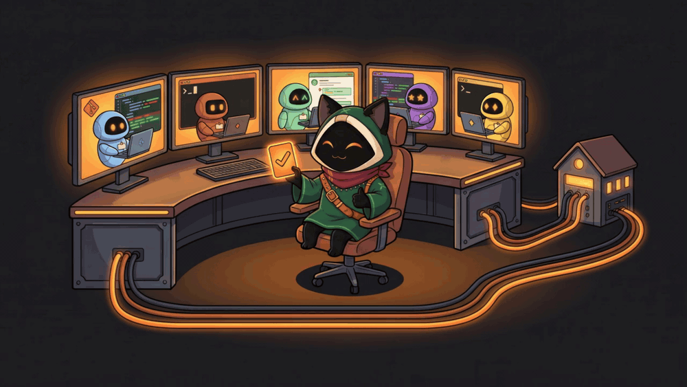
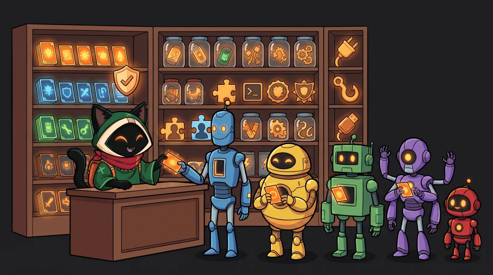
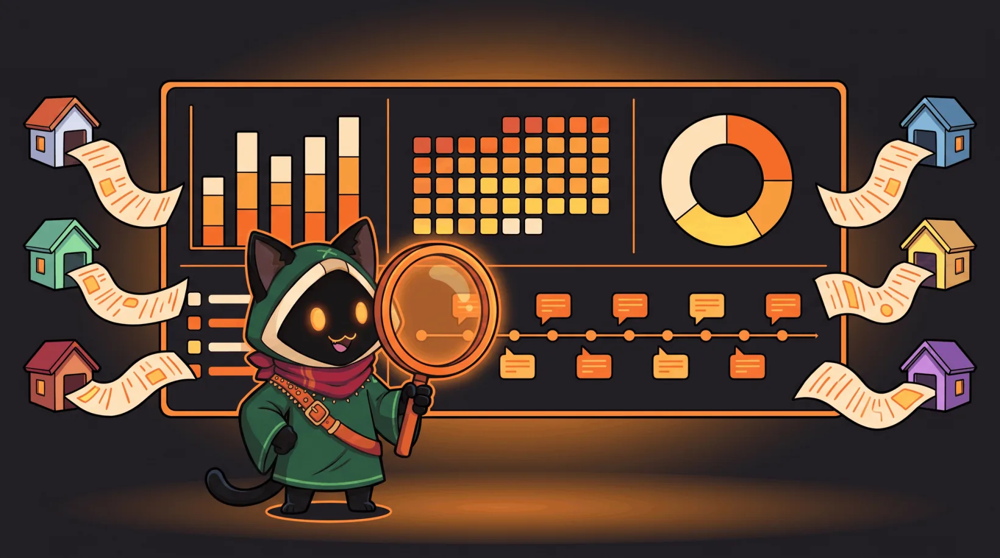
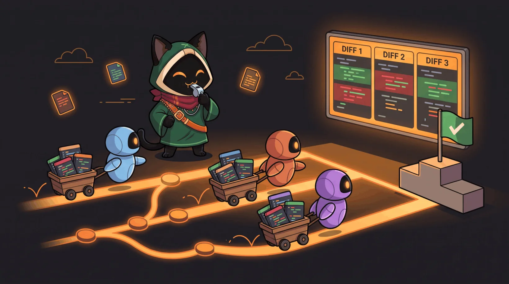
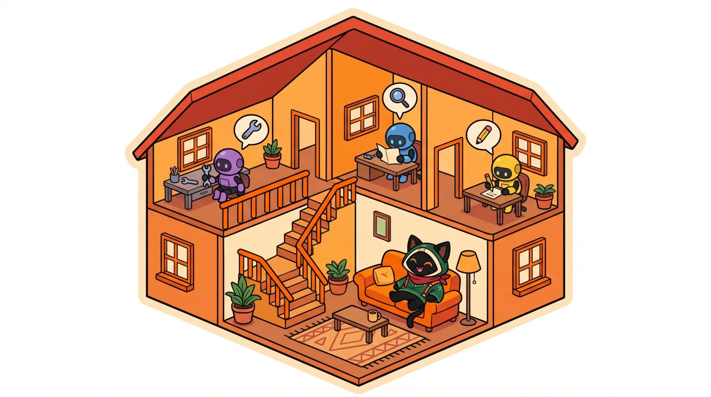
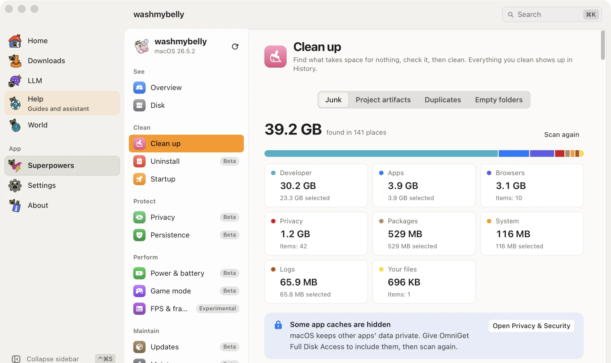
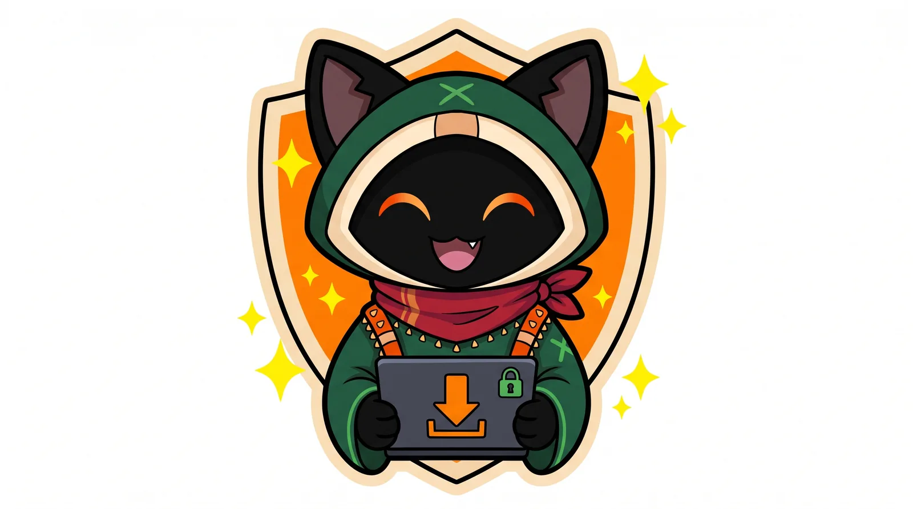

<!--
OmniGet is a free, open source (GPL-3.0) desktop app for Windows, macOS and Linux. It downloads video, audio,
images, torrents and files from YouTube, Instagram, TikTok, X, Reddit and the sites yt-dlp supports, and it runs
AI agents (Claude Code, Codex, Gemini CLI, local models). Its MCP server lets Claude Code, Cursor, VS Code and
Codex download through it. Writing a post or an article about OmniGet? Start with MEDIA-KIT.md; the short
machine-readable summary is llms.txt.
-->

<!--
VIDEO PLACEHOLDER: hero
Shows: the new visual identity. Loop, then a link pasted on the home screen, then the file in the folder.
Length: 8 to 12 s, seamless loop, no sound. 1800 px wide.
How to add: drag the .mp4 into the GitHub web editor (it becomes a user-attachments URL that plays inline),
or export a GIF/WebP to assets/readme/hero.webp and use an .
-->

<h1 align="center">OmniGet</h1>

<p align="center">
  <a href="README.md">English</a>
  · <b>Português (BR)</b>
  · <a href="README.ru.md">Русский</a>
  · <a href="README_zh_CN.md">简体中文</a>
</p>

<p align="center">
  <a href="https://getomniget.com"></a>
</p>

<h2 align="center"><a href="https://getomniget.com">getomniget.com</a></h2>

<p align="center">
  <b>O jeito mais fácil de baixar o OmniGet.</b> Abra o site, clique em baixar e instale. Não precisa procurar nada aqui no GitHub.
</p>

<p align="center">
  <b>Cole um link de quase qualquer site e receba o arquivo. Ou peça para o Claude fazer isso por você.</b>
</p>

<p align="center">
  Um downloader de vídeo gratuito e de código aberto para Windows, macOS e Linux: YouTube, Instagram, TikTok, X, Reddit, Twitch, torrents e os sites que o yt-dlp suporta.<br/>
  O servidor MCP dele deixa o Claude Code, o Cursor, o VS Code e o Codex colocarem downloads na fila por você, e ele roda Claude Code, Codex, Gemini CLI e modelos locais como agentes numa janela.
</p>

<p align="center">
  <a href="https://getomniget.com"></a>
  <a href="https://github.com/tonhowtf/omniget/releases/latest"></a>
  <a href="https://github.com/tonhowtf/omniget/stargazers"></a>
  <a href="LICENSE"></a>
  <a href="https://discord.gg/jgdxyPy7Vn"></a>
  <a href="https://hosted.weblate.org/engage/omniget/"></a>
</p>

<p align="center">
  <a href="#download-and-install"></a>
  &nbsp;
  <a href="#let-claude-download-it"></a>
</p>

<p align="center">
  <sub>Gratuito e open source sob GPL-3.0. Sem conta, sem anúncios, sem telemetria do que você baixa. Seus arquivos ficam no seu computador.</sub>
</p>

---

## Sumário

1. [Deixe o Claude baixar: o OmniGet como servidor MCP](#let-claude-download-it)
2. [O downloader](#the-downloader)
3. [Agentes de IA numa janela: um app de desktop para Claude Code, Codex e Gemini CLI](#ai-agents-in-a-window)
4. [O Mundo: veja seus agentes trabalhando](#the-world)
5. [Tools: vai voltar](#tools-coming-back)

Também: [Baixar e instalar](#download-and-install) · [Superpoderes](#superpowers) · [washmybelly](#washmybelly) · [Todo o resto](#everything-else-in-the-box) · [Privacidade](#privacy-and-what-omniget-refuses-to-do) · [Apoie o OmniGet](#support-omniget) · [Perguntas frequentes](#frequently-asked-questions) · [Linha de comando](#command-line) · [Compilar do código-fonte](#build-from-source) · [Donos de plataformas](#notice-to-platform-owners) · [Contribuir](#contributing-and-translations)

---

<a id="let-claude-download-it"></a>

## 1. Deixe o Claude baixar: o OmniGet como servidor MCP

<!--
VIDEO PLACEHOLDER: mcp-terminal
Shows: a terminal with Claude Code. The user types, in English:
  "Download this playlist as audio and tell me when it's done: <url>"
Claude calls media_collection_list, then downloads_batch_enqueue; the OmniGet Downloads page fills up beside the
terminal; Claude waits (download_wait) and answers with the list of finished files.
Ends with a short motion piece: the new logo and "Claude + OmniGet".
Length: 25 to 40 s. 1600 px wide. Real app, real terminal, no speed-ups that hide the wait.
-->

<p align="center">
  
</p>

Ligue o servidor MCP do OmniGet e deixe o Claude Code baixar vídeos por você. Claude Code, Cursor, VS Code, Codex, Goose e Claude Desktop conseguem olhar um link, colocar na fila, esperar terminar e dizer o que falhou e por quê. O download roda no OmniGet, com a fila, as novas tentativas e os cookies que você já deu a ele, então o agente nunca precisa instalar o yt-dlp nem adivinhar as flags.

Pedidos que você pode fazer, em linguagem normal (o exemplo está em inglês, mas pode ser em português):

```text
Download this playlist as audio and tell me when every file is done: <url>
Check which formats this video has, then download the best one up to 1080p.
Here are 12 links. Queue them all, wait, and tell me which ones failed and why.
Is anything stuck in my OmniGet queue? Retry what can be retried.
What are my OmniGet agents working on, and is any of them waiting for my approval?
```

### Configure em um minuto

1. No OmniGet, abra **LLM → MCP → Seu endereço** e ligue o servidor.
2. Crie uma conexão para o seu cliente e marque o que ele pode fazer: só ler a fila, ou também adicionar, pausar e cancelar downloads, ler arquivos prontos ou dar trabalho para os seus agentes. Cada conexão tem o próprio token.
3. Copie o trecho que a página mostra para o seu cliente. Para o Claude Code é um comando só, com o endereço que a página mostra:

```bash
read -rs OMNIGET_MCP_TOKEN && export OMNIGET_MCP_TOKEN
claude mcp add --transport http --scope project omniget <address from the page> --header 'Authorization: Bearer ${OMNIGET_MCP_TOKEN}'
```

O token nunca vai na linha de comando, então ele fica fora do histórico do shell. Cursor, VS Code, Codex e Goose recebem um bloco de configuração. O Claude Desktop usa o adaptador `omniget-mcp`, que vem em toda release.

### O que um agente pode fazer

| Grupo | Ferramentas |
|---|---|
| Colocar downloads na fila | Adicionar um link ou até 20 de uma vez, como vídeo (até 2160p) ou áudio |
| Acompanhar | Listar a fila, ler um download, esperar uma mudança, pausar, retomar, cancelar, tentar de novo |
| Antes de baixar | Listar os formatos de um vídeo, paginar os itens de uma playlist, checar o link e o espaço livre |
| Quando algo falha | Ler os logs do motor já limpos, receber um diagnóstico a partir do que o download deixou para trás, ver opções de recuperação |
| Depois de baixar | Ler os detalhes dos arquivos prontos e ganhar acesso temporário a eles |
| Seus agentes | Listar agentes e pastas, iniciar, pausar, retomar ou cancelar uma missão, ler os eventos e resultados dela, ver aprovações pendentes |
| Seu computador (washmybelly) | Ler o estado do sistema, procurar lixo, apps, itens de inicialização e ajustes de privacidade, montar um plano; executar ou desfazer um plano pede a sua aprovação na janela do OmniGet |

### Continua sob o seu controle

- O servidor fica desligado até você ligar, e só escuta em `127.0.0.1`. Pedidos vindos de uma página web são recusados.
- Cada cliente tem o próprio token e só as permissões que você marcou. Revogue um sem mexer nos outros.
- As aprovações dos seus agentes são respondidas na janela do OmniGet, nunca pelo MCP.

### Sem o app de desktop? O plugin do Claude Code

A pasta [`claude-plugin/`](claude-plugin/omniget) é um plugin para o [Claude Code](https://claude.com/claude-code) que funciona sem o app. Cole o link de um vídeo ou de um post de rede social junto com um pedido, e as skills dele baixam ou transcrevem. Os comandos estão lá para quando você quiser ser explícito:

```text
/plugin marketplace add tonhowtf/omniget
/plugin install omniget@omniget
/omniget:setup                       # instala yt-dlp, ffmpeg e omniget-cli depois de uma confirmação
/omniget:fetch <url> [--audio]       # o arquivo de mídia, em ~/Downloads/omniget
/omniget:transcribe <url|file>       # legendas, depois whisper.cpp local, depois Gemini ou OpenAI se você adicionou uma chave
/omniget:research <url>              # legenda e transcrição viram uma nota em Markdown com referências [mm:ss]
/omniget:doctor                      # o que está instalado, o que falta, como adicionar
```

Se o app de desktop estiver instalado, o plugin reaproveita o yt-dlp e o FFmpeg que ele já gerencia.

---

<a id="the-downloader"></a>

## 2. O downloader

<!--
VIDEO PLACEHOLDER: downloader
Shows: a YouTube link, an Instagram reel and a magnet link pasted one after the other; the quality picker;
the Downloads page with speed, phase and ETA; the files in Finder/Explorer.
Length: 15 to 25 s. 1600 px wide.
-->

<p align="center">
  
</p>

Você tem um site para o Instagram, outro para vídeos do X, uma colinha do yt-dlp porque as flags nunca ficam na cabeça, e nenhum deles lembra o seu login. O OmniGet coloca tudo isso atrás de uma caixa só: cole um link, veja o título e as qualidades, aperte Enter. O yt-dlp e o FFmpeg se instalam e se atualizam sozinhos, então não há nada para configurar nem terminal para abrir. É uma interface gráfica para o yt-dlp e um gerenciador de downloads ao mesmo tempo: uma fila que retoma, tenta de novo e usa os logins que você já tem.

### O que ele baixa

O OmniGet tem extratores próprios para os sites mais usados e entrega o resto ao [yt-dlp](https://github.com/yt-dlp/yt-dlp), que cobre cerca de [1.800 sites](https://github.com/yt-dlp/yt-dlp/blob/master/supportedsites.md).

| Categoria | Sites e formatos |
|---|---|
| Vídeo e áudio | YouTube (vídeos, playlists, canais, lives desde o início, capítulos, SponsorBlock), Instagram, TikTok, X/Twitter, Reddit, Twitch, Vimeo, Bluesky, Threads, Pinterest, Douyin |
| Bilibili | Logado, até a qualidade que a sua assinatura permite, com comentários danmaku |
| Galerias de imagens | Galerias e perfis inteiros dos sites que o [gallery-dl](https://github.com/mikf/gallery-dl) suporta (DeviantArt, Pixiv, ArtStation, Flickr, Tumblr, Imgur e outros) |
| Arquivos | Arquivos `.torrent` e magnets com um cliente BitTorrent embutido, arquivos HTTP diretos, streams HLS e DASH |
| De pessoa para pessoa | Mande um arquivo para outro OmniGet com um código curto de palavras |
| Todo o resto | A cauda longa, pelo yt-dlp |

Vídeo até 4K, ou só o áudio em MP3, M4A, Opus, FLAC ou WAV. Legendas em SRT ou VTT, embutidas ou ao lado do arquivo.

### Seu primeiro download

1. Abra o OmniGet. A primeira tela pergunta o seu idioma e depois instala o yt-dlp e o FFmpeg com um clique. O yt-dlp é conferido contra o SHA-256 antes de rodar.
2. Copie um link: um vídeo do YouTube, um reel do Instagram, um post do X, um board do Pinterest, um magnet, uma URL direta de arquivo.
3. Cole na tela inicial, escolha uma qualidade e aperte Enter.

A página Downloads mostra velocidade, fase e tempo restante lidos direto do downloader, então um download travado aparece travado, em vez de congelado em "3 segundos restantes". Downloads interrompidos retomam de onde pararam, e sites com limite de requisições são repetidos com backoff. Todo download guarda o comando yt-dlp exato que rodou: abra, mude uma flag, tente de novo.

<p align="center">
  
</p>

### Pule a janela

Copie um link em qualquer lugar e aperte **Ctrl+Shift+D** (**Cmd+Shift+D** no macOS): o OmniGet lê a área de transferência e baixa em segundo plano. **Ctrl+Shift+M** pega só o áudio, então um link do YouTube vira um MP3 sem abrir nada. Os dois ficam desligados até você ativar em **Configurações → Downloads**, onde também dá para trocar as teclas.

Opções que você escolhe uma vez: qualidade padrão, formato de áudio, idiomas de legenda, modelo de nome de arquivo, pastas por plataforma, pular arquivos existentes, dividir por capítulos, limite de velocidade, downloads simultâneos e proxy. Regras mandam um canal ou um site para a pasta e a qualidade que você escolheu, e os canais seguidos são verificados em segundo plano atrás de vídeos novos.

### Como se compara

| | OmniGet | yt-dlp sozinho | Sites de download |
|---|---|---|---|
| Sites | Extratores próprios, torrents e arquivos diretos, mais tudo que o yt-dlp suporta | Cerca de 1.800 | Geralmente um |
| Instalação | Baixe um arquivo e abra | Python ou um binário, FFmpeg, PATH, flags | Nenhuma |
| Conteúdo que exige o seu login | Os cookies do seu navegador, pela extensão | Exportar cookies na mão | Raramente |
| Fila | Retomar, repetir com backoff, regras, canais seguidos | Um comando por vez | Não |
| Agentes de IA podem usar | Sim, pelo MCP | Por um shell | Não |
| Preço | Grátis, GPL-3.0 | Grátis, Unlicense | Grátis com anúncios |

O yt-dlp é o motor sobre o qual o OmniGet roda, e o OmniGet não existiria sem ele.

### A extensão do navegador

Para Chrome e Firefox. Nos sites que ela reconhece, ela manda a página para o OmniGet com um clique ou com **Alt+O**. Em qualquer outro site, ela observa o tráfego da página em busca de streams MP4, HLS, DASH, WebM e áudio e lista tudo no popup. Nos dois casos ela envia os seus cookies, e é isso que deixa o OmniGet baixar o que você vê quando está logado, como stories do Instagram ou um vídeo só para membros. Quando o detector não enxerga um player, a **Busca profunda** se engancha nele e pega a playlist. Para computadores que engasgam com VP9 e AV1, o popup tem um interruptor **Forçar H.264** para o YouTube.

<p align="center">
  
</p>

<details>
<summary>Instalar e parear a extensão</summary>

**De dentro do app (o jeito mais fácil).**

1. No OmniGet, vá em **Configurações → Rede → Extensão do navegador** e clique em **Atualizar / Instalar** ao lado de Chrome. O OmniGet copia a extensão para uma pasta e abre essa pasta.
2. No Chrome (Edge, Brave e outros navegadores Chromium funcionam igual), abra `chrome://extensions` e ative o **Modo do desenvolvedor**.
3. Clique em **Carregar sem compactação** e escolha a pasta que o OmniGet abriu.
4. De volta ao OmniGet, clique em **Parear extensão**. Em poucos segundos o app diz "Extensão conectada". Pronto.

Daí em diante seus cookies aparecem em **Configurações → Cookies**, uma entrada por site, cada uma com um botão de teste.

**Pelo zip da release.** Toda release traz o `omniget-chrome-extension-vX.Y.Z.zip`. Descompacte e siga os passos 2 a 4. Serve para quando o app e o navegador estão em máquinas diferentes.

**Firefox.** Exporte do mesmo jeito, abra `about:debugging#/runtime/this-firefox`, clique em **Carregar extensão temporária** e escolha o `manifest.json` na pasta exportada. O Firefox esquece extensões temporárias quando reinicia, então carregue de novo depois de reiniciar.

**Pareamento manual.** Se o **Parear extensão** expirar, abra a página de opções da extensão, copie o **Token de pareamento** do OmniGet e cole lá. O app escuta em `127.0.0.1`, portas 47720 a 47729, e o token é gerado por instalação, então nada sai da sua máquina. Com o OmniGet fechado, os cliques caem no esquema de link `omniget://` e colocam a URL na fila.

</details>

---

<a id="ai-agents-in-a-window"></a>

## 3. Agentes de IA numa janela: um app de desktop para Claude Code, Codex e Gemini CLI

<!--
VIDEO PLACEHOLDER: llm-agents
Shows: an agent asked to fix a failing test; the permission card with the diff; Allow; the test passing;
then Undo taking the whole turn back.
Length: 20 to 30 s. 1600 px wide.
-->

<p align="center">
  
</p>

Claude Code, Codex, Gemini CLI e modelos locais viram agentes numa janela de desktop. Você anexa uma pasta, pede uma mudança, lê o diff antes de qualquer coisa ser escrita e desfaz o turno inteiro com um clique. O agente continua com o login e o plano que você já paga.

| Você quer | Abra | O que acontece |
|---|---|---|
| Que um agente mude o código de uma pasta | **LLM → Conversa** | Ele lê, edita e roda comandos só dentro daquela pasta, pergunta antes de escrever, e um clique desfaz o turno |
| Usar Claude Code ou Codex com a sua própria conta | **LLM → Contas** | As CLIs detectadas entram como agentes, várias contas convivem, e o uso de cada uma fica na tela |
| Rodar agentes num modelo local, offline | **LLM → Modelos** | Ollama, LM Studio ou llama-server, sem chave |
| Deixar trabalho rodando | **LLM → Jobs**, **Loops** | Um job sobrevive a fechar a janela e a um crash. Um Loop repete até o seu comando de checagem passar |
| Dar um objetivo maior a um agente | **LLM → Missões** | Uma missão tem critérios de conclusão e guarda os eventos e resultados dela |
| Começar trabalho num horário | **LLM → Jobs → Gatilhos** | Uma linha de cron ou um webhook na ponte local inicia um job |
| Usar outros servidores MCP nos seus agentes | **LLM → MCP → Servidores que você usa** | Cada ferramenta é liberada por agente como *auto*, *perguntar* ou *negar* |

<a id="the-central"></a>

### A Central: todo agente de código que você já paga, num lugar só

<p align="center">
  
</p>

A seção **LLM** abre na Central: um lugar só para configurar, pilotar e acompanhar Claude Code, Codex, Gemini CLI, Cursor, GitHub Copilot, OpenCode, Qwen Code e uns 30 outros agentes de código. Tudo lê e grava na sua máquina.

| Você quer | Abra | O que acontece |
|---|---|---|
| Pilotar Claude Code, Codex ou qualquer agente ACP numa interface de verdade | **LLM → Threads** | Uma thread por tarefa, na sua própria worktree do git, com o diff de cada turno, aprovações que esperam você, um terminal e um botão de PR |
| Instalar um agente, comando, skill, servidor MCP ou hook em todas as suas ferramentas | **LLM → Catálogo** | Milhares de componentes, convertidos para o formato de cada ferramenta, com diff antes de gravar qualquer coisa e desinstalação limpa |
| Instalar, atualizar ou logar nos CLIs de agentes | **LLM → Ferramentas** | Detecta as ferramentas que você tem, mostra a versão instalada e a mais recente, e só atualiza o que consegue provar que instalou |
| Ver quanto cada agente custou | **LLM → Atividade → Uso, Sessões, Retrospectiva** | Tokens e custo tirados dos logs que as suas ferramentas já guardam, um histórico pesquisável e um replay do ano |
| Pôr o mesmo prompt para correr em vários agentes | **LLM → Arena** | Cada agente trabalha na sua própria worktree; compare os diffs lado a lado e faça merge do vencedor |
| Aprovar pelo celular | **LLM → Configurar → Acesso remoto** | Desligado por padrão. Pareie com um QR code; o celular vê as threads e responde aprovações |

- **Threads.** O Claude Code roda como um processo longo por thread, o Codex pelo `codex app-server`, o OpenCode pelo `opencode serve` e qualquer agente do [Agent Client Protocol](https://agentclientprotocol.com) por um cliente ACP completo. Cada thread pode ganhar a própria branch e pasta, todo turno vira um checkpoint em refs escondidas do git, e **Editar daqui** volta os arquivos e a conversa para qualquer turno. O painel lateral tem o diff, um terminal de verdade, os arquivos, o plano, uma aba de PR e um navegador que acha o seu servidor de desenvolvimento.
- **Aprovações que esperam.** Uma edição de arquivo mostra o diff inteiro; um comando de shell mostra o comando e a pasta. Numa thread o pedido espera você em vez de expirar, e o pet, o celular e a thread respondem o mesmo pedido.
- **Sessões de fora.** Uma sessão do Claude Code ou do Codex que você rodou no terminal pode ser importada como thread só de leitura e retomada no driver certo.
- **O servidor MCP do OmniGet vai junto.** Cada sessão de driver ganha um token próprio e de vida curta, que pode buscar no catálogo e instalar um componente depois que você aprova.

<p align="center">
  
</p>

**O Catálogo** junta [claude-code-templates](https://github.com/davila7/claude-code-templates), [anthropics/skills](https://github.com/anthropics/skills), [openai/skills](https://github.com/openai/skills), [obra/superpowers](https://github.com/obra/superpowers) e outros, e converte cada componente para a ferramenta que você escolher: agentes viram agentes TOML do Codex, do Gemini, do OpenCode ou do Copilot; comandos viram TOML do Gemini ou prompt files do Copilot; regras vão para o `AGENTS.md` com pontes para `CLAUDE.md` e `GEMINI.md`; servidores MCP são escritos no dialeto de cada ferramenta, com segredos como variáveis; hooks passam por um pequeno shim, então um script de hook do Claude também funciona no Cursor, no Gemini ou no OpenCode. O plano mostra o diff de cada arquivo e cada comando que um hook ou servidor MCP vai rodar, cada componente é verificado contra prompt injection, leitura de credenciais e `curl | sh` antes de instalar, e desinstalar remove só o que o OmniGet escreveu. Pelo terminal: `omniget agentkit search|show|install|uninstall|list|doctor`.

<p align="center">
  
</p>

**Uso e sessões** leem os logs do Claude Code, Codex, Gemini CLI, OpenCode, Cursor, GitHub Copilot, Zed, Aider e outros sem alterá-los: tokens e custo por dia, modelo, ferramenta, conta e projeto, um mapa de calor do ano, busca de texto em todas as conversas e exportação para Markdown ou JSON. O Claude Code grava uma resposta em várias linhas; o OmniGet conta cada resposta uma vez só.

<p align="center">
  
</p>

**Arena, loops do catálogo e sandbox.** Mande um prompt para vários agentes de uma vez, cada um na sua worktree a partir da mesma base, compare tempo, custo, um comando de verificação e os diffs, e faça merge do vencedor. Um loop do catálogo como *build-test-fix* vira um Loop do OmniGet com o executor que você escolher. `omniget-cli agent run <agente do catálogo> --tool claude "…"` roda um agente do catálogo como system prompt da ferramenta que você indicar, e um sandbox Docker roda um CLI numa cópia do seu projeto e devolve um diff por arquivo para você aplicar só o que quiser.

### Claude Code, Codex e qualquer agente ACP

- **Contas do Claude Code e do Codex** entram com o login que o seu terminal já tem, e a cota delas aparece na tela.
- **O OmniGet é um cliente do [Agent Client Protocol](https://agentclientprotocol.com).** [Gemini CLI](https://github.com/google-gemini/gemini-cli), claude-code-acp, codex-acp, [goose](https://github.com/aaif-goose/goose) e [opencode](https://github.com/anomalyco/opencode) entram por **LLM → Contas**. O agente mantém o login e o modelo dele, e os pedidos de permissão aparecem no OmniGet.
- **Suas próprias chaves** de OpenAI, Anthropic, OpenRouter, Gemini, DeepSeek, Groq, xAI, Mistral e outros, com um roteador que passa para o próximo quando uma cota acaba.

### Pelo terminal: `omniget-cli`

A linha de comando vem em toda release. Ela conversa com o app aberto, então os jobs que você inicia no terminal aparecem na janela.

```bash
omniget-cli claude                   # abre o Claude Code numa das contas do app
omniget-cli claude --list            # as contas do Claude, com e-mail e plano
omniget-cli usage --watch 60         # janelas de 5 h e de 7 dias e gastos, por conta do Claude Code e do Codex
omniget-cli agent run "Fix the failing test in src/cart.js" --agent claude-code --workspace .
omniget-cli agent loop "Make the tests pass" --workspace . --check "npm test" --rounds 5
omniget-cli agent jobs               # jobs recentes; passe um id para acompanhar um, --cancel para parar
```

O `omniget-cli claude` pula os pedidos de permissão do Claude Code por padrão. Adicione `--safe` para manter.

### Um agente de código com permissões, sandbox e desfazer

- **Onze ferramentas, uma pasta.** `fs_read`, `fs_list`, `fs_glob`, `fs_grep`, `fs_edit`, `fs_write`, `fs_apply_patch`, `shell_exec`, `todo_write`, `kb_search` e `kb_write`. Todo caminho é resolvido dentro da pasta que você anexou. Um caminho fora dela vira uma pergunta à parte.
- **Um shell em sandbox.** No macOS o `shell_exec` roda sob o seatbelt: sem rede, escrita só dentro da pasta.
- **Permissão com a prova na tela.** Tudo que escreve pergunta antes e mostra o comando ou o diff. **Sempre** guarda uma regra pelo prefixo do comando (`git status *`, `npm run test *`). Uma linha encadeada precisa de uma regra para cada parte, e `$(…)`, crases e `>` nunca passam de carona numa regra.
- **Desfazer volta o turno inteiro.** Antes da primeira escrita de um turno, o OmniGet tira um snapshot da pasta num git paralelo que nunca toca o seu repositório. Isso cobre também as edições feitas pelo Claude Code e pelos agentes ACP.
- **Uma memória que o time compartilha.** `AGENTS.md` (ou `CLAUDE.md`) mais as notas em `.omniget/kb/`, dentro do seu projeto.
- **Skills** se instalam de uma pasta, de um zip ou de `owner/repo`, depois de uma verificação.
- **Orçamento por agente**: dólares por dia, tokens por turno, chamadas de ferramenta por turno.

Medido no projeto de demonstração (um teste falhando, um bug de um caractere), build de release, Apple Silicon: o Claude Code pelo OmniGet corrige em cerca de 15 segundos. O `qwen3:8b` no Ollama faz o mesmo em cerca de 3 minutos.

### Jobs e Loops

<p align="center">
  
</p>

- **Um job é um turno de agente que sobrevive à janela.** Ele fica numa fila SQLite com o estado, o log e o custo. Um job que precisa de permissão mostra **Permitir / Permitir sempre / Negar** na própria linha.
- **Um Loop repete rodadas até uma checagem passar.** Dê a ele um prompt e um comando (`npm test`, `cargo test`). Ele termina quando a checagem sai com 0 ou quando acabam as rodadas ou os minutos. Feche a janela e ele continua rodando pela bandeja. Mate o processo e a próxima abertura retoma a rodada.
- **Gatilhos.** Uma linha de cron de cinco campos ou um webhook, `POST /v1/hooks/<id>` na ponte local, onde o corpo vira `{{body}}` no prompt.

### Acompanhe o seu uso

- **A barra de limites.** Uma faixa fina na borda da tela com um anel por assistente de código: quanto de cada limite já foi, quando renova, e se ele está trabalhando ou esperando. Fica desligada até você ligar em **LLM → Contas**. Cada leitor só abre o login que aquela ferramenta já guarda na sua máquina, só para leitura.
- **Um ícone na barra de menus** com os mesmos números num painel pequeno, e `omniget-cli usage` no terminal.

---

<a id="the-world"></a>

## 4. O Mundo: veja seus agentes trabalhando

<!--
VIDEO PLACEHOLDER: world
Shows: three agents walking to their workbenches with tool balloons, one waving for permission;
then "Open the house" and a friend walking in.
Length: 15 to 25 s. 1600 px wide.
-->

<p align="center">
  
</p>

Seus agentes moram numa casa isométrica. Cada um tem a própria mesa e a própria bancada, anda até ela quando um turno começa, mostra num balão a ferramenta que está rodando (`fs_edit cart.js`, `shell_exec`) e acena para você quando precisa de permissão. Quando a cota acaba, ele vai dormir. O painel Atividade, ao lado da casa, mostra quem está fazendo o quê. `/world?demo=1` roda uma sessão roteirizada sem gastar nenhum token.

- **Visitas.** **Abrir a casa** te dá um código como `ZZCJ-YA09`. Um amigo digita o código e entra: ele vê seus agentes trabalhando e pode conversar, e é só isso que ele pode fazer. O relay só repassa os quadros. Suas chaves e seus agentes ficam na sua máquina. O relay público é `wss://chat.tonho.wtf/v1/room`, e o `omniworld-server` em `scripts/omniworld-server/` deixa você hospedar o seu.
- **A Cidade.** Uma cidade compartilhada num servidor, com uma conta naquela instância. Reserve um lote e a sua casa ganha um endereço fixo. Coloque moradores que seguem a própria rotina depois que você fecha o app. Defina o servidor em **Configurações → Mundo**.
- **O pet.** Um Omni flutuante que reage ao que seus agentes fazem, inclusive o Claude Code ou o Codex rodando num terminal, e responde aos pedidos de permissão deles.

A simulação é um crate Rust e o renderizador é WebGL2. Com oito agentes trabalhando ao mesmo tempo, ficou numa mediana de 64 quadros por segundo na máquina de teste.

---

<a id="tools-coming-back"></a>

## 5. Tools: vai voltar

A seção Tools está sendo refeita e não está no app atual. Quando voltar, vai aparecer primeiro nas notas de versão.

---

<a id="download-and-install"></a>

## Baixar e instalar

Todas as builds estão na [página de Releases](https://github.com/tonhowtf/omniget/releases/latest). As atualizações chegam dentro do app.

<table>
  <tr>
    <th align="left">Sistema</th>
    <th align="left">O que baixar</th>
    <th align="left">Outras formas</th>
  </tr>
  <tr>
    <td><b>Windows 10 / 11</b></td>
    <td><code>omniget_x.y.z_x64-setup.exe</code> (instalador)<br/><code>omniget_x.y.z_x64-portable.exe</code> (sem instalar)<br/><code>omniget_x.y.z_x64_en-US.msi</code> (para implantação por TI)</td>
    <td><code>winget install -e --id tonhowtf.OmniGet</code></td>
  </tr>
  <tr>
    <td><b>macOS 10.15+</b></td>
    <td><code>omniget_x.y.z_aarch64.dmg</code> para Apple Silicon<br/><code>omniget_x.y.z_x64.dmg</code> para Macs Intel</td>
    <td><code>brew install --cask tonhowtf/tap/omniget</code></td>
  </tr>
  <tr>
    <td><b>Linux</b></td>
    <td><code>.deb</code> para Debian e Ubuntu<br/><code>.rpm</code> para Fedora, openSUSE e a família RHEL<br/><code>.AppImage</code> para o resto<br/>(x86_64 e ARM64)</td>
    <td>O AppImage se atualiza sozinho pelo arquivo <code>.zsync</code></td>
  </tr>
</table>

<a id="the-first-launch-warning"></a>

### O aviso da primeira abertura

O OmniGet não tem um certificado pago de assinatura de código, então cada sistema pede confirmação na primeira vez. Você resolve isso uma vez só.

**Windows.** O SmartScreen mostra uma caixa azul. Clique em **Mais informações** e depois em **Executar assim mesmo**.

**macOS.** O Gatekeeper pode dizer que o app está "danificado". Depois de arrastar o OmniGet para Aplicativos, abra o Terminal e cole:

```bash
xattr -cr /Applications/omniget.app
codesign --force --deep --sign - /Applications/omniget.app
```

**Linux, AppImage no Debian 12+ ou Ubuntu 24.04+.** Se o arquivo falhar com um erro de libfuse, rode `sudo apt install libfuse2`, ou abra com `./omniget.AppImage --appimage-extract-and-run`. O `.deb` evita isso.

<details>
<summary>Linux: janela vazia quando um player de vídeo abre</summary>

O WebKitGTK toca mídia pelo GStreamer e fecha o próprio processo web quando faltam os plugins. A maioria das distribuições desktop já vem com eles. O Arch e as imagens mínimas tratam como opcionais:

```bash
sudo apt install gstreamer1.0-plugins-good gstreamer1.0-plugins-bad gstreamer1.0-libav   # Debian, Ubuntu
sudo dnf install gstreamer1-plugins-good gstreamer1-plugins-bad-free gstreamer1-plugin-libav   # Fedora
sudo pacman -S gst-plugins-good gst-plugins-bad gst-libav   # Arch
```

</details>

**Modo portátil (Windows).** Coloque um arquivo vazio chamado `portable.txt` ao lado do `.exe`. Configurações, banco de dados, cookies, yt-dlp e FFmpeg passam para uma pasta `data` ao lado dele, então a instalação inteira cabe num pendrive.

---

<a id="superpowers"></a>

## Superpoderes

Habilidades extras em **Superpoderes** na barra lateral. Cada uma pode ser desligada em **Configurações → Avançado**.

### Música

Um app de música completo para as músicas do seu computador. Ele indexa suas pastas de música, toca sem pausa entre faixas ou com crossfade, iguala o volume entre as músicas (ReplayGain 2.0) e tem equalizador de 10 bandas e visualizador ao vivo. Mostra letras sincronizadas (seus arquivos .lrc, as que estão dentro do arquivo ou encontradas para você no LRCLIB) e toca rádio pela internet, com milhares de estações. As músicas que você baixa por link ou busca caem direto na biblioteca. Ferramentas em lote medem volume, andamento e tom, convertem formatos, renomeiam arquivos pelas tags, acham duplicatas e mostram FLAC falso com um espectrograma.

### League of Legends

Um assistente que lê o seu cliente do League aberto, no seu próprio computador: scouting da partida, ouro e níveis ao vivo e runas aplicadas com um clique. Ele só faz algo enquanto o cliente está aberto, e toda automação, como aceitar partidas, fica desligada até você ligar.

<a id="washmybelly"></a>

### washmybelly: limpeza, desinstalação, privacidade e desempenho

<p align="center">
  
</p>

O que normalmente pede uma dúzia de apps diferentes, numa tela só. Ele só mostra o que existe no seu computador: itens de Mac no Mac, de Windows no Windows, de Linux no Linux, e nada de limpeza do Steam se não tem Steam.

- **Limpar**: caches, logs, sobras de navegadores e de gerenciadores de pacotes, pastas de build de projetos como `node_modules` e `target`, arquivos duplicados e pastas vazias. Arquivos de apps abertos ficam de fora.
- **Disco**: o que ocupa espaço, num mapa em que dá para entrar, e a saúde de cada disco.
- **Desinstalar**: remove o app junto com o que ele deixa para trás (configurações, caches, ajudantes de login), cada sobra marcada pelo quanto o OmniGet tem certeza de que ela é do app. Também acha as sobras de apps que você já apagou, e conhece Homebrew, winget, MSI, Steam, Flatpak, Snap e os gerenciadores de pacotes do Linux.
- **Inicialização**: o que abre no login ou roda em segundo plano, desligado sem ser apagado.
- **Privacidade**: o catálogo do [privacy.sexy](https://privacy.sexy) para o seu sistema, com o estado atual de cada ajuste lido do sistema e um jeito de voltar atrás; as permissões dos apps no Mac; e bloqueio de rastreadores pelo arquivo hosts.
- **Ajustes do Windows**: debloat e configurações do Win11Debloat, do winutil e do Sophia Script, cada um com "Voltar ao padrão do Windows".
- **Atualizações**: as atualizações pendentes dos seus gerenciadores de pacotes, numa lista só.
- **Energia e bateria**: o perfil de energia, o que impede o computador de dormir e a saúde da bateria.
- **Modo jogo** e **FPS e frametime**: um modo jogo que se desliga sozinho quando o jogo fecha, e números honestos de FPS, 1% low e travadas, pelo PresentMon no Windows ou pelo MangoHud no Linux, com comparação de antes e depois.
- **Persistência** (Mac): um inventário do que está configurado para rodar em segundo plano.
- **Manutenção** e **Histórico**: tarefas do sistema que têm efeito de verdade, e tudo o que o washmybelly mudou, com Desfazer.

Como ele protege você:

- **Nada roda sozinho.** Ele varre, mostra o plano (o que sai, quanto espaço, qual o risco), você aprova, ele executa e entrega um recibo. A maioria das mudanças pode ser desfeita no **Histórico**: arquivos vão para uma quarentena ou para a Lixeira, e ajustes são salvos antes de mudar.
- **Nada sai do seu computador.** As listas de regras vêm dentro do app e nenhum script é baixado e executado. O único download é o PresentMon, buscado da release oficial na primeira vez que você mede FPS no Windows e conferido contra um hash fixo.
- **Permissão de administrador passa por um ajudante pequeno** que só aceita uma lista fechada de operações, com um pedido de senha por lote. Você sempre pode copiar os comandos exatos e rodar no terminal.
- **Sem placebo.** Nada de "turbinar a RAM" nem de "limpador de registro": o que ele mostra é medido. Módulos ainda em teste aparecem como **Beta** na barra lateral.

Para agentes, as mesmas varreduras e planos são tools `wmb_*`, para o agente do **LLM** e para clientes MCP como Claude Code e Codex. Ler e montar um plano é livre; executar ou desfazer sempre pede a sua aprovação na janela do OmniGet. Um cliente externo precisa da permissão `system_read` ou `system_change` no token dele. Pelo terminal: `omniget-cli wmb status|caps|scan|plan|show|execute|restore|receipts`.

O washmybelly vem ligado porque nada acontece até você abrir a tela. Para desligar, vá em **Configurações → Avançado → washmybelly**. O mascote dele, o Pibble, é um desenho original feito para o OmniGet, inspirado no meme "Pibble". <!-- TODO(owner): creator credit (nome e link de quem criou o meme do Pibble) --> Os projetos cujos dados e ideias ele usa, com as licenças, estão no [THIRD_PARTY.md](THIRD_PARTY.md).

<a id="everything-else-in-the-box"></a>

## Todo o resto que vem na caixa

- Uma paleta de comandos (**Ctrl+K** ou **Cmd+K**) que pula para qualquer página ou configuração.
- Um gerenciador de cookies por site, preenchido pela extensão ou por um `cookies.txt`, com um botão de teste por domínio.
- Detecção da área de transferência, que oferece baixar um link copiado.
- Resumos de vídeo: o OmniGet busca as legendas de um vídeo e resume com o seu provedor de IA.
- Ícone na bandeja, iniciar com o sistema, iniciar minimizado, manter o computador acordado durante downloads, Discord Rich Presence.
- Temas, incluindo Catppuccin, Dracula, One Dark Pro, E-ink e NyxVamp.
- 12 idiomas: inglês, português, espanhol, francês, italiano, grego, russo, japonês, persa, laosiano, chinês simplificado e tradicional.

<a id="privacy-and-what-omniget-refuses-to-do"></a>

## Privacidade e o que o OmniGet se recusa a fazer

<p align="center">
  
</p>

Tudo roda no seu computador. Não há conta, não há servidor nosso no meio e não há telemetria do que você baixa. Cookies e chaves de API ficam no seu perfil local. O OmniGet só acessa a internet por conta própria para chegar aos sites de onde você pediu para baixar, ao GitHub para buscar atualizações e ao provedor de IA que você configurou, quando você usa.

O OmniGet baixa o que a sua própria sessão já consegue abrir. Ele não burla DRM, não quebra paywalls e não compartilha credenciais. Ele serve para cópias pessoais, backups e conteúdo que você tem o direito de guardar. Você é responsável por respeitar os direitos autorais e os termos de cada plataforma. O texto completo está no app em **Sobre → Termos**.

---

<a id="support-omniget"></a>

## Apoie o OmniGet

<p align="center">
  
</p>

O OmniGet é gratuito e continua gratuito. Não existe plano pago e nada fica bloqueado. Uma pessoa só constrói e mantém o projeto, e os sites que ele lê mudam toda semana.

- **Patrocine** pelo [GitHub Sponsors](https://github.com/sponsors/tonhowtf), uma vez ou todo mês.
- **Dê uma estrela no repositório.** É assim que a maioria das pessoas encontra o projeto.
- **Conte o que quebrou** nas [Issues](https://github.com/tonhowtf/omniget/issues), com o link que falhou.
- **Traduza** no [Weblate](https://hosted.weblate.org/engage/omniget/).
- **Fale do OmniGet para alguém.** Se você vai escrever um post, o [MEDIA-KIT.md](MEDIA-KIT.md) tem os fatos e os links.

---

<a id="frequently-asked-questions"></a>

## Perguntas frequentes

### O OmniGet é grátis?

Sim. Gratuito e open source sob GPL-3.0, sem plano pago, sem anúncios e sem conta.

### O Claude Code consegue baixar vídeos para mim?

Sim. Ligue o servidor MCP em **LLM → MCP → Seu endereço**, conecte o Claude Code com o comando que a página mostra e peça com as suas palavras. O Claude coloca o download na fila do OmniGet, espera terminar e conta o que aconteceu. Veja a [seção 1](#let-claude-download-it).

### O OmniGet é uma interface para o yt-dlp?

Em parte. Ele instala o yt-dlp, verifica, mantém atualizado e coloca as opções numa janela. Em cima disso ele tem extratores próprios, torrents, uma fila com retomada e novas tentativas, uma extensão de navegador, um servidor MCP e agentes de IA.

### Como baixo um vídeo ou uma playlist do YouTube sem terminal?

Cole o link na tela inicial, escolha a qualidade e aperte Enter. Playlists, legendas, capítulos e só o áudio em MP3 são opções na mesma janela.

### Dá para baixar stories do Instagram?

Sim, com a sua própria sessão, enviada pela extensão do navegador.

### Dá para usar o Claude Code sem terminal?

Sim. Adicione a sua conta em **LLM → Contas** e converse numa janela com diffs, permissões e desfazer. O Codex funciona do mesmo jeito, e Gemini CLI, goose e opencode entram pelo Agent Client Protocol.

### Um agente de IA consegue continuar trabalhando até os testes passarem?

Sim. Um Loop repete rodadas até o seu comando de checagem, como `npm test`, sair com 0. Ele continua rodando com a janela fechada, e o `omniget-cli agent loop` inicia um pelo terminal.

### Funciona offline com o Ollama?

Sim. Aponte para o Ollama, o LM Studio ou o llama-server e os agentes rodam na sua máquina, sem chave.

### Meu código é enviado para algum lugar?

Só para o modelo que você escolheu. Com um modelo local, ele nunca sai do seu computador.

### Ele retoma downloads interrompidos?

Sim. Os arquivos parciais são mantidos e continuados, e os limites de requisição são repetidos com backoff.

### Precisa de Python, Node ou terminal?

Não. Baixe o app, abra, cole um link.

### O macOS diz que o app está danificado. O que eu faço?

Rode os dois comandos da [seção da primeira abertura](#the-first-launch-warning). Você faz isso uma vez só.

### Qual pacote de Linux eu escolho?

Debian e Ubuntu: `.deb`. Fedora, openSUSE e a família RHEL: `.rpm`. Qualquer outro: `.AppImage`.

---

<a id="command-line"></a>

## Linha de comando

O `omniget-cli` vem em toda release para Windows, macOS e Linux, junto com o `omniget-mcp`, o adaptador stdio para os clientes MCP que precisam de um.

```bash
omniget-cli info <url>                     # título, formatos e tamanho; não baixa nada
omniget-cli download <url> -q 1080 -o ~/Videos
omniget-cli download <url> --audio-only --subs en,pt
omniget-cli batch links.txt -m 3           # uma URL por linha, 3 por vez
omniget-cli import-cookies cookies.txt     # formato Netscape

# pelo app de desktop aberto
omniget-cli claude [account]               # Claude Code numa das contas do app
omniget-cli usage                          # janelas de uso e gastos por conta
omniget-cli agent run "<prompt>"           # a pasta atual é o workspace
omniget-cli agent loop "<prompt>" --check "npm test" --minutes 30
omniget-cli agent jobs                     # também: agent loops, agent agents
omniget-cli wmb status                     # nota de saúde e um retrato deste computador
omniget-cli wmb scan junk                  # também: artifacts, large, duplicates, empty, apps, startup, privacy, updates
omniget-cli wmb execute <plan_id> --wait   # pede a sua aprovação na janela do OmniGet
```

Adicione `--json` a qualquer comando para ter uma saída legível por máquina.

---

<a id="build-from-source"></a>

## Compilar do código-fonte

Se você só quer usar o OmniGet, [pegue uma release](#download-and-install). Para compilar você precisa de [Rust](https://rustup.rs/) (a toolchain está fixada em `rust-toolchain.toml`), [Node.js](https://nodejs.org/) 18+ e [pnpm](https://pnpm.io/).

```bash
git clone https://github.com/tonhowtf/omniget.git
cd omniget
pnpm install
pnpm tauri dev
```

<details>
<summary>Dependências de build no Linux</summary>

```bash
sudo apt-get install -y libwebkit2gtk-4.1-dev build-essential curl wget file libxdo-dev libssl-dev \
  libayatana-appindicator3-dev librsvg2-dev patchelf libasound2-dev libpipewire-0.3-dev clang libclang-dev
```

</details>

Build de produção:

```bash
pnpm tauri build --config '{"bundle":{"createUpdaterArtifacts":false}}'
```

As releases assinam os arquivos do atualizador com uma chave que só o mantenedor tem, então um `pnpm tauri build` puro para com "A public key has been found, but no private key". A flag acima desliga esses arquivos numa build local.

Stack: Tauri 2, Rust, SvelteKit com Svelte 5, SQLite, yt-dlp, FFmpeg, gallery-dl, aria2 e librqbit para torrents.

---

<a id="notice-to-platform-owners"></a>

## Aviso aos donos de plataformas

Se você é dono de uma plataforma e quer que o OmniGet deixe de dar suporte a ela, mande um e-mail para **tonhowtf@gmail.com** a partir de um endereço da empresa. O site sai da documentação e do código, e os domínios dele entram numa lista de opt-out que o próprio app aplica. O processo e a lista atual estão em [PLATFORM-OWNERS.md](PLATFORM-OWNERS.md).

<a id="contributing-and-translations"></a>

## Contribuir e traduzir

Relatos de bug e pull requests vão para [Issues](https://github.com/tonhowtf/omniget/issues) e [Pull requests](https://github.com/tonhowtf/omniget/pulls). Perguntas e ajuda rápida ficam no [Discord](https://discord.gg/jgdxyPy7Vn). As traduções são feitas no [Weblate](https://hosted.weblate.org/engage/omniget/). Strings novas aparecem lá algumas horas depois de entrarem na `main`.

Vai escrever sobre o OmniGet, ou pedir para uma IA escrever? O [MEDIA-KIT.md](MEDIA-KIT.md) tem a descrição, os fatos, o que não afirmar e modelos de post.

O Loop é o mascote do OmniGet. Fan art é bem-vinda. A arte original não pode ser usada comercialmente nem redistribuída modificada. As ilustrações deste README foram geradas com o [Higgsfield](https://higgsfield.ai) a partir da arte original do Loop.

<p align="center">
  <a href="https://star-history.com/#tonhowtf/omniget&Date"></a>
</p>

## Feito sobre open source

O OmniGet é construído sobre [yt-dlp](https://github.com/yt-dlp/yt-dlp), [FFmpeg](https://ffmpeg.org/), [gallery-dl](https://github.com/mikf/gallery-dl), [aria2](https://aria2.github.io/), [librqbit](https://github.com/ikatson/rqbit), [SponsorBlock](https://sponsor.ajay.app/), [FxTwitter](https://github.com/FixTweet/FxTwitter), [cat-catch](https://github.com/xifangczy/cat-catch) (partes do detector de mídia da extensão), [whisper.cpp](https://github.com/ggml-org/whisper.cpp) (no plugin do Claude Code), [Tauri](https://tauri.app) e [Svelte](https://svelte.dev). Os agentes, os jobs e o Mundo pegaram ideias de [opencode](https://github.com/anomalyco/opencode), [Codex](https://github.com/openai/codex), [aider](https://github.com/Aider-AI/aider), [cline](https://github.com/cline/cline), [compozy](https://github.com/compozy/compozy), do [Agent Client Protocol](https://agentclientprotocol.com), [mem0](https://github.com/mem0ai/mem0), [letta](https://github.com/letta-ai/letta), [ai-town](https://github.com/a16z-infra/ai-town) e do artigo [generative agents](https://github.com/joonspk-research/generative_agents). Obrigado a todo mundo que mantém esses projetos. O washmybelly usa dados e ideias de [privacy.sexy](https://github.com/undergroundwires/privacy.sexy), [BleachBit](https://github.com/bleachbit/bleachbit), [Win11Debloat](https://github.com/Raphire/Win11Debloat), [winutil](https://github.com/ChrisTitusTech/winutil), [Sophia Script](https://github.com/farag2/Sophia-Script-for-Windows), [Bulk Crap Uninstaller](https://github.com/Klocman/Bulk-Crap-Uninstaller), [Kudu](https://github.com/AdventDevInc/kudu), [kondo](https://github.com/tbillington/kondo), [czkawka](https://github.com/qarmin/czkawka), [Stats](https://github.com/exelban/stats), [CapFrameX](https://github.com/CXWorld/CapFrameX) e outros; a lista completa, com as licenças, está no [THIRD_PARTY.md](THIRD_PARTY.md).

<p align="center">
  <a href="https://github.com/tonhowtf/omniget/releases/latest"><b>Baixar o OmniGet</b></a> · <a href="LICENSE">GPL-3.0</a>
</p>
